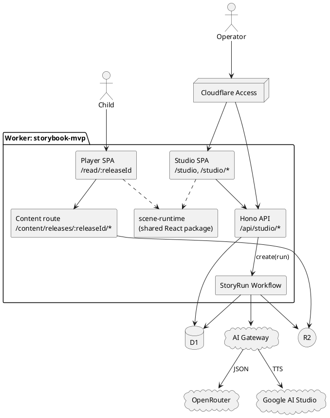

# storybook-mvp - Design Document

Requirements: [`requirements.md`](requirements.md). Decision record:
[ADR 0015](../../adr/0015-storybook-mvp-reset.md).

Revision 2 (2026-11-19): changed after a cross-family review (Codex, Gemini).
See [Review record](#review-record).

## Overview

The MVP is a storybook compiler. A news text goes in. A durable workflow turns
it into structured data: a story outline, the text of each page, a scene for
each page, and narration audio for each page. A shared renderer shows that
data in the Studio (to edit) and in the Player (to read). Publishing freezes
the data into an immutable release.

Five parts:

| Part | Job |
| :-- | :-- |
| Durable Workflow | Runs the production steps with retries. One instance per run. |
| Storybook DSL | Zod schemas for every stage output and for releases. |
| Asset pipeline and registry | Turns the Producer boards into versioned character, prop, scenery, and backdrop assets, plus a small sound set, and lists them in D1. |
| Studio | Starts runs, edits pages, regenerates one page target, publishes. |
| Player | Reads one release and plays it. |

Five rules hold from the first version:

1. **Models choose, code places.** A model picks a layout template and a
   backdrop, and puts registry keys into the slots. Code computes positions
   and checks them.
   Code, not the model, creates every ID.
2. **Failure goes to a person.** A page that still fails after one repair is
   kept with its errors and marked `needs_review`. Nothing is dropped or
   swapped silently.
3. **Revisions are append-only.** Every output is a new revision row. The
   story row holds a map of current revisions (`heads`) that changes only by
   compare-and-set.
4. **A stored result is never requested again.** Each model call has a call
   ID. Its result is stored in `call_log` before anything else uses it.
5. **Releases never change.** A release has its own R2 prefix with copies of
   every asset and sound it uses.

## Architecture

### Components



### Deployment

| Item | Value |
| :-- | :-- |
| Worker | `storybook-mvp`. Serves the SPA (Static Assets), the API, the content route, and the Workflow class. |
| D1 | New database `storybook-mvp`. |
| R2 | New bucket `storybook-mvp`. |
| Workflow | `StoryRunWorkflow`, binding `STORY_RUN`. |
| Access | One Access application with three paths: `/studio`, `/studio/*`, and `/api/studio/*`. `/read/*` and `/content/*` stay public. The Worker does not check `Cf-Access-Jwt-Assertion` in the MVP. Access protects the routes at the edge. The `workers.dev` route and preview URLs are off, so no route bypasses Access (#25). |
| Models | JSON generation: AI Gateway, then OpenRouter. Development points the same adapter at a local proxy. TTS: AI Gateway, provider `google-ai-studio`. Development calls Google AI Studio directly. TTS never goes through OpenRouter (owner decision Q7). |

The existing Worker `goodnight-ai-news` (folder `app/`), its D1 database, and
its R2 bucket stay untouched until the new Worker is live. Removing them is a
separate decision.

### Repository layout

```
apps/storybook/           one Vite project: front end + Worker
  src/studio/             Studio routes
  src/player/             Player routes
  worker/api/             Hono routes
  worker/workflow/        StoryRunWorkflow and its steps
  worker/db/              Drizzle schema and queries
  migrations/             D1 migrations
  wrangler.jsonc
packages/dsl/             zod schemas, types, validation
packages/scene-runtime/   React renderer, animation and tap primitives
packages/layout/          layout templates and the placement engine
packages/models/          model adapter (JSON generation, TTS)
tools/assets/             offline asset pipeline and registry seed
assets/                   hand-cleaned SVG sources (tracked); built WebP is not tracked
```

pnpm workspaces, Node.js 22 or later, TypeScript strict mode, Vitest.

## Components and Interfaces

### 1. Model adapter (`packages/models`)

One client for every model call. JSON generation speaks the
OpenAI-compatible API. TTS speaks the Google AI Studio API (`v1beta`) and
never goes through OpenRouter (owner decision Q7). Production and development
differ only in configuration.

| Call | Development | Cloudflare |
| :-- | :-- | :-- |
| `generateJson` | Local proxy | AI Gateway, then OpenRouter |
| `synthesizeSpeech` | Google AI Studio directly: `https://generativelanguage.googleapis.com/v1beta` | AI Gateway: `https://gateway.ai.cloudflare.com/v1/<account>/<gateway>/google-ai-studio/v1beta` |

```ts
interface ModelConfig {
  baseUrl: string;        // AI Gateway URL for OpenRouter, or the local proxy
  apiKey: string;         // Worker secret
  gatewayToken?: string;  // AI Gateway token, sent on both routes
  models: { script: string; scene: string; tts: string }; // model IDs from env
  tts: { baseUrl: string; apiKey: string; voice: string }; // Google AI Studio, or AI Gateway `google-ai-studio`
}

generateJson(req: {
  model: "script" | "scene";
  system: string;
  user: string;
  schema: JsonSchema;     // strict JSON schema output
}): Promise<{ value: unknown; usage: Usage; modelId: string }>;

synthesizeSpeech(req: {
  text: string;
  voice?: string;         // default: `tts.voice`
}): Promise<{ bytes: Uint8Array; contentType: string; durationMs: number }>;
```

- `ModelConfig` follows the #17 implementation: the TTS settings and the voice
  are under `tts`, and `gatewayToken` is optional (implementation decision
  R52).
- Model IDs come from environment variables. They are not in code.
- `generateJson` returns unvalidated JSON. Callers validate with zod.
- `synthesizeSpeech` returns audio the browser can play. If the provider
  returns raw PCM, the adapter adds a WAV header. TB0 (#25) records the audio
  content type that the gateway returns.
- The adapter does not deduplicate. Deduplication is the job of `call_log`
  (section 3).

### 2. StoryRun Workflow (`apps/storybook/worker/workflow`)

Parameters: `{ runId, storyId, scope }`.

```ts
type RunScope =
  | { kind: "full" }
  | { kind: "page"; pageId: string; target: "scene" | "audio" };
```

Steps for a full run:

| Step name | Does | Writes |
| :-- | :-- | :-- |
| `freeze` | Records the source revision, the active registry versions, and the current heads as the run basis. | `run.basis` |
| `script` | One LLM call: outline (title, cast, 6 to 8 page beats) and the text of every page. Code gives each page a new UUID v7 `pageId`. | 1 `outline` revision, N `page_text` revisions |
| `scene:<pageId>` | LLM picks a template and fills slots, then validation, at most one repair, then layout. | 1 `scene` revision per page |
| `audio:<pageId>` | TTS of the page text, stored in R2. | 1 `audio` revision per page |
| `finish` | Checks that every page has current text, scene, and audio. Sets the run status (rule below). | `run.status` |

- Step names are unique because `pageId` values come from code, never from
  the model.
- `scene:*` and `audio:*` run in parallel, at most 4 pages at a time.
- Every step returns only IDs and keys. A non-stream step result is at most
  1 MiB (Workflows limits, checked 2026-11-19).
- Retry policy for model steps: 3 tries, exponential back-off, starting at
  10 s. Validation failures are not retried by the platform; they use the
  repair rule.
- A page run (`scope.kind = "page"`) runs `freeze`, then the one target step,
  then `finish`.
- Each run freezes the registry versions that are active when it starts, so
  a page run after a new asset version uses the new version. One draft can
  therefore hold scenes made with different versions of an asset. This is
  allowed. Publish copies each version that a page uses ("7. Publish").
- The workflow does not wait for a person. A run ends at `draft_ready` or
  `needs_review`.
- `finish` sets `needs_review` when a page has no `page_text`, `scene`, or
  `audio` head, when one of these heads has `status = needs_review`, or when
  one of these heads is stale ("Staleness"). Otherwise it sets `draft_ready`.

```plantuml
@startuml
participant Studio
participant API
participant "StoryRun" as WF
participant "Model adapter" as M
database D1
storage R2

Studio -> API : POST /api/studio/stories {text}
API -> D1 : one batch: story (heads = {source}), source revision, run
API -> WF : create({runId, storyId, scope: full})
API --> Studio : 202 {storyId, runId}
WF -> D1 : freeze (run.basis)
WF -> M : script (JSON)
WF -> D1 : call_log, outline + page_text revisions, heads CAS
par each page (max 4)
  WF -> M : scene (JSON), repair if needed
  WF -> D1 : call_log, scene revision, heads CAS
  WF -> M : TTS
  WF -> R2 : calls/<callId>.<ext>
  WF -> D1 : call_log, audio revision, heads CAS
end
WF -> D1 : run status draft_ready | needs_review
Studio -> API : GET /api/studio/runs/:runId (poll)
@enduml
```

### 3. Calls, revisions, and heads

**Call IDs.** `callId = sha256(runId, stepName, pageId, purpose)`, where
`purpose` is `first` or `repair`. A repair is a different call with its own
ID.

**Basis.** Every generated revision records `basis`: the revision IDs it was
made from, for example `{ "page_text:<pageId>": "<revisionId>" }`. A step
takes its basis from the heads at the moment it starts generating (for the
first steps of a run, from the revisions written earlier in the same run).
The basis is read once, at the first attempt, and stored in `call_log.basis`.
A retry that finds a stored result reuses that basis. It does not read the
heads again. A `repair` call uses the basis stored with the `first` call of
the same step. At the same moment, the step reads the current head of each
key that it will move, and stores this map in `call_log.expected_heads`
(`null` for a key with no head). A retry reuses it in the same way.

**Step pattern.**

1. Read `call_log` by `callId`. If a row exists, use its stored result and
   its stored basis, and skip to step 4. If the stored result is
   `{ providerError }`, skip to step 5 and write the `needs_review` revision
   with that error. Do not validate, and do not call the model again.
2. Call the model.
3. Store the result. A binary goes to R2 at `calls/<callId>.<ext>` first.
   Then insert the `call_log` row with the result (JSON, or the R2 key), the
   basis, and the expected heads. Code assigns any new IDs (for example `pageId`) before this
   insert, so a retry sees the same IDs.
4. Validate and lay out. This is deterministic code with no model call.
5. Insert the revision(s) with
   `INSERT ... ON CONFLICT (call_id, kind, page_id) DO NOTHING`, then read the
   stored row. The unique key makes a retried insert a no-op, and the step
   continues with the stored row.
6. Move the head with the compare-and-set loop below.

A retry after a stop between steps 5 and 6 finds the stored result (step 1),
inserts nothing new (step 5), and completes the head move (step 6).

The only window that repeats a model call is a stop between steps 2 and 3.
The requirements accept this.

**Compare-and-set loop.**

```
input: moves (key -> newRevisionId), basis, expected (key -> revisionId | null)
loop at most 5 times:
  read story.heads, story.heads_version
  pending = the keys where heads[key] != moves[key]
  if pending is empty -> done ("moved"), write nothing
  if a basis entry has heads[key] != basis[key],
     or a pending key has (heads[key] or null) != expected[key]
    -> mark the revisions of the pending keys superseded, stop ("superseded")
  UPDATE story SET heads = <heads with the pending keys moved>,
                   heads_version = heads_version + 1
    WHERE id = ? AND heads_version = ?
  if 1 row changed -> done ("moved")
```

Each target key is checked on its own, by exact equality only. A key whose
head is already the new revision is done, so a retry after a successful move
writes nothing and returns "moved" before the basis check (implementation
decision R56, #16). A key whose head is not the head that the step or edit
expected was moved by other work, so the new revision is superseded and never
overwrites it. No code compares revision IDs for age, because UUID v7 order
is not creation order across isolates (implementation decision R58, #16).
When every target key is done, nothing is written and `heads_version` does
not change.

The API creates the story row with `heads = { source: <source revision ID> }`
and `heads_version = 0`, in one batch with the source revision and the run.
The first write therefore has a row to update.

**Operator edits** use the same loop, with `expected = { <key>: basedOn }`.
The request carries `basedOn` (the revision the operator edited). The edit
is "moved" only when its own new revision is the head after the loop. If the head has moved since, the API returns
409 with the current revision. If the loop marks the edit `superseded`
because a basis entry moved (for example, the page text changed between the
read and the write), the API returns 409 `head_moved` with the current
revision.

**Example: an edit during a full run.** The full run starts `scene:p3` with
basis `page_text:p3 = T1`. The operator saves new text `T2`. When `scene:p3`
commits, `heads[page_text:p3]` is `T2`, not `T1`. The scene revision is kept
as `superseded` and the head does not move. The Studio shows page 3 as
missing a current scene, and the operator regenerates it.

### 4. Layout engine (`packages/layout`)

Narration is HTML outside the stage, below it in portrait and in landscape
(owner decision 2026-11-19, ADR 0016). The stage image never carries text. The
text of a `show_bubble` action is an HTML element over the stage. It is not
part of the stage image.

**Backdrop.** Every page has one backdrop (ADR 0016): a painted full-frame
background from the registry, below every layer. It is not a layer and has no
slot. Every backdrop fits every template; the art contract in "8. Asset
pipeline" keeps the character zone clear. The layout engine places layers as
before and does not read the backdrop.

A layout template is data:

```ts
type LayoutTemplate = {
  id: string;                         // for example "two-friends-meadow"
  stage: { width: 1600; height: 1200 };
  slots: Array<{
    id: string;                       // "left", "right", "sky-1", "ground-1"
    accepts: "character" | "prop" | "scenery";
    footX: number; footY: number;     // where the asset's foot point goes
    height: number;                   // target height in stage units
    minScale: number;                 // 0.7 to 1.0; the engine may shrink to this
    z: number;
    poses?: string[];                 // the only poses this slot accepts; reserved for slots that list them
  }>;
};
```

The rule holds in both directions, and each case fails validation with
`slot_pose_mismatch`:

- A pose that some slot lists in `poses` may be placed only in a slot that
  lists it.
- A slot with `poses` accepts only the poses that it lists.

For example, a `bust` pose has its own slot: template `solo-center` has the
slot `bust` (owner decision 2026-11-19).

Placement: for each layer, take the slot, read the asset's foot point and
height from the registry, and compute `x`, `y`, `scale`, `z`. Then check:

| Check | Fails when |
| :-- | :-- |
| Face visible | A character's face box is outside the stage, or more than 30% covered by a layer with a higher `z`. |
| Overlap | Two character boxes overlap by more than 15% of the smaller box. |
| Bounds | A box goes outside the stage by more than 10%. |

If a check fails, the engine shrinks the layers involved step by step down to
each slot's `minScale` and checks again. Only if that fails does the page
count as a validation failure. For a model output, the repair rule then
applies ("Error Handling").

MVP has 6 to 8 templates. An operator's manual `at` value in the Studio
overrides the slot for that layer. The engine does not shrink a layer that
has a manual `at`. If a check still fails, the operator's scene fails
validation ("6. API").

A manual `at` needs `scale` greater than 0. It can be below the slot's
`minScale`: `minScale` is the lower bound for automatic shrinking, and the
operator's choice is kept. The layout checks still apply (owner decision
Q14).

### 5. Scene runtime (`packages/scene-runtime`)

```ts
<SceneView
  page={PageScene}
  assets={AssetResolver}          // key + version -> URL or SVG text
  mode="play" | "edit"
  onSelectLayer?={(instanceId) => void}
  onMoveLayer?={(instanceId, at) => void}
/>
```

- The stage is 1600 × 1200 units, scaled to the container with CSS.
- **Backdrop.** The backdrop variant (`backdrop`, `sky`) is the bottom
  element. Its file is 2400 × 1200 units: the stage in the middle and 400
  units of bleed on each side. In the Player, the stage keeps 4:3 and the
  bleed fills a wider container; a narrower container crops the bleed. Layers
  are never placed in the bleed. In edit mode, the Studio shows the stage
  only.
- `svg` and `svg-rig` assets are inlined. `webp` assets are `` elements.
- A paper texture image covers the backdrop and the stage with
  `mix-blend-mode: multiply`. No per-layer SVG filters.
- Animations use the Web Animations API on the layer element, or on named
  parts of an `svg-rig` asset (`part-eyes`, `part-arm-left`, ...).
- `prefers-reduced-motion` turns looping animations off.
- **Audio.** The Player has one `<audio>` element for the whole book. The
  first tap on a "Start" button unlocks it. Each page turn is a tap; its
  handler sets the new `src` and calls `play()` in the same handler, because
  iOS Safari blocks `play()` outside a user gesture. Sound effects use a
  second shared element, unlocked the same way.
- **Page turn** (ADR 0016). A tap on "next" or "previous" turns the page:
  - The page (stage, backdrop, and narration) turns like paper: a forward
    turn rotates the old page about its left edge and shows the new page
    below it; a backward turn runs the other way. 500 ms, `transform` and
    `opacity` only, no filters. The frame time target applies during the
    turn.
  - The tap handler sets the new audio `src` and calls `play()` at once. It
    does not wait for the turn to end.
  - Looping animations of the old page stop when the turn starts. `enter`
    animations of the new page start when the turn ends.
  - A tap during a turn ends that turn at once and starts the next one.
  - With `prefers-reduced-motion`, the turn is a 200 ms cross-fade.
  - After a page is shown, the Player loads the assets of the next page. If
    a page is shown before its assets are loaded, its narration text and the
    paper colour show at once, and each image fades in (200 ms) when it is
    loaded.
- Edit mode adds selection boxes and drag handles. Play mode adds tap handling.

Animation primitives (closed list). Validation rejects a primitive on a layer
whose renderer does not support it.

| Primitive | Renderers | Parameters (bounded) |
| :-- | :-- | :-- |
| `float` | all | amplitude 0.005 to 0.03 of stage height, period 2 to 6 s |
| `sway` | all | angle 1 to 8 degrees, period 2 to 6 s |
| `bounce` | all | height 0.01 to 0.05, count 1 to 3 |
| `pop` | all | scale 1.05 to 1.25 |
| `fade-in` | all | delay 0 to 3 s |
| `blink` | `svg-rig` | interval 2 to 6 s |
| `wave` | `svg-rig` | count 1 to 3 |

A parameter outside its bounds fails validation. Code does not clamp it to
the bounds. For a model output, the repair rule then applies ("Error
Handling").

Tap actions (closed list):

| Action | Rule |
| :-- | :-- |
| `play_animation` | Same renderer rule as above. |
| `play_sfx` | `sfx` must be a key of an active `sfx` asset. |
| `show_bubble` | Text of at most 60 characters. |
| `set_expression` | The pair (current pose, new expression) must be legal for the character. On `svg-rig` it swaps face parts; on `svg` and `webp` it swaps the image. |
| `set_pose` | The pair (new pose, current expression) must be legal. |

### 6. API (`apps/storybook/worker/api`)

Studio routes are behind Cloudflare Access.

| Method and route | Does |
| :-- | :-- |
| `POST /api/studio/stories` | Body `{ text }` or `{ url }`. Creates a story, a source revision, and a full run. Returns 202 with `{ storyId, runId }`. |
| `GET /api/studio/stories` | Lists stories. |
| `GET /api/studio/stories/:id` | Heads with content, page states (`ok`, `stale`, `missing`, `needs_review`), and releases. |
| `GET /api/studio/runs/:id` | Run status and step progress. |
| `PUT /api/studio/stories/:id/pages/:pageId/text` | Body `{ text, basedOn }`. Checks `basedOn` first: 409 if the head moved, and the text is not validated. Then validated as `PageText` (1 to 3 sentences, at most 40 words). 422 with the error list if it fails validation; nothing is saved. Otherwise saved as a new human `page_text` revision (owner decision Q15). |
| `PUT /api/studio/stories/:id/pages/:pageId/scene` | Body `{ scene, basedOn }`. Checks `basedOn` first: 409 if the head moved, and the scene is not validated. Then validated (the same checks as a model output: enum rules, zod rules, layout checks), laid out, saved as a human `scene` revision whose basis is the current page text. 422 with the error list if it fails validation; nothing is saved. The enums and checks use the active registry versions at the time of the request, and the revision records them in `asset_versions` (owner decision Q3). A layer without `instanceId` is new, and the API assigns its `instanceId` (owner decision Q14). Every `instanceId` in the request must be the ID of a layer in the `basedOn` scene revision; otherwise 422 `unknown_instance`. When `basedOn` is null, no layer may carry an `instanceId`. An animation or tap in the same request cannot name a new layer: 422 `unknown_target`. The Studio saves a new layer first. If the compare-and-set loop marks the edit `superseded` ("3. Calls, revisions, and heads"), 409 `head_moved` with the current revision. |
| `POST /api/studio/stories/:id/pages/:pageId/scene/still-fits` | Body `{ basedOn, textBasedOn }`. `textBasedOn` is the `page_text` revision that the operator saw. Copies the current scene into a new human revision whose basis is the current page text. Clears a stale scene. Checks in this order, and saves nothing when one fails: 409 if the `scene` head moved since `basedOn`; 409 `head_moved` if the `page_text` head is not `textBasedOn`; 409 if the current scene head has `status = needs_review`; then the copied scene is validated again, and 422 `invalid_scene` with the error list if it fails. The validation runs the same checks as `PUT .../scene` (enum rules, zod rules, layout checks) with the active registry versions at the time of the request; a manual `at` is not shrunk. The new revision records those versions in `asset_versions` (owner decision Q3). |
| `POST /api/studio/stories/:id/runs` | Body `{ scope }`. Starts a page run. It also takes `{ scope: { kind: "full" } }`, but only when the story has no `outline` head (the `script` step never succeeded) and no run of the story is `queued` or `running`; otherwise 409 `full_run_not_allowed`. A page run is refused with 409 `run_active` and the `runId` of the active run while a run of the story is `queued` or `running` (amendment R61). The check and the run insert are one statement (`INSERT ... SELECT ... WHERE NOT EXISTS (...)`). A failed page step is fixed with a page run. |
| `POST /api/studio/stories/:id/releases` | Publishes the current heads. 409 with a list of blocking pages and reasons. |
| `GET /api/studio/registry` | Active assets (with backdrops), sounds, and templates. |
| `GET /api/studio/files/*` | Serves registry assets and draft audio from R2 to the Studio. Only keys under `assets/` and `calls/`. A key that does not start with `assets/` or `calls/`, or that has a `..` segment, gives 404 `{ error: "not_found" }`, the same as a missing object. |
| `GET /content/releases/:releaseId/*` | Public. Serves `releases/<releaseId>/*` from R2 with `Cache-Control: public, max-age=31536000, immutable`, only when a `release` row with that ID exists. Answers a `Range` request with 206. |

The three save routes (`PUT .../text`, `PUT .../scene`, and `still-fits`) return 503 `busy` when the compare-and-set loop is exhausted. The operator can retry; the stored revision is not a head (amendment R58).

**URL input.**

- `http` and `https` only. A URL, or a redirect target, with any other
  scheme gives 422, and the Studio asks for pasted text.
- `redirect: "manual"`; follow at most 3 redirects, checking the scheme of
  each target.
- 10 s timeout. Read the body as a stream and stop at 2 MB.
- Text comes from `<p>` elements inside `article` or `main`, parsed with
  HTMLRewriter.
- If the result has fewer than 200 words, the API returns 422 and the Studio
  asks for pasted text. If it has more than 2,000 words, the text is cut at
  2,000 words and the Studio shows a note.

**Text input.** A pasted `{ text }` follows the same word rule. Fewer than
200 words gives 422. More than 2,000 words is cut at 2,000 words, and the
Studio shows a note.

### 7. Publish

1. Read the story row (`heads`, `heads_version`) once. This is the snapshot.
2. Check every page in the outline head. Block the page if any of these is
   true:
   - the `page_text`, `scene`, or `audio` head is missing;
   - a head has `status = needs_review`;
   - a head is stale (section "Staleness").
3. Build page JSON and the manifest from the snapshot revisions.
4. Copy each asset version and sound version that a snapshot `scene`
   revision records in `asset_versions` to `releases/<releaseId>/assets/`.
5. Copy each audio object to `releases/<releaseId>/audio/`.
6. Write page JSON, then the manifest last.
7. Insert the `release` row and update `story.published_release_id` in one
   batch. The pointer moves only to a higher release number. The same
   statement sets `story.status = published`. The status never goes back to
   `draft`.

If a step fails, the prefix stays unreferenced. The Player never sees it.

### 8. Asset pipeline (`tools/assets`)

Offline Node.js scripts, run by the developer.

| Step | Tool | Output |
| :-- | :-- | :-- |
| Find figures | Connected components on the near-white board background | Candidate boxes per board |
| Name figures | A tracked crop map per board: box, name, pose or expression | `tools/assets/crops/<board>.json` |
| Cut out | Flood fill of the background from the box edges with a colour tolerance, trim, 2 px feather | Transparent WebP per pose and expression |
| Measure | Alpha bounds, foot point (lowest opaque row, centre), face box (from the crop map) | Values for the registry manifest |
| SVG | Hand-cleaned SVG sources in `assets/<key>/v<n>/`; SVGO with scripts and event attributes removed | Sanitised SVG |
| Sounds | A small set (about 8) of short sound effects synthesised in code (no third-party audio), normalised | `sfx` assets |
| Code backdrop | The backdrop `meadow` drawn in code: sky colour and three hills, one SVG per sky palette (all 4) | `backdrop` asset, renderer `svg` |
| Painted backdrops | One painting per variant from the Producer, scaled to 2400 × 1200 px, WebP of at most 250 KB per file | `backdrop` asset, renderer `webp` |
| Backdrop review | A sheet per backdrop variant with the slot boxes of all templates drawn over it. A person approves it before publish | `tools/assets/out/review/` |
| Publish | Upload to R2 `assets/<key>/v<n>/...`; upsert `asset` and `asset_version` rows. One (`key`, `version`) always holds the same bytes (R65): publish compares the file digests, renderer and manifest of an existing version, and any difference is an error, never a skip | Registry rows |

All 13 characters get WebP cut-outs. Pip gets a rigged SVG in S1. Other
characters move to SVG later, one at a time, as a new asset version.

**Backdrop art contract** (ADR 0016). The values come from the character
slots of the 8 templates in `packages/layout/src/templates.ts` (foot points
x 360 to 1240 and y 960 to 1200, heights up to 900 units). In stage units of
the 1600 × 1200 middle part:

- The floor band, x 200 to 1400 and y 940 to 1200, is open ground or floor.
  No painted object stands in it.
- Above the floor band, painted objects in x 200 to 1400 are far behind the
  characters, end at y 940 or higher, and are not needed for the story.
- No painted text, no characters, no animals that look like a cast member.
- Each variant has the same layout; only the light and colour change.
- The style follows the Producer illustration guideline (painted paper,
  hand-cut shapes).

The 250 KB file budget is a proposal. The device test checks it against the
4G load target ("Testing Strategy").

## Data Models

### D1 tables

All IDs are UUID version 7, lower case (ADR 0007).

| Table | Columns | Notes |
| :-- | :-- | :-- |
| `asset` | `id`, `key` (unique, for example `pip`), `kind` (`character`, `prop`, `scenery`, `backdrop`, `sfx`), `name`, `created_at` | One row per asset. |
| `asset_version` | `id`, `asset_id`, `version`, `renderer` (`svg-rig`, `svg`, `webp`, `audio`), `manifest` (JSON), `files` (JSON: file name to lower-case SHA-256 hex; null for a row published before R65), `r2_prefix`, `active`, `created_at` | Unique `(asset_id, version)`. One active version per asset. A version with `files` null cannot be published again; publish a new version (R65). |
| `story` | `id`, `title`, `status` (`draft`, `published`; becomes `published` with the first release pointer update and never goes back), `heads` (JSON, starts `{ source }`), `heads_version` (integer, starts 0), `published_release_id`, `created_at` | `heads` maps `<kind>` or `<kind>:<pageId>` to a revision ID. |
| `run` | `id`, `story_id`, `scope` (JSON), `status`, `basis` (JSON), `registry` (JSON), `workflow_instance_id`, `error` (JSON), `created_at`, `finished_at` | Status: `queued`, `running`, `draft_ready`, `needs_review`, `failed`. |
| `call_log` | `call_id` (primary key), `run_id`, `step`, `page_id`, `purpose` (`first`, `repair`), `basis` (JSON), `expected_heads` (JSON), `result` (JSON), `r2_key`, `model`, `usage` (JSON), `created_at` | Written once, after the model answers. `basis` and `expected_heads` are read at the first attempt; a retry reuses them. `expected_heads` maps each key that the step moves to its head at that moment (`null` for none; `{}` when the step moves no key) (R58). For a provider 4xx other than 429, `result` is `{ providerError: { status, message } }` ("Error Handling"). |
| `revision` | `id`, `story_id`, `kind`, `page_id`, `content` (JSON), `r2_key`, `basis` (JSON), `asset_versions` (JSON), `origin` (`ai`, `human`), `call_id` (null for human), `status` (`ok`, `needs_review`, `superseded`), `error` (JSON), `created_at` | Kinds: `source`, `outline`, `page_text`, `scene`, `audio`. `page_id` is `''` for story-level kinds. Unique index on `(call_id, kind, page_id)`, with no `WHERE`. SQLite treats every NULL as distinct, so human revisions (`call_id` null) never conflict. No code orders revisions by `id`: UUID v7 order is not creation order across isolates (R58). `asset_versions` maps each asset key that a `scene` revision uses (its layers and its backdrop) to its version (Q3). |
| `release` | `id`, `story_id`, `number`, `manifest_key`, `snapshot` (JSON of revision IDs), `created_at` | Unique `(story_id, number)`. |

### Asset manifest (`asset_version.manifest`)

```ts
type AssetManifest =
  | {
      kind: "character" | "prop" | "scenery";
      poses: Array<{ id: string; file: string; foot: Point; box: Rect; face?: Rect }>;
      expressions: string[];                        // empty for props and scenery
      legal: Array<{ pose: string; expression: string }>;
      flippable: boolean;
      parts?: string[];                             // svg-rig only
    }
  | {
      kind: "backdrop";
      description: string;                          // one line for the model, for example "a meadow by a small river"
      size: { width: 2400; height: 1200 };          // stage units; the stage is the middle 1600
      variants: Array<{ sky: PaletteId; file: string }>; // at least one; one per palette at most
    }
  | { kind: "sfx"; file: string; durationMs: number };
```

### Storybook DSL (`packages/dsl`)

```ts
type Outline = {
  title: string;
  ageBand: "5-7";
  cast: string[];                    // asset keys
  pages: Array<{ pageId: string; beat: string }>; // pageId set by code
};

type PageText = { text: string };    // 1 to 3 sentences, at most 40 words

type PageScene = {
  templateId: string;
  backdrop: string;                  // asset key of a backdrop (ADR 0016)
  sky: PaletteId;                    // picks the variant of the backdrop
  layers: Layer[];                   // scenery, props, and characters
  animations: Animation[];
  interactions: Interaction[];
};

type Layer = {
  instanceId: string;                // set by code
  kind: "character" | "prop" | "scenery";
  ref: string;                       // asset key
  pose?: string;
  expression?: string;
  slot: string;
  at?: { x: number; y: number; scale: number; z: number }; // set by layout or the Studio
  flip?: boolean;                    // only if the asset is flippable
};

type Animation = {
  target: string;                    // instanceId
  primitive: "float" | "sway" | "bounce" | "pop" | "fade-in" | "blink" | "wave";
  params: Record<string, number>;
  trigger: "enter" | "loop";
};

type Interaction = {
  on: { tap: string };               // instanceId
  do: Array<
    | { action: "play_animation"; target: string; primitive: string }
    | { action: "play_sfx"; sfx: string }
    | { action: "show_bubble"; target: string; text: string }
    | { action: "set_expression"; target: string; expression: string }
    | { action: "set_pose"; target: string; pose: string }
  >;
};
```

The model does not write `instanceId`. It names layers by their slot, and
code assigns `instanceId` values and rewrites `target` and `on.tap`.

The JSON schema sent to the model is built at run time from the frozen
registry and the template list. `ref`, `pose`, `expression`, `slot`, `sfx`,
`backdrop`, and `templateId` are enums in that schema. The prompt gives the
model the `description` of each backdrop and the palettes that it has. An operator's scene does not pass
through that schema, so the API also checks the same enums in code. For an
operator's scene, the enums use the active registry versions at the time of
the request (owner decision Q3). A `scene` revision records the versions that
it uses in `asset_versions`: for a run, the versions that the run froze; for
an operator's edit or a "still fits" copy, the active versions at the time of
the request. Publish copies those versions ("7. Publish").

Zod validation then checks what a JSON schema cannot:

- every pose and expression pair is legal for its character;
- each layer's `kind` matches its slot's `accepts`;
- the backdrop has a variant for the page's `sky`
  (`backdrop_sky_mismatch`, ADR 0016);
- `flip` is set only on flippable assets;
- every primitive and action is allowed for the target's renderer;
- every `target` names an existing layer;
- a pose that a slot lists in `poses` is placed only in a slot that lists
  it, and a slot with `poses` holds only the poses that it lists
  (`slot_pose_mismatch`, "4. Layout engine");
- every animation parameter is inside the bounds of its primitive
  ("5. Scene runtime");
- the page has at least one character layer, one animation, and one tap
  interaction.

A page that fails one of these checks fails validation. For a model output,
the repair rule then applies ("Error Handling").

### Staleness

A head is stale when one of its `basis` entries is not the current head for
that key.

| Head | Basis | When stale |
| :-- | :-- | :-- |
| `audio` of page P | `page_text:P` | The page text changed. Blocks publish. |
| `scene` of page P | `page_text:P` | The page text changed. Blocks publish until the operator regenerates the scene or marks it "still fits". |

### Release layout (R2)

```
assets/<key>/v<n>/<file>                    registry assets and sounds
calls/<callId>.<ext>                        stored model binaries (draft audio)
releases/<releaseId>/manifest.json
releases/<releaseId>/pages/<pageId>.json
releases/<releaseId>/audio/<file>
releases/<releaseId>/assets/<key>/v<n>/<file>
```

`releaseId` is a UUID v7, unique across stories, so the release prefix needs
no story ID. The `release` row keeps the story ID.

```ts
type ReleaseManifest = {
  format: "storybook-mvp";
  formatVersion: 1;
  storyId: string;
  releaseId: string;
  number: number;
  title: string;
  pages: Array<{ pageId: string; json: string }>;   // relative paths
};

type ReleasePage = {
  pageId: string;
  text: string;
  audio: string;                     // relative path
  scene: PageScene;                  // every layer has `at`
  assets: Record<string, { renderer: string; manifest: AssetManifest; base: string }>;
  // includes the backdrop and the sfx assets used by the page
};
```

## Error Handling

| Error | Where | Behaviour |
| :-- | :-- | :-- |
| URL scheme refused, URL fetch fails, too many redirects, or text too short | API | 422. For a URL, the Studio asks for pasted text. |
| Model output fails the schema or validation | `script`, `scene:*` | One repair call (`purpose = repair`) with the error list. If it still fails: for `scene`, save the candidate with `status = needs_review` and the errors; for `script`, fail the run with the errors. |
| Layout check fails after shrinking | `scene:*` | Counts as a validation failure (same repair rule). |
| Provider 429 or 5xx | any model step | Step throws; the platform retries (3 tries, exponential back-off). The stored-result check prevents a second call for a stored result. |
| Provider 4xx other than 429 | `scene:*`, `audio:*` | Non-retryable error. The step stores the provider error once in `call_log`: its `result` is the tagged envelope `{ kind: "provider_error", status, message }`, with `message` cut to 300 characters. It writes a `needs_review` revision with `content = null` and `error = { providerStatus, message }`, and that revision becomes the head. A replay never calls the model again. |
| Provider 4xx other than 429 | `script` | Non-retryable error. The run fails with the provider message. |
| TTS fails after retries | `audio:*` | No new audio head (an old head in a page run is stale). The run ends `needs_review`. Publish is blocked ("missing audio"). The Studio offers "regenerate audio". |
| Basis changed before commit | any step | The revision is kept as `superseded`. The head does not move. |
| Operator's scene fails validation | API | 422 with the error list. Nothing is saved. There is no repair call; the repair rule is for model output only. |
| Operator's scene names a new layer in an animation or tap | API | 422 `unknown_target`. Nothing is saved. |
| Operator's page text fails `PageText` validation | API | 422 with the error list. Nothing is saved. |
| "Still fits" on a `needs_review` scene | API | 409. Nothing is copied. |
| "Still fits" copy fails validation against the active registry | API | 422 `invalid_scene` with the error list. Nothing is saved. |
| Full run requested when the story has an `outline` head, or a run of the story is `queued` or `running` | API | 409 `full_run_not_allowed`. No run starts. |
| Page run requested while a run of the story is `queued` or `running` | API | 409 `run_active` with the `runId` of the active run. No run starts (amendment R61). |
| Head moved since the operator loaded it | API | 409 with the current revision. For "still fits", a `page_text` head that is not `textBasedOn` gives 409 `head_moved`. An operator edit that the compare-and-set loop marks `superseded` (a basis entry moved between the read and the write) gives 409 `head_moved` with the current revision. |
| Operator's scene carries an `instanceId` that is not a layer of the `basedOn` scene revision | API | 422 `unknown_instance`. Nothing is saved. |
| Compare-and-set loop exhausted (5 tries) | step | Step throws; the platform retries the step. |
| Compare-and-set loop exhausted (5 tries) | API save route | 503 `busy`. The operator can retry; the stored revision is not a head (amendment R58). |
| Publish blocked | API | 409 with the list of pages and reasons. |
| Run fails | Workflow | `run.status = failed` with the error. The Studio shows it. A run whose `script` step failed restarts as a full run; a run whose page step failed restarts that page with a page run. |

Every error record has `runId`, `storyId`, `pageId`, `step`, and the provider
status. Logs do not contain the full news text or model output.

## Testing Strategy

| Level | Tool | What it covers |
| :-- | :-- | :-- |
| Unit | Vitest | DSL validation (legal pairs, slot kinds, renderer rules for primitives and actions, targets, flip, backdrop and sky pair); JSON schema builder from a registry fixture; layout placement, the three checks, and shrinking; staleness from basis; manifest builder. |
| Worker integration | Vitest with `@cloudflare/vitest-plugin` (the new name of `@cloudflare/vitest-pool-workers`), local D1 and R2, stub model adapter that counts calls | See the sequences below. |
| Model contract | Recorded model outputs as fixtures | Real outputs from S2 stay as fixtures; schema changes must keep them valid or update them on purpose. |
| Product premise (S2) | Real models, 3 real news texts | At least 90% of pages pass validation and layout with at most one repair. This is the test that a stub cannot replace. |
| Renderer | Playwright with WebKit, iPad and iPhone profiles, on a fixture release | Pages render with their backdrop and the narration below the stage; taps fire actions; reduced motion stops loops and makes the page turn a cross-fade; audio starts on "Start" and continues on each page turn; a tap during a turn starts the next turn. |
| Device | Manual, on a real phone and tablet | Frame time p95 on an animated page and during a page turn (target 33 ms or less). Page assets load in 2 s or less on a throttled 4G profile. Recorded in the S1 and TB3 results. |

Integration sequences (each asserts both the revisions and `story.heads`):

| Sequence | Expected |
| :-- | :-- |
| Full run on an empty database | 6 to 8 pages; every page has current text, scene, and audio heads. |
| Stop after the `call_log` insert, then retry | The stub model is called once; the revision and head exist once. |
| Stop after the revision insert and before the head move, then retry | The head points at the revision. |
| First output invalid, repair valid, 429 between them | Two model calls in total (first, repair); the repaired scene is the head. |
| Operator edits page 3 text while `scene:p3` is running | The late scene is `superseded`; the head is unchanged; page 3 shows "missing scene". |
| Page run for page 3 audio after a text change | Only `audio:p3` gets a new revision; all other heads are unchanged. |
| TTS fails for page 5, then publish | Publish returns 409 with "page 5: missing audio". |
| Stale scene, "still fits", then publish | Publish succeeds; the scene revision is a human copy. |
| Publish twice | Two prefixes; the first is byte-for-byte unchanged. |
| Release contents | The prefix holds every asset, sound, and audio file the pages reference. |
| Content route | `GET /content/releases/<id>/manifest.json` returns the manifest with the immutable cache header. |
| URL input | Redirect chain of 4 is refused; a 3 MB body is cut at 2 MB; a short article returns 422. |
| Text input | A pasted text of 199 words returns 422; a pasted text of 2,001 words is cut at 2,000 words. |

Acceptance criteria to tests:

| Requirement | Test |
| :-- | :-- |
| 6 to 8 pages with text, audio, layer, animation, tap | Integration, full run; S2 for real models |
| Layers reference the frozen registry | Unit (schema builder) and integration |
| `needs_review` instead of silent changes | Integration with an invalid stub output |
| One stored result per call ID | Integration, stop after `call_log` insert |
| Head move completes on retry | Integration, stop before head move |
| Late result does not replace the operator's work | Integration, edit during run |
| Page 3 text change regenerates only page 3 audio | Integration, page run |
| Publish blocked on missing, `needs_review`, or stale | Integration, TTS failure and stale scene |
| Releases do not change; release contains its assets, with the backdrop | Integration, publish twice; list R2 prefix |
| Every scene names a backdrop that has a variant for its sky | Unit (DSL validation) and integration |
| Narration below the stage; page-turn transition | Renderer test |
| Safari and Chrome on phones and tablets | Renderer and device tests |
| Assets load in 2 s on 4G | Device test |
| Studio behind Access | Manual check after deploy: `/studio`, `/studio/x`, `/api/studio/x` all ask for login; `/read/x` does not |

## Review record

Cross-family review of revision 1 (commit 4191fc9), 2026-11-19. Seat 1: Codex
(correctness and data integrity). Seat 2: Gemini (boundaries and premises).
All findings were checked against the document before they were accepted.

| # | Finding | Seats | Change in revision 2 |
| :-- | :-- | :-- | :-- |
| 1 | First head write had no row to update | both | `story.heads` map created at story creation |
| 2 | `script` wrote N+1 rows under one unique `call_id` | both | `call_log` table; revision unique key `(call_id, kind, page_id)` |
| 3 | Repair reused the first call ID | both | `purpose` in the call ID |
| 4 | Expected head for compare-and-set was undefined; a late result could overwrite an edit | both | `basis` per revision; `superseded` status |
| 5 | Stop between revision insert and head move left the head stale | Codex | Retry reaches the head move |
| 6 | "No second model call" cannot be guaranteed | Codex | Requirement reworded |
| 7 | Publish did not block a missing audio | Codex | Publish checks missing heads |
| 8 | Revision version allocation undefined | Codex | `version` removed; order by UUID v7 |
| 9 | Model-made page IDs could repeat | Codex | Code makes all IDs |
| 10 | Release route lacked the story ID of the R2 key | Gemini | `releases/<releaseId>/` |
| 11 | DSL gaps: scenery slots, sounds, renderer rules, legal pairs, text zone, no layout fallback | Gemini | Scenery slots, `sfx` assets, renderer rules, pair checks, text out of stage, shrink step |
| 12 | Per-page audio fails on iOS page turns | Gemini | One shared audio element, `play()` in the tap handler |
| 13 | URL redirects and size, `/studio` path, 4G test | Gemini | URL rules, Access paths, device test |
| 14 | Stub tests cannot test the product premise | Gemini | S2 listed as the premise test |

Cross-family review of revision 3 (the owner's answers to Q1 to Q9, #34),
2026-11-19. Seat 1: Codex. Seat 2: Gemini. Findings were merged as a union.
A finding from one seat was checked against the document first.

| # | Finding | Seats | Result |
| :-- | :-- | :-- | :-- |
| 1 | The repair rule was written for every validation, so it also covered an operator's scene edit | Gemini | Limited to model output; the operator case stays open (Q2) |
| 2 | Publish cannot know which version of an asset a scene used | Gemini | Kept open (Q3) |
| 3 | In a page run, the Q9 rule and the row "TTS fails after retries" disagree | both | Owner decision (Q10): a stale head also gives `needs_review` |
| 4 | ADR 0015 says "a run ends at `draft_ready`" | both | Owner decision: ADR 0015 corrected in place with a dated note |
| 5 | Two scenarios stated a run status that their `Given` and `When` do not give | both | Scenarios corrected |

Cross-family review of revision 4 (the owner's answer to Q2, #36),
2026-11-19. Seat 1: Codex. Seat 2: Gemini. Findings were merged as a union.

| # | Finding | Seats | Result |
| :-- | :-- | :-- | :-- |
| 1 | The order of 409 and 422 for an operator's scene is not defined | both | Kept open (Q12); EDT-03.S7 fixes the head as current |
| 2 | A layout failure after shrinking went beyond the decision; shrinking a manual `at` is not defined | Gemini | Removed from the error row; kept open (Q11) |
| 3 | "4. Layout engine" applied the repair rule to every scene | Gemini | Limited to model output |
| 4 | "Still fits" can copy a `needs_review` scene | Gemini | Kept open (Q13) |

Cross-family review of revision 5 (the owner's answers to Q11 to Q13, #38),
2026-11-19. Seat 1: Codex. Seat 2: Gemini. Findings were merged as a union.

| # | Finding | Seats | Result |
| :-- | :-- | :-- | :-- |
| 1 | The enum check for an operator's scene names no registry version | both | Points to owner decision Q3, which #32 writes |
| 2 | EDT-03.S9 did not rule out a shrink of the other layers | both | Scenario corrected |
| 3 | EDT-03.S2 and EDT-03.S11 disagreed for a stale `needs_review` scene | Codex | EDT-03.S2 now requires `status = ok` |
| 4 | "before the zod rules" went beyond the decision | Gemini | Removed |
| 5 | Who assigns `instanceId` to a layer that the operator adds; valid values of a manual `at` | Gemini | Kept open (Q14) |
| 6 | Validation of `PUT .../text`, and its order against 409 | Gemini | Kept open (Q15) |

Revision 6 (#32), 2026-11-19: the owner decisions on Q3, Q7, Q14, and Q15,
the planner list of spec corrections (rows 1 to 15), and the planner
decisions R37, R48, R41, and Access JWT, all on #32. The cross-family review
of this revision is recorded below the table.

| Source on #32 | Change | Section |
| :-- | :-- | :-- |
| Row 1 | The story starts with `heads = { source }`, in one batch with the source revision and the run | "2. StoryRun Workflow" (diagram), "3. Calls, revisions, and heads", "D1 tables" |
| Row 2 | `INSERT ... ON CONFLICT ... DO NOTHING`, then read the stored row | "3. Calls, revisions, and heads" |
| Row 3 | `call_log.basis`, read once at the first attempt | "3. Calls, revisions, and heads", "D1 tables" |
| Row 4, Q3 | `revision.asset_versions`; active versions for operator edits and "still fits"; publish copies the recorded versions | "6. API", "7. Publish", "D1 tables", "Storybook DSL" |
| Row 5 | `story.status` values; `published` is set with the pointer update and never goes back | "7. Publish", "D1 tables" |
| Row 6 | Head compare-and-set per key; a key already at the target is skipped; any other key must match `expected`, or the move is superseded (R58); when every key is skipped, nothing is written | "3. Calls, revisions, and heads" |
| Row 7 | `@cloudflare/vitest-plugin` | "Testing Strategy" |
| Row 8 | Provider 4xx in a page step: `call_log.result` and `revision.error` hold `{ providerError: { status, message } }`; the `needs_review` revision is the head | "Error Handling", "D1 tables" |
| Row 9 | Slot `poses` in both directions, `slot_pose_mismatch`, slot `bust` in `solo-center` | "4. Layout engine", "Storybook DSL" |
| Row 10 | `GET /api/studio/files/*`; other keys and `..` give 404 `not_found` | "6. API" |
| Row 11, R37 | "Still fits" body `{ basedOn, textBasedOn }`; order 409, 409 `head_moved`, 409, 422 `invalid_scene` | "6. API", "Error Handling" |
| Row 12 | Release row and pointer in one batch; the pointer moves only to a higher number | "7. Publish" |
| Row 13 | Content route needs a `release` row; `Range` gives 206 | "6. API" |
| Row 14, Q14, R41 | The API assigns new layer IDs; an `instanceId` not in the `basedOn` scene gives 422 `unknown_instance`; 422 `unknown_target`; manual `scale` greater than 0, may be below `minScale` | "4. Layout engine", "6. API", "Error Handling" |
| Row 15, Q7 | TTS goes to Google AI Studio directly in development, and through AI Gateway (`google-ai-studio`) on Cloudflare | "Architecture", "Deployment", "1. Model adapter"; also ADR 0015 and `requirements.md` |
| Q15 | `PUT .../text`: 409 first, then `PageText` validation, 422 | "6. API", "Error Handling" |
| R48 | Full run only when the story has no `outline` head and no run is `queued` or `running`; else 409 `full_run_not_allowed` | "6. API", "Error Handling" |
| Access JWT | The Worker does not check `Cf-Access-Jwt-Assertion`; `workers.dev` and preview URLs off | "Deployment" |

Cross-family review of revision 6 (Codex, Gemini), 2026-11-19: 11 findings,
all applied.
