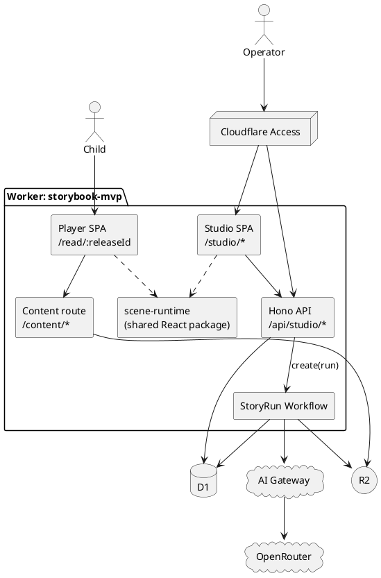

# storybook-mvp - Design Document

Requirements: [`requirements.md`](requirements.md). Decision record:
[ADR 0015](../../adr/0015-storybook-mvp-reset.md).

## Overview

The MVP is a storybook compiler. A news text goes in. A durable workflow turns
it into structured data: a story outline, the text of each page, a scene for
each page, and narration audio for each page. A shared renderer shows that
data in the Studio (to edit) and in the Player (to read). Publishing freezes
the data into an immutable release.

Five parts:

| Part | Job |
| :-- | :-- |
| Durable Workflow | Runs the production steps with retries. One instance per run. |
| Storybook DSL | Zod schemas for every stage output and for releases. |
| Asset pipeline and registry | Turns the Producer boards into versioned character and prop assets, and lists them in D1. |
| Studio | Starts runs, edits pages, regenerates one page target, publishes. |
| Player | Reads one release and plays it. |

Five rules hold from the first version:

1. **Models choose, code places.** A model picks a layout template and puts
   registry IDs into its slots. Code computes positions and checks them.
2. **Failure goes to a person.** A page that still fails after one repair is
   kept with its error and marked `needs_review`. Nothing is dropped or
   swapped silently.
3. **Revisions never change.** Every output is a new row. A `heads` row points
   at the current one and moves only by compare-and-set.
4. **Retries are safe.** Each model call has a call ID. A revision is written
   once per call ID.
5. **Releases never change.** A release has its own R2 prefix with copies of
   every asset it uses.

## Architecture

### Components



### Deployment

| Item | Value |
| :-- | :-- |
| Worker | `storybook-mvp`. Serves the SPA (Static Assets), the API, the content route, and the Workflow class. |
| D1 | New database `storybook-mvp`. |
| R2 | New bucket `storybook-mvp`. |
| Workflow | `StoryRunWorkflow`, binding `STORY_RUN`. |
| Access | One Access application on `/studio/*` and `/api/studio/*`. |
| Models | AI Gateway, then OpenRouter. Development points the same adapter at a local proxy. |

The existing Worker `goodnight-ai-news` (folder `app/`), its D1 database, and
its R2 bucket stay untouched until the new Worker is live. Removing them is a
separate decision.

### Repository layout

```
apps/storybook/           one Vite project: front end + Worker
  src/studio/             Studio routes
  src/player/             Player routes
  worker/api/             Hono routes
  worker/workflow/        StoryRunWorkflow and its steps
  worker/db/              Drizzle schema and queries
  migrations/             D1 migrations
  wrangler.jsonc
packages/dsl/             zod schemas, types, hashing
packages/scene-runtime/   React renderer, animation and tap primitives
packages/layout/          layout templates and the placement engine
packages/models/          model adapter (JSON generation, TTS)
tools/assets/             offline asset pipeline and registry seed
assets/                   hand-cleaned SVG sources (tracked); built WebP is not tracked
```

pnpm workspaces, Node.js 22 or later, TypeScript strict mode, Vitest.

## Components and Interfaces

### 1. Model adapter (`packages/models`)

One client for every model call. It speaks the OpenAI-compatible API, so
production and development differ only in configuration.

```ts
interface ModelConfig {
  baseUrl: string;        // AI Gateway URL for OpenRouter, or the local proxy
  apiKey: string;         // Worker secret
  models: { script: string; scene: string; tts: string }; // model IDs from env
}

generateJson<T>(req: {
  callId: string;
  model: "script" | "scene";
  system: string;
  user: string;
  schema: JsonSchema;     // strict JSON schema output
}): Promise<{ value: unknown; usage: Usage; modelId: string }>;

synthesizeSpeech(req: {
  callId: string;
  text: string;
  voice: string;
}): Promise<{ bytes: Uint8Array; contentType: string; durationMs: number }>;
```

- Model IDs come from environment variables. They are not in code.
- `generateJson` returns unvalidated JSON. Callers validate with zod.
- `synthesizeSpeech` returns audio the browser can play. If the provider
  returns raw PCM, the adapter adds a WAV header. The real format is checked
  in TB0 (open question in ADR 0015).

### 2. StoryRun Workflow (`apps/storybook/worker/workflow`)

Parameters: `{ runId, storyId, scope }`.

```ts
type RunScope =
  | { kind: "full" }
  | { kind: "page"; pageId: string; target: "scene" | "audio" };
```

Steps for a full run:

| Step name | Does | Writes |
| :-- | :-- | :-- |
| `freeze` | Records the source revision and the active registry versions. | `runs.frozen` |
| `script` | One LLM call: outline (title, cast, 6 to 8 page beats) and the text of every page. | 1 `outline` revision, N `page_text` revisions |
| `scene:<pageId>` | LLM picks a template and fills slots, then validation, at most one repair, then layout. | 1 `scene` revision per page |
| `audio:<pageId>` | TTS of the page text, stored in R2. | 1 `audio` revision per page |
| `finish` | Checks that every page has a scene and an audio head. Sets the run status. | `runs.status` |

- `scene:*` and `audio:*` run in parallel, at most 4 pages at a time.
- Every step returns only IDs and keys. A non-stream step result is at most
  1 MiB (Workflows limits, checked 2026-11-19).
- Retry policy for model steps: 3 tries, exponential back-off, starting at
  10 s. Validation failures are not retried by the platform; they use the
  repair rule.
- A page run (`scope.kind = "page"`) runs `freeze`, then the one target step,
  then `finish`.
- The workflow does not wait for a person. A run ends at `draft_ready` or
  `needs_review`.

```plantuml
@startuml
participant Studio
participant API
participant "StoryRun" as WF
participant "Model adapter" as M
database D1
storage R2

Studio -> API : POST /api/studio/stories {text}
API -> D1 : insert story, source revision, run
API -> WF : create({runId, storyId, scope: full})
API --> Studio : 202 {storyId, runId}
WF -> D1 : freeze
WF -> M : script (JSON)
WF -> D1 : outline + page_text revisions, heads
par each page (max 4)
  WF -> M : scene (JSON)
  WF -> WF : validate, repair once, layout
  WF -> D1 : scene revision, head
  WF -> M : TTS
  WF -> R2 : audio object
  WF -> D1 : audio revision, head
end
WF -> D1 : run status draft_ready
Studio -> API : GET /api/studio/runs/:runId (poll)
@enduml
```

### 3. Idempotent writes

Each model step follows the same pattern:

1. `callId = sha256(runId, stepName, pageId)`.
2. If a revision with this `callId` exists, return it. Do not call the model.
3. Call the model with `callId`.
4. If there is a binary, write it to R2 at a key made from `callId`. A retry
   overwrites the same key.
5. Insert the revision. `revisions.call_id` is unique, so a duplicate insert
   fails and the step reads the existing row.
6. Move the head with compare-and-set:
   `UPDATE heads SET revision_id = ? WHERE story_id = ? AND kind = ? AND page_id = ? AND revision_id = ?`.
   If no row changes, a newer revision exists. The step keeps its revision but
   does not move the head, and reports `superseded`.

### 4. Layout engine (`packages/layout`)

A layout template is data:

```ts
type LayoutTemplate = {
  id: string;                         // for example "two-friends-meadow"
  stage: { width: 1600; height: 1200 };
  textZone: Rect;                     // where narration may cover the art
  slots: Array<{
    id: string;                       // "left", "right", "sky", "ground-prop-1"
    accepts: "character" | "prop";
    footX: number; footY: number;     // where the asset's foot point goes
    height: number;                   // target height in stage units
    z: number;
  }>;
};
```

Placement: for each layer, take the slot, read the asset's foot point and
height from the registry, and compute `x`, `y`, `scale`, `z`. Then check:

| Check | Fails when |
| :-- | :-- |
| Text zone | A character's face box overlaps `textZone`. |
| Overlap | Two character boxes overlap by more than 15% of the smaller box. |
| Bounds | A box goes outside the stage by more than 10%. |

MVP has 6 to 8 templates. An operator's manual `at` value in the Studio
overrides the slot for that layer.

### 5. Scene runtime (`packages/scene-runtime`)

```ts
<SceneView
  page={PageScene}
  assets={AssetResolver}          // id + version -> URL or SVG text
  mode="play" | "edit"
  onSelectLayer?={(instanceId) => void}
  onMoveLayer?={(instanceId, at) => void}
/>
```

- The stage is 1600 × 1200 units, scaled to the container with CSS.
- `svg` and `svg-rig` assets are inlined. `webp` assets are `` elements.
- A paper texture image covers the whole stage with `mix-blend-mode: multiply`.
  No per-layer SVG filters.
- Animations use the Web Animations API on the layer element, or on named
  parts of an `svg-rig` asset (`part-eyes`, `part-arm-left`, ...).
- `prefers-reduced-motion` turns looping animations off.
- Narration text is HTML outside the stage. Audio is one `<audio>` per page.
  Audio starts after the first tap on the page, because iOS blocks autoplay.
- Edit mode adds selection boxes and drag handles. Play mode adds tap handling.

Animation primitives (closed list):

| Primitive | Targets | Parameters (bounded) |
| :-- | :-- | :-- |
| `float` | any layer | amplitude 0.005 to 0.03 of stage height, period 2 to 6 s |
| `sway` | any layer | angle 1 to 8 degrees, period 2 to 6 s |
| `bounce` | any layer | height 0.01 to 0.05, count 1 to 3 |
| `pop` | any layer | scale 1.05 to 1.25 |
| `fade-in` | any layer | delay 0 to 3 s |
| `blink` | `svg-rig` only | interval 2 to 6 s |
| `wave` | `svg-rig` only | count 1 to 3 |

Tap actions (closed list): `play_animation`, `play_sfx`, `show_bubble`
(short text, at most 60 characters), `set_expression`, `set_pose`.

### 6. API (`apps/storybook/worker/api`)

Studio routes are behind Cloudflare Access.

| Method and route | Does |
| :-- | :-- |
| `POST /api/studio/stories` | Body `{ text }` or `{ url }`. Creates a story, a source revision, and a full run. Returns 202 with `{ storyId, runId }`. |
| `GET /api/studio/stories` | Lists stories. |
| `GET /api/studio/stories/:id` | Heads with content, page states (`ok`, `stale`, `needs_review`), and releases. |
| `GET /api/studio/runs/:id` | Run status and step progress. |
| `PUT /api/studio/stories/:id/pages/:pageId/text` | Body `{ text, expectedRevisionId }`. New human `page_text` revision. 409 on conflict. |
| `PUT /api/studio/stories/:id/pages/:pageId/scene` | Body `{ scene, expectedRevisionId }`. Validated, laid out, saved as a human `scene` revision. |
| `POST /api/studio/stories/:id/runs` | Body `{ scope }`. Starts a page run. |
| `POST /api/studio/stories/:id/releases` | Publishes the current heads. 409 with a list of blocking pages. |
| `GET /api/studio/registry` | Active assets and templates. |
| `GET /content/releases/:releaseId/*` | Public. Serves release files from R2 with `Cache-Control: public, max-age=31536000, immutable`. |

URL input: `fetch` with a 10 s timeout and a 2 MB limit, `http` and `https`
only, text from `<p>` elements inside `article` or `main` with HTMLRewriter.
If the result is under 200 words, the API returns 422 and the Studio asks for
pasted text.

### 7. Publish

1. Read all heads of the story in one query.
2. Block if any page is `needs_review`, or if any audio head is stale.
3. Build page JSON and the manifest from the head revisions.
4. Copy each asset version in use to `releases/<storyId>/<releaseId>/assets/`.
5. Copy each audio object to the release prefix.
6. Write page JSON, then the manifest last.
7. Insert the `releases` row, then set `stories.published_release_id` with
   compare-and-set.

If a step fails, the prefix stays unreferenced. The Player never sees it.

### 8. Asset pipeline (`tools/assets`)

Offline Node.js scripts, run by the developer.

| Step | Tool | Output |
| :-- | :-- | :-- |
| Find figures | Connected components on the near-white board background | Candidate boxes per board |
| Name figures | A tracked crop map per board: box, name, pose or expression | `tools/assets/crops/<board>.json` |
| Cut out | Flood fill of the background from the box edges with a colour tolerance, trim, 2 px feather | Transparent WebP per pose and expression |
| Measure | Alpha bounds, foot point (lowest opaque row, centre), face box (from the crop map) | Values for the registry manifest |
| SVG | Hand-cleaned SVG sources in `assets/<key>/v<n>/`; SVGO with scripts and event attributes removed | Sanitised SVG |
| Publish | Upload to R2 `assets/<key>/v<n>/...`; upsert `asset` and `asset_version` rows | Registry rows |

All 13 characters get WebP cut-outs. Pip gets a rigged SVG in S1. Other
characters move to SVG later, one at a time, as a new asset version.

## Data Models

### D1 tables

All IDs are UUID version 7, lower case (ADR 0007).

| Table | Columns | Notes |
| :-- | :-- | :-- |
| `asset` | `id`, `key` (unique, for example `pip`), `kind` (`character`, `prop`, `scenery`), `name`, `created_at` | One row per character or prop. |
| `asset_version` | `id`, `asset_id`, `version`, `renderer` (`svg-rig`, `svg`, `webp`), `manifest` (JSON), `r2_prefix`, `active`, `created_at` | Unique `(asset_id, version)`. One active version per asset. |
| `story` | `id`, `title`, `status`, `published_release_id`, `created_at` | |
| `run` | `id`, `story_id`, `scope` (JSON), `status`, `frozen` (JSON), `workflow_instance_id`, `error` (JSON), `created_at`, `finished_at` | Status: `queued`, `running`, `draft_ready`, `needs_review`, `failed`. |
| `revision` | `id`, `story_id`, `kind`, `page_id`, `version`, `content` (JSON), `r2_key`, `inputs_hash`, `input_revision_ids` (JSON), `origin` (`ai`, `human`), `call_id` (unique, null for human), `model`, `usage` (JSON), `status` (`ok`, `needs_review`), `error` (JSON), `created_at` | Kinds: `source`, `outline`, `page_text`, `scene`, `audio`. `page_id` is `''` for story-level kinds. Unique `(story_id, kind, page_id, version)`. |
| `head` | `story_id`, `kind`, `page_id`, `revision_id`, `updated_at` | Primary key `(story_id, kind, page_id)`. |
| `release` | `id`, `story_id`, `number`, `manifest_key`, `snapshot` (JSON of revision IDs), `created_at` | Unique `(story_id, number)`. |

### Asset manifest (`asset_version.manifest`)

```ts
type AssetManifest = {
  poses: Array<{ id: string; file: string; foot: Point; box: Rect; face?: Rect }>;
  expressions: string[];                          // empty for props
  legal: Array<{ pose: string; expression: string }>;
  flippable: boolean;
  parts?: string[];                               // svg-rig only
};
```

### Storybook DSL (`packages/dsl`)

```ts
type Outline = {
  title: string;
  ageBand: "5-7";
  cast: string[];                    // asset keys
  pages: Array<{ pageId: string; beat: string }>;
};

type PageText = { text: string };    // 1 to 3 sentences, at most 40 words

type PageScene = {
  templateId: string;
  background: { scenery: Array<{ ref: string; slot: string }>; sky: PaletteId };
  layers: Layer[];
  animations: Animation[];
  interactions: Interaction[];
};

type Layer = {
  instanceId: string;
  kind: "character" | "prop";
  ref: string;                       // asset key
  pose?: string;
  expression?: string;
  slot: string;
  at?: { x: number; y: number; scale: number; z: number }; // set by layout or the Studio
  flip?: boolean;                    // only if the asset is flippable
};

type Animation = {
  target: string;                    // instanceId
  primitive: "float" | "sway" | "bounce" | "pop" | "fade-in" | "blink" | "wave";
  params: Record<string, number>;
  trigger: "enter" | "loop";
};

type Interaction = {
  on: { tap: string };               // instanceId
  do: Array<
    | { action: "play_animation"; target: string; primitive: string }
    | { action: "play_sfx"; sfx: string }
    | { action: "show_bubble"; target: string; text: string }
    | { action: "set_expression"; target: string; expression: string }
    | { action: "set_pose"; target: string; pose: string }
  >;
};
```

The JSON schema sent to the model is built at run time from the frozen
registry and the template list. `ref`, `pose`, `expression`, `slot`, and
`templateId` are enums in that schema. Zod validation then checks what a JSON
schema cannot: legal pose and expression pairs, slot kinds, `flip` only on
flippable assets, and that every `target` names an existing layer.

### Staleness

| Head | Is stale when |
| :-- | :-- |
| `audio` of page P | Its `inputs_hash` differs from `hash(page_text head of P, voice, TTS model)`. |
| `scene` of page P | Its `inputs_hash` differs from `hash(page_text head of P, outline cast)`. Shown as a warning only; publish is not blocked. |

### Release layout (R2)

```
assets/<key>/v<n>/<file>                         registry assets
stories/<storyId>/audio/<callId>.<ext>           draft audio
releases/<storyId>/<releaseId>/manifest.json
releases/<storyId>/<releaseId>/pages/<pageId>.json
releases/<storyId>/<releaseId>/audio/<file>
releases/<storyId>/<releaseId>/assets/<key>/v<n>/<file>
```

```ts
type ReleaseManifest = {
  format: "storybook-mvp";
  formatVersion: 1;
  storyId: string;
  releaseId: string;
  number: number;
  title: string;
  pages: Array<{ pageId: string; json: string }>;   // relative paths
};

type ReleasePage = {
  pageId: string;
  text: string;
  audio: string;                     // relative path
  scene: PageScene;                  // every layer has `at`
  assets: Record<string, { renderer: string; manifest: AssetManifest; base: string }>;
};
```

## Error Handling

| Error | Where | Behaviour |
| :-- | :-- | :-- |
| URL fetch fails or text is too short | API | 422. The Studio asks for pasted text. |
| Model output fails the schema or validation | `script`, `scene:*` | One repair call with the error list. If it still fails: for `scene`, save the candidate with `status = needs_review` and the errors; for `script`, fail the run with the errors. |
| Layout check fails | `scene:*` | Counts as a validation failure (same repair rule). |
| Provider 429 or 5xx | any model step | Step throws; the platform retries (3 tries, exponential back-off). |
| Provider 4xx other than 429 | any model step | Non-retryable error. The page goes to `needs_review` with the provider message. |
| TTS fails after retries | `audio:*` | Audio head stays missing. The run ends `needs_review`. The Studio offers "regenerate audio". |
| Head moved by someone else | API or step | API returns 409 with the current revision. A step reports `superseded` and does not move the head. |
| Publish blocked | API | 409 with the list of pages and reasons. |
| Run fails | Workflow | `run.status = failed` with the error. The Studio shows it and can start a new run with the same scope. |

Every error record has `runId`, `storyId`, `pageId`, `step`, and the provider
status. Logs do not contain the full news text or model output.

## Testing Strategy

| Level | Tool | What it covers |
| :-- | :-- | :-- |
| Unit | Vitest | DSL validation (legal pairs, targets, flip rules); JSON schema builder from a registry fixture; layout placement and the three checks; hashing and staleness; manifest builder. |
| Worker integration | Vitest with `@cloudflare/vitest-pool-workers`, local D1 and R2, stub model adapter | A full run gives 6 to 8 pages. A step that throws after its insert is retried without a second model call. A head compare-and-set conflict returns 409. A page run touches only its target. Publish writes a new prefix and leaves the old one unchanged. |
| Model contract | Recorded model outputs as fixtures | Real outputs from S2 stay as fixtures; schema changes must keep them valid or update them on purpose. |
| Renderer | Playwright with iPad and iPhone emulation on a fixture release | Pages render, taps fire actions, reduced motion stops loops, audio starts after the first tap. |
| Device | Manual, on a real phone and tablet | Frame time p95 on an animated page (target 33 ms or less). Recorded in the S1 and TB3 results. |

Acceptance criteria to tests:

| Requirement | Test |
| :-- | :-- |
| 6 to 8 pages with text, audio, layer, animation, tap | Worker integration, full run |
| Layers reference the frozen registry | Unit (schema builder) and integration |
| `needs_review` instead of silent changes | Integration with an invalid stub output |
| Page 3 text change regenerates only page 3 audio | Integration, page run |
| Retry does not repeat a model call | Integration, throw after insert |
| Releases do not change | Integration, publish twice |
| Release contains its asset copies | Integration, list R2 prefix |
| Safari and Chrome on phones and tablets | Renderer and device tests |
| Studio behind Access | Manual check after deploy |
