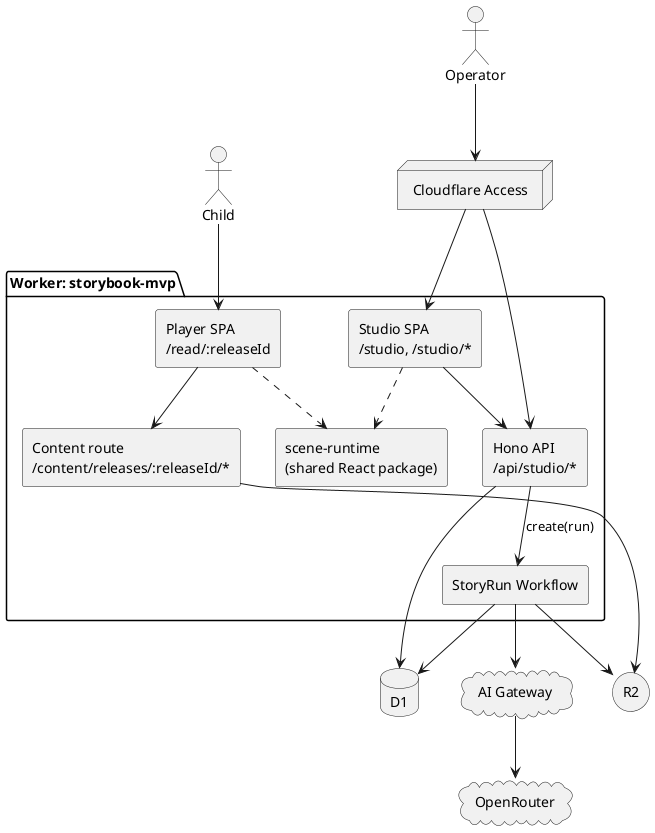

# storybook-mvp - Design Document

Requirements: [`requirements.md`](requirements.md). Decision record:
[ADR 0015](../../adr/0015-storybook-mvp-reset.md).

Revision 2 (2026-11-19): changed after a cross-family review (Codex, Gemini).
See [Review record](#review-record).

## Overview

The MVP is a storybook compiler. A news text goes in. A durable workflow turns
it into structured data: a story outline, the text of each page, a scene for
each page, and narration audio for each page. A shared renderer shows that
data in the Studio (to edit) and in the Player (to read). Publishing freezes
the data into an immutable release.

Five parts:

| Part | Job |
| :-- | :-- |
| Durable Workflow | Runs the production steps with retries. One instance per run. |
| Storybook DSL | Zod schemas for every stage output and for releases. |
| Asset pipeline and registry | Turns the Producer boards into versioned character, prop, and scenery assets, plus a small sound set, and lists them in D1. |
| Studio | Starts runs, edits pages, regenerates one page target, publishes. |
| Player | Reads one release and plays it. |

Five rules hold from the first version:

1. **Models choose, code places.** A model picks a layout template and puts
   registry keys into its slots. Code computes positions and checks them.
   Code, not the model, creates every ID.
2. **Failure goes to a person.** A page that still fails after one repair is
   kept with its errors and marked `needs_review`. Nothing is dropped or
   swapped silently.
3. **Revisions are append-only.** Every output is a new revision row. The
   story row holds a map of current revisions (`heads`) that changes only by
   compare-and-set.
4. **A stored result is never requested again.** Each model call has a call
   ID. Its result is stored in `call_log` before anything else uses it.
5. **Releases never change.** A release has its own R2 prefix with copies of
   every asset and sound it uses.

## Architecture

### Components



### Deployment

| Item | Value |
| :-- | :-- |
| Worker | `storybook-mvp`. Serves the SPA (Static Assets), the API, the content route, and the Workflow class. |
| D1 | New database `storybook-mvp`. |
| R2 | New bucket `storybook-mvp`. |
| Workflow | `StoryRunWorkflow`, binding `STORY_RUN`. |
| Access | One Access application with three paths: `/studio`, `/studio/*`, and `/api/studio/*`. `/read/*` and `/content/*` stay public. |
| Models | AI Gateway, then OpenRouter. Development points the same adapter at a local proxy. |

The existing Worker `goodnight-ai-news` (folder `app/`), its D1 database, and
its R2 bucket stay untouched until the new Worker is live. Removing them is a
separate decision.

### Repository layout

```
apps/storybook/           one Vite project: front end + Worker
  src/studio/             Studio routes
  src/player/             Player routes
  worker/api/             Hono routes
  worker/workflow/        StoryRunWorkflow and its steps
  worker/db/              Drizzle schema and queries
  migrations/             D1 migrations
  wrangler.jsonc
packages/dsl/             zod schemas, types, validation
packages/scene-runtime/   React renderer, animation and tap primitives
packages/layout/          layout templates and the placement engine
packages/models/          model adapter (JSON generation, TTS)
tools/assets/             offline asset pipeline and registry seed
assets/                   hand-cleaned SVG sources (tracked); built WebP is not tracked
```

pnpm workspaces, Node.js 22 or later, TypeScript strict mode, Vitest.

## Components and Interfaces

### 1. Model adapter (`packages/models`)

One client for every model call. It speaks the OpenAI-compatible API, so
production and development differ only in configuration.

```ts
interface ModelConfig {
  baseUrl: string;        // AI Gateway URL for OpenRouter, or the local proxy
  apiKey: string;         // Worker secret
  models: { script: string; scene: string; tts: string }; // model IDs from env
}

generateJson(req: {
  model: "script" | "scene";
  system: string;
  user: string;
  schema: JsonSchema;     // strict JSON schema output
}): Promise<{ value: unknown; usage: Usage; modelId: string }>;

synthesizeSpeech(req: {
  text: string;
  voice: string;
}): Promise<{ bytes: Uint8Array; contentType: string; durationMs: number }>;
```

- Model IDs come from environment variables. They are not in code.
- `generateJson` returns unvalidated JSON. Callers validate with zod.
- `synthesizeSpeech` returns audio the browser can play. If the provider
  returns raw PCM, the adapter adds a WAV header. The real format is checked
  in TB0 (open question in ADR 0015).
- The adapter does not deduplicate. Deduplication is the job of `call_log`
  (section 3).

### 2. StoryRun Workflow (`apps/storybook/worker/workflow`)

Parameters: `{ runId, storyId, scope }`.

```ts
type RunScope =
  | { kind: "full" }
  | { kind: "page"; pageId: string; target: "scene" | "audio" };
```

Steps for a full run:

| Step name | Does | Writes |
| :-- | :-- | :-- |
| `freeze` | Records the source revision, the active registry versions, and the current heads as the run basis. | `run.basis` |
| `script` | One LLM call: outline (title, cast, 6 to 8 page beats) and the text of every page. Code gives each page a new UUID v7 `pageId`. | 1 `outline` revision, N `page_text` revisions |
| `scene:<pageId>` | LLM picks a template and fills slots, then validation, at most one repair, then layout. | 1 `scene` revision per page |
| `audio:<pageId>` | TTS of the page text, stored in R2. | 1 `audio` revision per page |
| `finish` | Checks that every page has current text, scene, and audio. Sets the run status. | `run.status` |

- Step names are unique because `pageId` values come from code, never from
  the model.
- `scene:*` and `audio:*` run in parallel, at most 4 pages at a time.
- Every step returns only IDs and keys. A non-stream step result is at most
  1 MiB (Workflows limits, checked 2026-11-19).
- Retry policy for model steps: 3 tries, exponential back-off, starting at
  10 s. Validation failures are not retried by the platform; they use the
  repair rule.
- A page run (`scope.kind = "page"`) runs `freeze`, then the one target step,
  then `finish`.
- The workflow does not wait for a person. A run ends at `draft_ready` or
  `needs_review`.

```plantuml
@startuml
participant Studio
participant API
participant "StoryRun" as WF
participant "Model adapter" as M
database D1
storage R2

Studio -> API : POST /api/studio/stories {text}
API -> D1 : insert story (empty heads), source revision, run
API -> WF : create({runId, storyId, scope: full})
API --> Studio : 202 {storyId, runId}
WF -> D1 : freeze (run.basis)
WF -> M : script (JSON)
WF -> D1 : call_log, outline + page_text revisions, heads CAS
par each page (max 4)
  WF -> M : scene (JSON), repair if needed
  WF -> D1 : call_log, scene revision, heads CAS
  WF -> M : TTS
  WF -> R2 : calls/<callId>.<ext>
  WF -> D1 : call_log, audio revision, heads CAS
end
WF -> D1 : run status draft_ready | needs_review
Studio -> API : GET /api/studio/runs/:runId (poll)
@enduml
```

### 3. Calls, revisions, and heads

**Call IDs.** `callId = sha256(runId, stepName, pageId, purpose)`, where
`purpose` is `first` or `repair`. A repair is a different call with its own
ID.

**Basis.** Every generated revision records `basis`: the revision IDs it was
made from, for example `{ "page_text:<pageId>": "<revisionId>" }`. A step
takes its basis from the heads at the moment it starts generating (for the
first steps of a run, from the revisions written earlier in the same run).

**Step pattern.**

1. Read `call_log` by `callId`. If a row exists, use its stored result and
   skip to step 4.
2. Call the model.
3. Store the result. A binary goes to R2 at `calls/<callId>.<ext>` first.
   Then insert the `call_log` row with the result (JSON, or the R2 key). Code
   assigns any new IDs (for example `pageId`) before this insert, so a retry
   sees the same IDs.
4. Validate and lay out. This is deterministic code with no model call.
5. Insert the revision(s) with `INSERT OR IGNORE`. The unique key
   `(call_id, kind, page_id)` makes a retried insert a no-op.
6. Move the head with the compare-and-set loop below.

A retry after a stop between steps 5 and 6 finds the stored result (step 1),
inserts nothing new (step 5), and completes the head move (step 6).

The only window that repeats a model call is a stop between steps 2 and 3.
The requirements accept this.

**Compare-and-set loop.**

```
loop at most 5 times:
  read story.heads, story.heads_version
  for each basis entry: if heads[key] != basis[key] -> mark revision superseded, stop
  heads[target] = newRevisionId
  UPDATE story SET heads = ?, heads_version = heads_version + 1
    WHERE id = ? AND heads_version = ?
  if 1 row changed -> done
```

The story row is created with `heads = {}` and `heads_version = 0`, so the
first write has a row to update.

**Operator edits** use the same loop. The request carries `basedOn` (the
revision the operator edited). If the head has moved since, the API returns
409 with the current revision.

**Example: an edit during a full run.** The full run starts `scene:p3` with
basis `page_text:p3 = T1`. The operator saves new text `T2`. When `scene:p3`
commits, `heads[page_text:p3]` is `T2`, not `T1`. The scene revision is kept
as `superseded` and the head does not move. The Studio shows page 3 as
missing a current scene, and the operator regenerates it.

### 4. Layout engine (`packages/layout`)

Narration is HTML outside the stage: below it in portrait, beside it in
landscape (Producer guideline). The stage never carries text.

A layout template is data:

```ts
type LayoutTemplate = {
  id: string;                         // for example "two-friends-meadow"
  stage: { width: 1600; height: 1200 };
  slots: Array<{
    id: string;                       // "left", "right", "sky-1", "ground-1"
    accepts: "character" | "prop" | "scenery";
    footX: number; footY: number;     // where the asset's foot point goes
    height: number;                   // target height in stage units
    minScale: number;                 // 0.7 to 1.0; the engine may shrink to this
    z: number;
  }>;
};
```

Placement: for each layer, take the slot, read the asset's foot point and
height from the registry, and compute `x`, `y`, `scale`, `z`. Then check:

| Check | Fails when |
| :-- | :-- |
| Face visible | A character's face box is outside the stage, or more than 30% covered by a layer with a higher `z`. |
| Overlap | Two character boxes overlap by more than 15% of the smaller box. |
| Bounds | A box goes outside the stage by more than 10%. |

If a check fails, the engine shrinks the layers involved step by step down to
each slot's `minScale` and checks again. Only if that fails does the page
count as a validation failure (repair rule, then `needs_review`).

MVP has 6 to 8 templates. An operator's manual `at` value in the Studio
overrides the slot for that layer.

### 5. Scene runtime (`packages/scene-runtime`)

```ts
<SceneView
  page={PageScene}
  assets={AssetResolver}          // key + version -> URL or SVG text
  mode="play" | "edit"
  onSelectLayer?={(instanceId) => void}
  onMoveLayer?={(instanceId, at) => void}
/>
```

- The stage is 1600 × 1200 units, scaled to the container with CSS.
- `svg` and `svg-rig` assets are inlined. `webp` assets are `` elements.
- A paper texture image covers the whole stage with `mix-blend-mode: multiply`.
  No per-layer SVG filters.
- Animations use the Web Animations API on the layer element, or on named
  parts of an `svg-rig` asset (`part-eyes`, `part-arm-left`, ...).
- `prefers-reduced-motion` turns looping animations off.
- **Audio.** The Player has one `<audio>` element for the whole book. The
  first tap on a "Start" button unlocks it. Each page turn is a tap; its
  handler sets the new `src` and calls `play()` in the same handler, because
  iOS Safari blocks `play()` outside a user gesture. Sound effects use a
  second shared element, unlocked the same way.
- Edit mode adds selection boxes and drag handles. Play mode adds tap handling.

Animation primitives (closed list). Validation rejects a primitive on a layer
whose renderer does not support it.

| Primitive | Renderers | Parameters (bounded) |
| :-- | :-- | :-- |
| `float` | all | amplitude 0.005 to 0.03 of stage height, period 2 to 6 s |
| `sway` | all | angle 1 to 8 degrees, period 2 to 6 s |
| `bounce` | all | height 0.01 to 0.05, count 1 to 3 |
| `pop` | all | scale 1.05 to 1.25 |
| `fade-in` | all | delay 0 to 3 s |
| `blink` | `svg-rig` | interval 2 to 6 s |
| `wave` | `svg-rig` | count 1 to 3 |

Tap actions (closed list):

| Action | Rule |
| :-- | :-- |
| `play_animation` | Same renderer rule as above. |
| `play_sfx` | `sfx` must be a key of an active `sfx` asset. |
| `show_bubble` | Text of at most 60 characters. |
| `set_expression` | The pair (current pose, new expression) must be legal for the character. On `svg-rig` it swaps face parts; on `svg` and `webp` it swaps the image. |
| `set_pose` | The pair (new pose, current expression) must be legal. |

### 6. API (`apps/storybook/worker/api`)

Studio routes are behind Cloudflare Access.

| Method and route | Does |
| :-- | :-- |
| `POST /api/studio/stories` | Body `{ text }` or `{ url }`. Creates a story, a source revision, and a full run. Returns 202 with `{ storyId, runId }`. |
| `GET /api/studio/stories` | Lists stories. |
| `GET /api/studio/stories/:id` | Heads with content, page states (`ok`, `stale`, `missing`, `needs_review`), and releases. |
| `GET /api/studio/runs/:id` | Run status and step progress. |
| `PUT /api/studio/stories/:id/pages/:pageId/text` | Body `{ text, basedOn }`. New human `page_text` revision. 409 if the head moved. |
| `PUT /api/studio/stories/:id/pages/:pageId/scene` | Body `{ scene, basedOn }`. Validated, laid out, saved as a human `scene` revision whose basis is the current page text. |
| `POST /api/studio/stories/:id/pages/:pageId/scene/still-fits` | Copies the current scene into a new human revision whose basis is the current page text. Clears a stale scene. |
| `POST /api/studio/stories/:id/runs` | Body `{ scope }`. Starts a page run. |
| `POST /api/studio/stories/:id/releases` | Publishes the current heads. 409 with a list of blocking pages and reasons. |
| `GET /api/studio/registry` | Active assets, sounds, and templates. |
| `GET /content/releases/:releaseId/*` | Public. Serves `releases/<releaseId>/*` from R2 with `Cache-Control: public, max-age=31536000, immutable`. |

**URL input.**

- `http` and `https` only.
- `redirect: "manual"`; follow at most 3 redirects, checking the scheme of
  each target.
- 10 s timeout. Read the body as a stream and stop at 2 MB.
- Text comes from `<p>` elements inside `article` or `main`, parsed with
  HTMLRewriter.
- If the result has fewer than 200 words, the API returns 422 and the Studio
  asks for pasted text. If it has more than 2,000 words, the text is cut at
  2,000 words and the Studio shows a note.

### 7. Publish

1. Read the story row (`heads`, `heads_version`) once. This is the snapshot.
2. Check every page in the outline head. Block the page if any of these is
   true:
   - the `page_text`, `scene`, or `audio` head is missing;
   - a head has `status = needs_review`;
   - a head is stale (section "Staleness").
3. Build page JSON and the manifest from the snapshot revisions.
4. Copy each asset version and sound in use to
   `releases/<releaseId>/assets/`.
5. Copy each audio object to `releases/<releaseId>/audio/`.
6. Write page JSON, then the manifest last.
7. Insert the `release` row, then set `story.published_release_id` with
   compare-and-set.

If a step fails, the prefix stays unreferenced. The Player never sees it.

### 8. Asset pipeline (`tools/assets`)

Offline Node.js scripts, run by the developer.

| Step | Tool | Output |
| :-- | :-- | :-- |
| Find figures | Connected components on the near-white board background | Candidate boxes per board |
| Name figures | A tracked crop map per board: box, name, pose or expression | `tools/assets/crops/<board>.json` |
| Cut out | Flood fill of the background from the box edges with a colour tolerance, trim, 2 px feather | Transparent WebP per pose and expression |
| Measure | Alpha bounds, foot point (lowest opaque row, centre), face box (from the crop map) | Values for the registry manifest |
| SVG | Hand-cleaned SVG sources in `assets/<key>/v<n>/`; SVGO with scripts and event attributes removed | Sanitised SVG |
| Sounds | A small set (about 8) of short licensed sound effects, normalised | `sfx` assets |
| Publish | Upload to R2 `assets/<key>/v<n>/...`; upsert `asset` and `asset_version` rows | Registry rows |

All 13 characters get WebP cut-outs. Pip gets a rigged SVG in S1. Other
characters move to SVG later, one at a time, as a new asset version.

## Data Models

### D1 tables

All IDs are UUID version 7, lower case (ADR 0007).

| Table | Columns | Notes |
| :-- | :-- | :-- |
| `asset` | `id`, `key` (unique, for example `pip`), `kind` (`character`, `prop`, `scenery`, `sfx`), `name`, `created_at` | One row per asset. |
| `asset_version` | `id`, `asset_id`, `version`, `renderer` (`svg-rig`, `svg`, `webp`, `audio`), `manifest` (JSON), `r2_prefix`, `active`, `created_at` | Unique `(asset_id, version)`. One active version per asset. |
| `story` | `id`, `title`, `status`, `heads` (JSON, starts `{}`), `heads_version` (integer, starts 0), `published_release_id`, `created_at` | `heads` maps `<kind>` or `<kind>:<pageId>` to a revision ID. |
| `run` | `id`, `story_id`, `scope` (JSON), `status`, `basis` (JSON), `registry` (JSON), `workflow_instance_id`, `error` (JSON), `created_at`, `finished_at` | Status: `queued`, `running`, `draft_ready`, `needs_review`, `failed`. |
| `call_log` | `call_id` (primary key), `run_id`, `step`, `page_id`, `purpose` (`first`, `repair`), `result` (JSON), `r2_key`, `model`, `usage` (JSON), `created_at` | Written once, after the model answers. |
| `revision` | `id`, `story_id`, `kind`, `page_id`, `content` (JSON), `r2_key`, `basis` (JSON), `origin` (`ai`, `human`), `call_id` (null for human), `status` (`ok`, `needs_review`, `superseded`), `error` (JSON), `created_at` | Kinds: `source`, `outline`, `page_text`, `scene`, `audio`. `page_id` is `''` for story-level kinds. Unique `(call_id, kind, page_id)` where `call_id` is not null. Order by `id` (UUID v7 is time-ordered). |
| `release` | `id`, `story_id`, `number`, `manifest_key`, `snapshot` (JSON of revision IDs), `created_at` | Unique `(story_id, number)`. |

### Asset manifest (`asset_version.manifest`)

```ts
type AssetManifest =
  | {
      kind: "character" | "prop" | "scenery";
      poses: Array<{ id: string; file: string; foot: Point; box: Rect; face?: Rect }>;
      expressions: string[];                        // empty for props and scenery
      legal: Array<{ pose: string; expression: string }>;
      flippable: boolean;
      parts?: string[];                             // svg-rig only
    }
  | { kind: "sfx"; file: string; durationMs: number };
```

### Storybook DSL (`packages/dsl`)

```ts
type Outline = {
  title: string;
  ageBand: "5-7";
  cast: string[];                    // asset keys
  pages: Array<{ pageId: string; beat: string }>; // pageId set by code
};

type PageText = { text: string };    // 1 to 3 sentences, at most 40 words

type PageScene = {
  templateId: string;
  sky: PaletteId;
  layers: Layer[];                   // scenery, props, and characters
  animations: Animation[];
  interactions: Interaction[];
};

type Layer = {
  instanceId: string;                // set by code
  kind: "character" | "prop" | "scenery";
  ref: string;                       // asset key
  pose?: string;
  expression?: string;
  slot: string;
  at?: { x: number; y: number; scale: number; z: number }; // set by layout or the Studio
  flip?: boolean;                    // only if the asset is flippable
};

type Animation = {
  target: string;                    // instanceId
  primitive: "float" | "sway" | "bounce" | "pop" | "fade-in" | "blink" | "wave";
  params: Record<string, number>;
  trigger: "enter" | "loop";
};

type Interaction = {
  on: { tap: string };               // instanceId
  do: Array<
    | { action: "play_animation"; target: string; primitive: string }
    | { action: "play_sfx"; sfx: string }
    | { action: "show_bubble"; target: string; text: string }
    | { action: "set_expression"; target: string; expression: string }
    | { action: "set_pose"; target: string; pose: string }
  >;
};
```

The model does not write `instanceId`. It names layers by their slot, and
code assigns `instanceId` values and rewrites `target` and `on.tap`.

The JSON schema sent to the model is built at run time from the frozen
registry and the template list. `ref`, `pose`, `expression`, `slot`, `sfx`,
and `templateId` are enums in that schema. Zod validation then checks what a
JSON schema cannot:

- every pose and expression pair is legal for its character;
- each layer's `kind` matches its slot's `accepts`;
- `flip` is set only on flippable assets;
- every primitive and action is allowed for the target's renderer;
- every `target` names an existing layer.

### Staleness

A head is stale when one of its `basis` entries is not the current head for
that key.

| Head | Basis | When stale |
| :-- | :-- | :-- |
| `audio` of page P | `page_text:P` | The page text changed. Blocks publish. |
| `scene` of page P | `page_text:P` | The page text changed. Blocks publish until the operator regenerates the scene or marks it "still fits". |

### Release layout (R2)

```
assets/<key>/v<n>/<file>                    registry assets and sounds
calls/<callId>.<ext>                        stored model binaries (draft audio)
releases/<releaseId>/manifest.json
releases/<releaseId>/pages/<pageId>.json
releases/<releaseId>/audio/<file>
releases/<releaseId>/assets/<key>/v<n>/<file>
```

`releaseId` is a UUID v7, unique across stories, so the release prefix needs
no story ID. The `release` row keeps the story ID.

```ts
type ReleaseManifest = {
  format: "storybook-mvp";
  formatVersion: 1;
  storyId: string;
  releaseId: string;
  number: number;
  title: string;
  pages: Array<{ pageId: string; json: string }>;   // relative paths
};

type ReleasePage = {
  pageId: string;
  text: string;
  audio: string;                     // relative path
  scene: PageScene;                  // every layer has `at`
  assets: Record<string, { renderer: string; manifest: AssetManifest; base: string }>;
  // includes the sfx assets used by the page
};
```

## Error Handling

| Error | Where | Behaviour |
| :-- | :-- | :-- |
| URL fetch fails, too many redirects, or text too short | API | 422. The Studio asks for pasted text. |
| Model output fails the schema or validation | `script`, `scene:*` | One repair call (`purpose = repair`) with the error list. If it still fails: for `scene`, save the candidate with `status = needs_review` and the errors; for `script`, fail the run with the errors. |
| Layout check fails after shrinking | `scene:*` | Counts as a validation failure (same repair rule). |
| Provider 429 or 5xx | any model step | Step throws; the platform retries (3 tries, exponential back-off). The stored-result check prevents a second call for a stored result. |
| Provider 4xx other than 429 | any model step | Non-retryable error. The page goes to `needs_review` with the provider message. |
| TTS fails after retries | `audio:*` | No audio head. The run ends `needs_review`. Publish is blocked ("missing audio"). The Studio offers "regenerate audio". |
| Basis changed before commit | any step | The revision is kept as `superseded`. The head does not move. |
| Head moved since the operator loaded it | API | 409 with the current revision. |
| Compare-and-set loop exhausted (5 tries) | step | Step throws; the platform retries the step. |
| Publish blocked | API | 409 with the list of pages and reasons. |
| Run fails | Workflow | `run.status = failed` with the error. The Studio shows it and can start a new run with the same scope. |

Every error record has `runId`, `storyId`, `pageId`, `step`, and the provider
status. Logs do not contain the full news text or model output.

## Testing Strategy

| Level | Tool | What it covers |
| :-- | :-- | :-- |
| Unit | Vitest | DSL validation (legal pairs, slot kinds, renderer rules for primitives and actions, targets, flip); JSON schema builder from a registry fixture; layout placement, the three checks, and shrinking; staleness from basis; manifest builder. |
| Worker integration | Vitest with `@cloudflare/vitest-pool-workers`, local D1 and R2, stub model adapter that counts calls | See the sequences below. |
| Model contract | Recorded model outputs as fixtures | Real outputs from S2 stay as fixtures; schema changes must keep them valid or update them on purpose. |
| Product premise (S2) | Real models, 3 real news texts | At least 90% of pages pass validation and layout with at most one repair. This is the test that a stub cannot replace. |
| Renderer | Playwright with WebKit, iPad and iPhone profiles, on a fixture release | Pages render; taps fire actions; reduced motion stops loops; audio starts on "Start" and continues on each page turn. |
| Device | Manual, on a real phone and tablet | Frame time p95 on an animated page (target 33 ms or less). Page assets load in 2 s or less on a throttled 4G profile. Recorded in the S1 and TB3 results. |

Integration sequences (each asserts both the revisions and `story.heads`):

| Sequence | Expected |
| :-- | :-- |
| Full run on an empty database | 6 to 8 pages; every page has current text, scene, and audio heads. |
| Stop after the `call_log` insert, then retry | The stub model is called once; the revision and head exist once. |
| Stop after the revision insert and before the head move, then retry | The head points at the revision. |
| First output invalid, repair valid, 429 between them | Two model calls in total (first, repair); the repaired scene is the head. |
| Operator edits page 3 text while `scene:p3` is running | The late scene is `superseded`; the head is unchanged; page 3 shows "missing scene". |
| Page run for page 3 audio after a text change | Only `audio:p3` gets a new revision; all other heads are unchanged. |
| TTS fails for page 5, then publish | Publish returns 409 with "page 5: missing audio". |
| Stale scene, "still fits", then publish | Publish succeeds; the scene revision is a human copy. |
| Publish twice | Two prefixes; the first is byte-for-byte unchanged. |
| Release contents | The prefix holds every asset, sound, and audio file the pages reference. |
| Content route | `GET /content/releases/<id>/manifest.json` returns the manifest with the immutable cache header. |
| URL input | Redirect chain of 4 is refused; a 3 MB body is cut at 2 MB; a short article returns 422. |

Acceptance criteria to tests:

| Requirement | Test |
| :-- | :-- |
| 6 to 8 pages with text, audio, layer, animation, tap | Integration, full run; S2 for real models |
| Layers reference the frozen registry | Unit (schema builder) and integration |
| `needs_review` instead of silent changes | Integration with an invalid stub output |
| One stored result per call ID | Integration, stop after `call_log` insert |
| Head move completes on retry | Integration, stop before head move |
| Late result does not replace the operator's work | Integration, edit during run |
| Page 3 text change regenerates only page 3 audio | Integration, page run |
| Publish blocked on missing, `needs_review`, or stale | Integration, TTS failure and stale scene |
| Releases do not change; release contains its assets | Integration, publish twice; list R2 prefix |
| Safari and Chrome on phones and tablets | Renderer and device tests |
| Assets load in 2 s on 4G | Device test |
| Studio behind Access | Manual check after deploy: `/studio`, `/studio/x`, `/api/studio/x` all ask for login; `/read/x` does not |

## Review record

Cross-family review of revision 1 (commit 4191fc9), 2026-11-19. Seat 1: Codex
(correctness and data integrity). Seat 2: Gemini (boundaries and premises).
All findings were checked against the document before they were accepted.

| # | Finding | Seats | Change in revision 2 |
| :-- | :-- | :-- | :-- |
| 1 | First head write had no row to update | both | `story.heads` map created at story creation |
| 2 | `script` wrote N+1 rows under one unique `call_id` | both | `call_log` table; revision unique key `(call_id, kind, page_id)` |
| 3 | Repair reused the first call ID | both | `purpose` in the call ID |
| 4 | Expected head for compare-and-set was undefined; a late result could overwrite an edit | both | `basis` per revision; `superseded` status |
| 5 | Stop between revision insert and head move left the head stale | Codex | Retry reaches the head move |
| 6 | "No second model call" cannot be guaranteed | Codex | Requirement reworded |
| 7 | Publish did not block a missing audio | Codex | Publish checks missing heads |
| 8 | Revision version allocation undefined | Codex | `version` removed; order by UUID v7 |
| 9 | Model-made page IDs could repeat | Codex | Code makes all IDs |
| 10 | Release route lacked the story ID of the R2 key | Gemini | `releases/<releaseId>/` |
| 11 | DSL gaps: scenery slots, sounds, renderer rules, legal pairs, text zone, no layout fallback | Gemini | Scenery slots, `sfx` assets, renderer rules, pair checks, text out of stage, shrink step |
| 12 | Per-page audio fails on iOS page turns | Gemini | One shared audio element, `play()` in the tap handler |
| 13 | URL redirects and size, `/studio` path, 4G test | Gemini | URL rules, Access paths, device test |
| 14 | Stub tests cannot test the product premise | Gemini | S2 listed as the premise test |
