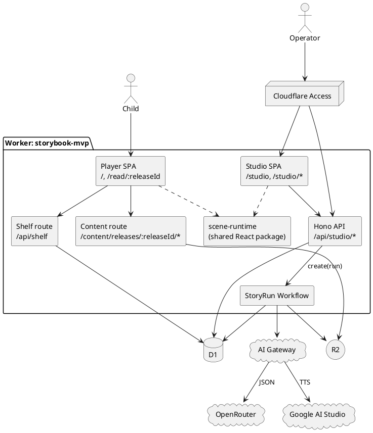

# storybook-mvp - Design Document

Requirements: [`requirements.md`](requirements.md). Decision record:
[ADR 0015](../../adr/0015-storybook-mvp-reset.md).

Revision 2 (2026-11-19): changed after a cross-family review (Codex, Gemini).
See [Review record](#review-record).

## Overview

The MVP is a storybook compiler. A news text goes in. A durable workflow turns
it into structured data: a story outline, the text of each page, a scene for
each page, and narration audio for each page. A shared renderer shows that
data in the Studio (to edit) and in the Player (to read). Publishing freezes
the data into an immutable release.

Five parts:

| Part | Job |
| :-- | :-- |
| Durable Workflow | Runs the production steps with retries. One instance per run. |
| Storybook DSL | Zod schemas for every stage output and for releases. |
| Asset pipeline and registry | Turns the Producer boards into versioned character, prop, scenery, and backdrop assets, plus a small sound set, and lists them in D1. |
| Studio | Starts runs, edits pages, regenerates one page target, publishes. |
| Player | Shows the shelf of published books. Reads one release and plays it. |

Five rules hold from the first version:

1. **Models choose, code places.** A model picks a layout template and a
   backdrop, and puts registry keys into the slots. Code computes positions
   and checks them.
   Code, not the model, creates every ID.
2. **Failure goes to a person.** A page that still fails after one repair is
   kept with its errors and marked `needs_review`. Nothing is dropped or
   swapped silently.
3. **Revisions are append-only.** Every output is a new revision row. The
   story row holds a map of current revisions (`heads`) that changes only by
   compare-and-set.
4. **A stored result is never requested again.** Each model call has a call
   ID. Its result is stored in `call_log` before anything else uses it.
5. **Releases never change.** A release has its own R2 prefix with copies of
   every asset and sound it uses.

## Architecture

### Components



### Deployment

| Item | Value |
| :-- | :-- |
| Worker | `storybook-mvp`. Serves the SPA (Static Assets), the API, the content route, and the Workflow class. |
| D1 | New database `storybook-mvp`. |
| R2 | New bucket `storybook-mvp`. |
| Workflow | `StoryRunWorkflow`, binding `STORY_RUN`. |
| Access | One Access application with three paths: `/studio`, `/studio/*`, and `/api/studio/*`. `/`, `/read/*`, `/api/shelf`, and `/content/*` stay public (ADR 0017). The Worker does not check `Cf-Access-Jwt-Assertion` in the MVP. Access protects the routes at the edge. The `workers.dev` route and preview URLs are off, so no route bypasses Access (#25). |
| Player routes | `/` is the shelf, the home of the Player. `/read/:releaseId` is one book. Both are static asset paths with the SPA fallback. `/api/*` and `/content/*` run the Worker first (ADR 0017). A path that matches no route shows the shelf ("9. Player screens", "Unknown path"). |
| Models | JSON generation: AI Gateway, then OpenRouter. Development points the same adapter at a local proxy. TTS: AI Gateway, provider `google-ai-studio`. Development calls Google AI Studio directly. TTS never goes through OpenRouter (owner decision Q7). |

The existing Worker `goodnight-ai-news` (folder `app/`), its D1 database, and
its R2 bucket stay untouched until the new Worker is live. Removing them is a
separate decision.

### Repository layout

```
apps/storybook/           one Vite project: front end + Worker
  src/studio/             Studio routes
  src/player/             Player routes
  worker/api/             Hono routes
  worker/workflow/        StoryRunWorkflow and its steps
  worker/db/              Drizzle schema and queries
  migrations/             D1 migrations
  wrangler.jsonc
packages/dsl/             zod schemas, types, validation
packages/scene-runtime/   React renderer, animation and tap primitives
packages/layout/          layout templates and the placement engine
packages/models/          model adapter (JSON generation, TTS)
tools/assets/             offline asset pipeline and registry seed
assets/                   hand-cleaned SVG sources (tracked); built WebP is not tracked
```

pnpm workspaces, Node.js 22 or later, TypeScript strict mode, Vitest.

## Components and Interfaces

### 1. Model adapter (`packages/models`)

One client for every model call. JSON generation speaks the
OpenAI-compatible API. TTS speaks the Google AI Studio API (`v1beta`) and
never goes through OpenRouter (owner decision Q7). Production and development
differ only in configuration.

| Call | Development | Cloudflare |
| :-- | :-- | :-- |
| `generateJson` | Local proxy | AI Gateway, then OpenRouter |
| `synthesizeSpeech` | Google AI Studio directly: `https://generativelanguage.googleapis.com/v1beta` | AI Gateway: `https://gateway.ai.cloudflare.com/v1/<account>/<gateway>/google-ai-studio/v1beta` |

```ts
interface ModelConfig {
  baseUrl: string;        // AI Gateway URL for OpenRouter, or the local proxy
  apiKey: string;         // Worker secret
  gatewayToken?: string;  // AI Gateway token, sent on both routes
  models: { script: string; scene: string; tts: string }; // model IDs from env
  tts: { baseUrl: string; apiKey: string; voice: string }; // Google AI Studio, or AI Gateway `google-ai-studio`
}

generateJson(req: {
  model: "script" | "scene";
  system: string;
  user: string;
  schema: JsonSchema;     // strict JSON schema output
}): Promise<{ value: unknown; usage: Usage; modelId: string }>;

synthesizeSpeech(req: {
  text: string;
  voice?: string;         // default: `tts.voice`
}): Promise<{ bytes: Uint8Array; contentType: string; durationMs: number; usage: Usage | null }>;
```

- `ModelConfig` follows the #17 implementation: the TTS settings and the voice
  are under `tts`, and `gatewayToken` is optional (implementation decision
  R52).
- Model IDs come from environment variables. They are not in code.
- `generateJson` returns unvalidated JSON. Callers validate with zod.
- `synthesizeSpeech` returns audio the browser can play. If the provider
  returns raw PCM, the adapter adds a WAV header. TB0 (#25) records the audio
  content type that the gateway returns. Narration is to be compressed (MP3,
  mono) after a spike on Worker encoding cost and Safari playback (ADR 0016,
  decision E); until then this WAV rule holds.
- `synthesizeSpeech` returns the token counts of the answer as `usage`:
  `usageMetadata.promptTokenCount` is `inputTokens`, and
  `usageMetadata.candidatesTokenCount` is `outputTokens`. If the answer does
  not have both as integers of 0 or more, `usage` is null; the adapter never
  puts 0 in place of a missing count. An output error after a 2xx answer
  carries the same `usage`. The audio step stores it in `call_log.usage`
  (#65).
- The adapter does not deduplicate. Deduplication is the job of `call_log`
  (section 3).

### 2. StoryRun Workflow (`apps/storybook/worker/workflow`)

Parameters: `{ runId, storyId, scope }`.

```ts
type RunScope =
  | { kind: "full" }
  | { kind: "page"; pageId: string; target: "scene" | "audio" };
```

Steps for a full run:

| Step name | Does | Writes |
| :-- | :-- | :-- |
| `freeze` | Records the source revision, the active registry versions, and the current heads as the run basis. | `run.basis` |
| `script` | One LLM call: outline (title, cast, 6 to 8 page beats) and the text of every page. Code gives each page a new UUID v7 `pageId`. | 1 `outline` revision, N `page_text` revisions |
| `scene:<pageId>` | LLM picks a template and fills slots, then validation, at most one repair, then layout. The prompt also gets the template, sky, and scenery keys of the `ok` scene heads of the earlier pages (#105). | 1 `scene` revision per page |
| `audio:<pageId>` | TTS of the page text, stored in R2. | 1 `audio` revision per page |
| `finish` | Checks that every page has current text, scene, and audio. Sets the run status (rule below). | `run.status` |

- Step names are unique because `pageId` values come from code, never from
  the model.
- `scene:*` steps run one at a time, in page order, so that each scene step sees the scenes of the earlier pages (#105). Then the `audio:*` steps run in parallel, at most 4 pages at a time.
- Every step returns only IDs and keys. A non-stream step result is at most
  1 MiB (Workflows limits, checked 2026-11-19).
- Retry policy for model steps: 3 tries, exponential back-off, starting at
  10 s. Validation failures are not retried by the platform; they use the
  repair rule.
- A page run (`scope.kind = "page"`) runs `freeze`, then the one target step,
  then `finish`.
- Each run freezes the registry versions that are active when it starts, so
  a page run after a new asset version uses the new version. One draft can
  therefore hold scenes made with different versions of an asset. This is
  allowed. Publish copies each version that a page uses ("7. Publish").
- The workflow does not wait for a person. A run ends at `draft_ready` or
  `needs_review`.
- `finish` sets `needs_review` when a page has no `page_text`, `scene`, or
  `audio` head, when one of these heads has `status = needs_review`, or when
  one of these heads is stale ("Staleness"). Otherwise it sets `draft_ready`.

Script rules (#83). The script tells the news as a story of the cast in
their own world, outdoors (DESIGN.md section 8, ADR 0016). It keeps the one
or two main facts of the news (what happened, what is new). It leaves out
personal names, dates, and money. Every page names a cast member who does
something, and the last page slows down toward sleep. The prompt gives the
model each character with its poses, and the prop and scenery keys, and asks
for only what these can show. These are prompt rules. Code checks two limits
on the page texts of a model output:

- every sentence has at most 12 words (`sentence_too_long`);
- the page texts of the story hold at most 2 real-world names
  (`too_many_names`).

The counting rule:

1. A page text is split into sentences where white space follows `.`, `!`,
   or `?`, or follows one of these and then `"`, `'`, `”`, or `’`.
2. A sentence is split into words at white space. Its word count is the
   number of words.
3. The core of a word is the word without the characters at its start and
   end that are not letters or digits, and without a final `'s` or `’s`.
4. A word is a name word when it is not the first word of its sentence, it
   does not start with `"`, `“`, `'`, or `‘`, its core starts with a
   capital letter A to Z, its core in lower case is not a cast key, and its
   core is not `I` and does not start with `I'` or `I’`.
5. Name words that follow each other form one name. A name ends at a word
   that is not a name word, and after a word whose last character is not a
   letter or a digit.
6. The names of a story are the distinct names of all its page texts. The
   title and the beats are not counted.

A failure starts the repair rule ("Error Handling"). Code never changes the
text. These limits apply to the `script` step only. An operator's text is
checked as `PageText` only (owner decision Q15), with the `PageText`
sentence split.

```plantuml
@startuml
participant Studio
participant API
participant "StoryRun" as WF
participant "Model adapter" as M
database D1
storage R2

Studio -> API : POST /api/studio/stories {text}
API -> D1 : one batch: story (heads = {source}), source revision, run
API -> WF : create({runId, storyId, scope: full})
API --> Studio : 202 {storyId, runId}
WF -> D1 : freeze (run.basis)
WF -> M : script (JSON)
WF -> D1 : call_log, outline + page_text revisions, heads CAS
loop each page, in order
  WF -> M : scene (JSON), repair if needed
  WF -> D1 : call_log, scene revision, heads CAS
end
par each page (max 4)
  WF -> M : TTS
  WF -> R2 : calls/<callId>.<ext>
  WF -> D1 : call_log, audio revision, heads CAS
end
WF -> D1 : run status draft_ready | needs_review
Studio -> API : GET /api/studio/runs/:runId (poll)
@enduml
```

### 3. Calls, revisions, and heads

**Call IDs.** `callId = sha256(runId, stepName, pageId, purpose)`, where
`purpose` is `first` or `repair`. A repair is a different call with its own
ID.

**Basis.** Every generated revision records `basis`: the revision IDs it was
made from, for example `{ "page_text:<pageId>": "<revisionId>" }`. A step
takes its basis from the heads at the moment it starts generating (for the
first steps of a run, from the revisions written earlier in the same run).
The basis is read once, at the first attempt, and stored in `call_log.basis`.
A retry that finds a stored result reuses that basis. It does not read the
heads again. A `repair` call uses the basis stored with the `first` call of
the same step. At the same moment, the step reads the current head of each
key that it will move, and stores this map in `call_log.expected_heads`
(`null` for a key with no head). A retry reuses it in the same way.
The earlier scenes that a scene step gets as story context are not part of its basis, so a change to an earlier scene does not make a later scene stale (#105).

**Step pattern.**

1. Read `call_log` by `callId`. If a row exists, use its stored result and
   its stored basis, and skip to step 4. If the stored result is
   `{ providerError }`, skip to step 5 and write the `needs_review` revision
   with that error. Do not validate, and do not call the model again.
2. Call the model.
3. Store the result. A binary goes to R2 at `calls/<callId>.<ext>` first.
   Then insert the `call_log` row with the result (JSON, or the R2 key), the
   basis, and the expected heads. Code assigns any new IDs (for example `pageId`) before this
   insert, so a retry sees the same IDs.
4. Validate and lay out. This is deterministic code with no model call.
5. Insert the revision(s) with
   `INSERT ... ON CONFLICT (call_id, kind, page_id) DO NOTHING`, then read the
   stored row. The unique key makes a retried insert a no-op, and the step
   continues with the stored row.
6. Move the head with the compare-and-set loop below.

A retry after a stop between steps 5 and 6 finds the stored result (step 1),
inserts nothing new (step 5), and completes the head move (step 6).

The only window that repeats a model call is a stop between steps 2 and 3.
The requirements accept this.

**Compare-and-set loop.**

```
input: moves (key -> newRevisionId), basis, expected (key -> revisionId | null)
loop at most 5 times:
  read story.heads, story.heads_version
  pending = the keys where heads[key] != moves[key]
  if pending is empty -> done ("moved"), write nothing
  if a basis entry has heads[key] != basis[key],
     or a pending key has (heads[key] or null) != expected[key]
    -> mark the revisions of the pending keys superseded, stop ("superseded")
  UPDATE story SET heads = <heads with the pending keys moved>,
                   heads_version = heads_version + 1
    WHERE id = ? AND heads_version = ?
  if 1 row changed -> done ("moved")
```

Each target key is checked on its own, by exact equality only. A key whose
head is already the new revision is done, so a retry after a successful move
writes nothing and returns "moved" before the basis check (implementation
decision R56, #16). A key whose head is not the head that the step or edit
expected was moved by other work, so the new revision is superseded and never
overwrites it. No code compares revision IDs for age, because UUID v7 order
is not creation order across isolates (implementation decision R58, #16).
When every target key is done, nothing is written and `heads_version` does
not change.

The API creates the story row with `heads = { source: <source revision ID> }`
and `heads_version = 0`, in one batch with the source revision and the run.
The first write therefore has a row to update.

**Operator edits** use the same loop, with `expected = { <key>: basedOn }`.
The request carries `basedOn` (the revision the operator edited). The edit
is "moved" only when its own new revision is the head after the loop. If the head has moved since, the API returns
409 with the current revision. If the loop marks the edit `superseded`
because a basis entry moved (for example, the page text changed between the
read and the write), the API returns 409 `head_moved` with the current
revision.

**Example: an edit during a full run.** The full run starts `scene:p3` with
basis `page_text:p3 = T1`. The operator saves new text `T2`. When `scene:p3`
commits, `heads[page_text:p3]` is `T2`, not `T1`. The scene revision is kept
as `superseded` and the head does not move. The Studio shows page 3 as
missing a current scene, and the operator regenerates it.

### 4. Layout engine (`packages/layout`)

Narration is HTML outside the stage, below it in portrait and in landscape
(owner decision 2026-11-19, ADR 0016). The stage image never carries text. The
text of a `show_bubble` action is an HTML element over the stage. It is not
part of the stage image.

**Backdrop.** Every page has one backdrop (ADR 0016): a painted full-frame
background from the registry, below every layer. It is not a layer and has no
slot. MVP backdrops are outdoor scenes only. Every backdrop fits every
template; the art contract in "8. Asset pipeline" keeps the ground band open.
The layout engine places layers as before and does not read the backdrop.
Characters stand in front of the painting; a character cannot sit at a
painted object or stand behind one.

A layout template is data:

```ts
type LayoutTemplate = {
  id: string;                         // for example "two-friends-meadow"
  stage: { width: 1600; height: 1200 };
  slots: Array<{
    id: string;                       // "left", "right", "sky-1", "ground-1"
    accepts: "character" | "prop" | "scenery";
    footX: number; footY: number;     // where the asset's foot point goes
    height: number;                   // target height in stage units
    minScale: number;                 // 0.7 to 1.0; the engine may shrink to this
    z: number;
    poses?: string[];                 // the only poses this slot accepts; reserved for slots that list them
  }>;
};
```

The rule holds in both directions, and each case fails validation with
`slot_pose_mismatch`:

- A pose that some slot lists in `poses` may be placed only in a slot that
  lists it.
- A slot with `poses` accepts only the poses that it lists.

For example, a `bust` pose has its own slot: template `solo-center` has the
slot `bust` (owner decision 2026-11-19).

Placement: for each layer, take the slot, read the asset's foot point and
height from the registry, and compute `x`, `y`, `scale`, `z`. Then check:

| Check | Fails when |
| :-- | :-- |
| Face visible | A character's face box is outside the stage, or more than 30% covered by a layer with a higher `z`. |
| Overlap | Two character boxes overlap by more than 15% of the smaller box. |
| Bounds | A box goes outside the stage by more than 10%. |

If a check fails, the engine shrinks the layers involved step by step down to
each slot's `minScale` and checks again. Only if that fails does the page
count as a validation failure. For a model output, the repair rule then
applies ("Error Handling").

MVP has 6 to 8 templates. An operator's manual `at` value in the Studio
overrides the slot for that layer. The engine does not shrink a layer that
has a manual `at`. If a check still fails, the operator's scene fails
validation ("6. API").

A manual `at` needs `scale` greater than 0. It can be below the slot's
`minScale`: `minScale` is the lower bound for automatic shrinking, and the
operator's choice is kept. The layout checks still apply (owner decision
Q14).

### 5. Scene runtime (`packages/scene-runtime`)

```ts
<SceneView
  page={PageScene}
  assets={AssetResolver}          // key + version -> URL or SVG text
  mode="play" | "edit" | "still"
  fit?="contain" | "cover"        // default "contain"
  phase?="incoming" | "current" | "outgoing"   // Player only; default "current"
  onSelectLayer?={(instanceId) => void}
  onMoveLayer?={(instanceId, at) => void}
/>
```

- The stage is 1600 × 1200 units, scaled to the container with CSS.
- **Backdrop frame.** The backdrop variant (`backdrop`, `sky`) is drawn in a
  frame of 2400 × 1200 units: the stage in the middle and 400 units of bleed
  on each side. Layers are drawn in a separate stage container of
  1600 × 1200 units that clips them, so no layer shows in the bleed.
- **Picture area.** The Player sizes the picture area from the space above
  the narration (portrait and landscape, ADR 0016). It uses
  `fit="contain"`, the default: the stage keeps 4:3 and is never cropped:
  - an area between 4:3 and 2:1 shows as much bleed as fits;
  - an area wider than 2:1 shows the whole frame and the paper colour beyond it;
  - an area narrower than 4:3 shows the stage at full width and the paper
    colour above and below it.
  - On a short landscape screen (for example a phone), the narration keeps
    its minimum font size of 18 px and the stage gets the remaining height.
- In edit mode, the Studio shows the stage only.
- **Fit** (ADR 0017). `fit` says how the backdrop frame is scaled into a box
  of `W` x `H` CSS px. `k` is the size of one stage unit in CSS px. In both
  cases the frame is centred in the box.

  | `fit` | `k` | Result | Used by |
  | :-- | :-- | :-- | :-- |
  | `contain` (default) | `min(W / 1600, H / 1200)` | The whole stage shows. Bleed shows as far as the box is wider than the stage. The paper colour shows where the box is larger than the frame. These are the three cases of "Picture area" | The picture area of a page; the Studio |
  | `cover` | `max(H / 1200, W / 2400)` | The frame covers the whole box, and the box cuts what is outside it. No paper colour shows. In a box narrower than 4:3, the stage is cut at the left and the right: stage x `800 - W / (2k)` to `800 + W / (2k)` shows. In a box from 4:3 to 2:1, the whole stage shows with bleed beside it. In a box wider than 2:1, the frame is cut above and below | A cover on the shelf |
- **Still mode** (ADR 0017). `mode="still"` draws the backdrop variant and
  every layer at its `at`, with the paper texture. No animation runs, of
  either trigger, and a layer with an `enter` `fade-in` is visible. It has
  no tap handling, no hit layer, no bubble, no focus ring, and no sound. No
  layer has a role or is in the tab order. `phase` is ignored.
  - It loads only the files of the picture: the backdrop variant, and for
    each layer the file of its starting pose and expression. It does not
    load a file that only a `set_pose` or `set_expression` tap would show,
    and it loads no `sfx` file. Play mode loads those swap files ahead
    (`packages/scene-runtime/src/SceneView.tsx:238`); still mode does not.
  - A cover on the shelf uses this mode with `fit="cover"`
    ("9. Player screens").
  - For the backdrop, still mode loads the `coverFile` of the variant when
    the asset manifest names one, and the `file` of the variant when it
    names none ("8. Asset pipeline", "Cover files"). Play mode and edit
    mode always load `file`.
- Until the backdrop file is loaded, the paper colour shows behind the stage,
  not a sky colour.
- `svg` and `svg-rig` assets are inlined. `webp` assets are `` elements.
- A paper texture image is tiled over the whole backdrop frame with
  `mix-blend-mode: multiply`. No per-layer SVG filters.
- Animations use the Web Animations API on the layer element, or on named
  parts of an `svg-rig` asset (`part-eyes`, `part-arm-left`, ...).
- `prefers-reduced-motion` turns looping animations off.
- **Audio.** The Player has one `<audio>` element for the narration of the
  whole book. The first tap on a "Start" button unlocks it. Each page turn
  is a tap; its handler sets the new `src` and calls `play()` in the same
  handler, because iOS Safari blocks `play()` outside a user gesture. Sound
  effects use a second shared element.
  - Both `<audio>` elements are made one time for the book route. They are
    mounted above the switch between the Start gate, the reading page, the
    end page, and the Small screen state ("9. Player screens").
  - A change of screen, a page turn, and "Read again" never remove an
    element and never make it again. An element that is made again is
    locked again, and no tap unlocks it at that time.
  - The elements are removed when the route changes, for example at Home.
- **Sound-effect unlock** (ADR 0017, decision 25). The handler of the
  "Start" tap does two things in this order, both before it returns:
  1. It sets the narration `src` of page 1 and calls `play()` on the
     narration element.
  2. It sets the silent clip as the `src` of the sound-effect element and
     calls `play()` on it.
  - The silent clip is a part of the app: 0.1 s or less, with no sound. It
    is not a release file. No request is sent for it (implementation
    decision: a `data:` URL in the bundle), so "Start" does not wait for
    it.
  - The format of the clip (implementation decision): a WAV file with PCM
    audio, 1 channel, and 1 sample or more, every sample at the zero
    level, as `data:audio/wav;base64,...`. Safari plays PCM in a WAV file.
    A clip with no sample is not used: it has nothing to play. The device
    test (PLY-03.S5) checks the unlock; it is not run yet.
  - A `play_sfx` action then sets the `src` of the `sfx` file and calls
    `play()` on the same element.
  - If the `play()` of the silent clip is rejected, the Player handles the
    error. It shows no sign and does not try again. A sound effect that
    cannot be loaded or played is quiet in the same way: the other actions
    of the tap run, and no error is thrown.
  - "Read again" and a page turn do not play the clip again.
- **Loading.** "Start" is enabled only when the manifest, every page JSON,
  and the first-page files are loaded.
  - The **first-page files** are the backdrop variant of page 1, the file
    of the starting pose and expression of each layer of page 1, and the
    paper texture. The paper texture is a file of the app, not of a release
    (implementation decision: "Release layout" has no texture file).
  - A file is **loaded** when its request ended with a 2xx status and the
    browser can draw it: a WebP is decoded, and an SVG is parsed and passes
    the sanitiser. A response with status 200 that cannot be decoded, or
    that the sanitiser refuses, is a failed file. The manifest and a page
    JSON are loaded when they pass their release schema.
  - "Start" does not wait for a narration audio file, an `sfx` file, a
    swap file of a tap, or a file of another page. iOS Safari loads no
    audio before a user gesture, so a wait for the `<audio>` element would
    not end.
  - If the manifest, a page JSON, or a first-page file fails before
    "Start", the Player shows the Resting state ("9. Player screens").
  - The Start gate also stays in Loading until the Player has measured the
    height of the narration panel (implementation decision; root
    `DESIGN.md` section 12.3, "How the panel gets its height"). The
    measurement waits for the narration font, which is a file of the app.
    It is not a Resting trigger. From Ready on the panel keeps its height,
    so the picture does not change its size at "Start", and no legal page
    text is cut.
  - After a page is shown, the Player loads the files of the next and the
    previous page.
- **Narration that fails** (ADR 0017). After "Start", the narration of a
  page can fail: a network error, a status that is not 2xx, a file that
  cannot be decoded, or a `play()` that is rejected. Then the page stays as
  it is, with its picture, its text, and its controls. The Player plays no
  sound for that page, shows no fault sign, and does not try again by
  itself. It handles the error, so no error is thrown. The next tap on
  "next", "previous", or "Read again" sets a `src` and calls `play()` as
  usual, so a turn away and back requests the file again. The Player does
  not change to Resting.
- **Page turn** (ADR 0016). A tap on "next" or "previous" turns the page:
  - The page sheet (backdrop frame, stage, and narration on an opaque paper
    background) turns about the left edge of the page panel. A forward turn
    rotates the old sheet away and shows the new sheet below it; a backward
    turn brings the new sheet back over the old one. 500 ms, `transform` and
    `opacity` only, no filters. The frame time target applies during the
    turn.
  - The tap handler sets the new audio `src` and calls `play()` at once. It
    does not wait for the turn to end.
  - Looping animations and bubbles of the old page stop when the turn
    starts. A playing sound effect is not stopped.
  - Taps on layers are ignored during a turn.
  - A tap on "next" or "previous" during a turn ends that turn at once and
    starts a turn from the page that is now current.
  - With `prefers-reduced-motion`, the turn is a 200 ms cross-fade.
- **End page** (ADR 0016, decision B). "Next" on the last page stops the
  narration, sets no new `src`, and turns to an end page that the Player
  makes: the backdrop of the last page in its sky, no layers, "The end", a
  "Read again" button, and "previous". It has no "next", no progress pill,
  and no audio. "Previous" turns back to the last page and plays its
  narration in the tap handler. "Read again" sets the `src` of page 1, calls
  `play()` in the tap handler, and shows page 1 with a 200 ms cross-fade;
  the Start gate is not shown again. A tap on "next" or "previous" during
  the cross-fade ends it at once, as during a turn. The end page has the
  Home round button ("9. Player screens", "Home").
- **Page phases.** `SceneView` takes a `phase` prop: `incoming`, `current`,
  or `outgoing`. `enter` animations run once, when the page is `current` and
  all its assets are loaded. A layer with an `enter` `fade-in` is hidden
  until then. A load callback for a page that is no longer `incoming` or
  `current` is ignored.
- **Start gate** (ADR 0017). In Ready, the Start gate shows page 1 with
  `mode="play"` and `phase="incoming"`. Its `loop` animations run. No
  `enter` animation runs, and a layer with an `enter` `fade-in` is hidden.
  No layer takes a tap or the focus. The tap on "Start" makes page 1
  `current`: its `enter` animations play once, and tap handling starts.
  The picture keeps its size and its place.
- **Late images.** If a page becomes `current` before an image is loaded, the
  narration and the paper colour show at once, and the image fades in
  (200 ms) when it is loaded. A layer with an `enter` `fade-in` uses its own
  animation instead. With `prefers-reduced-motion`, a late image appears
  without a fade.
- **Hit area** (ADR 0017). In play mode, on the `current` page, a layer
  that has a tap interaction has a hit area:
  - The **drawn box** is the layout box of the layer (the box of the layout
    checks, "4. Layout engine"), cut at the stage edge. A layout box can be
    larger than the stage, because the bounds check lets a box go outside
    the stage by up to 10%.
  - On an axis where the drawn box is less than 64 CSS px on the screen,
    the hit area is 64 CSS px on that axis, centred on the drawn box. The
    part beyond the drawn box is the **margin**.
  - The hit area is cut at the stage edge. It is never moved. So a small
    layer at the stage edge has a hit area of less than 64 CSS px on that
    axis.
  - The margins are in one **hit layer** below every drawn layer. Each
    tappable layer has one element there. The element has the box of the
    hit area and the `z` of its layer.
  - So a point inside the drawn box of one or more tappable layers belongs
    to the one with the highest `z`. The margin of another layer never wins
    there, whatever its `z`.
  - A point that is in no such box, and inside one or more margins, belongs
    to the layer with the highest `z` among them.
  - A layer without a tap interaction takes no tap and blocks none.
  - A margin element is for a pointer only. It has no role, it is not in
    the tab order, and assistive technology does not read it. The keyboard
    focus and a screen reader use the layer element.
  - The sizes are in CSS px. They are computed from `k`, and again after a
    resize.
  - This is a rule of the runtime. It is not a validation rule, and the
    layout checks do not change. Edit mode, still mode, and a page that is
    not `current` have no hit layer.
- **Stage overlay** (ADR 0017). The runtime has one overlay above the stage
  container. It has the box of the stage. The clip of the stage container
  does not cut it, and it takes no tap. It is part of the page sheet and
  turns with it. It holds two things:
  - A bubble. It is sized in stage units (the bubble is scaled by `k`) and
    is placed inside the stage area: 0 to 1600 across, 0 to 1200 down. So
    the bubble of a layer at the stage edge is not cut.
  - The focus ring of a tappable layer. It is sized in CSS px, not in stage
    units, so it is not thinner on a small stage. It follows the drawn box
    of the layer and stays inside the stage area.
- **Frame parts.** No control and no status of the Player frame lies over
  the picture area, in any layout (ADR 0017). A bubble is part of the
  page, not of the frame. The frame controls are above the page sheets in
  the stacking order. The page panel is a stacking context of its own, so
  a sheet that turns never lies over a frame control, and Home,
  "previous", and "next" take a tap during a turn.
- Edit mode adds selection boxes and drag handles. Play mode adds tap handling.

Animation primitives (closed list). Validation rejects a primitive on a layer
whose renderer does not support it.

| Primitive | Renderers | Parameters (bounded) |
| :-- | :-- | :-- |
| `float` | all | amplitude 0.005 to 0.03 of stage height, period 2 to 6 s |
| `sway` | all | angle 1 to 8 degrees, period 2 to 6 s |
| `bounce` | all | height 0.01 to 0.05, count 1 to 3 |
| `pop` | all | scale 1.05 to 1.25 |
| `fade-in` | all | delay 0 to 3 s |
| `blink` | `svg-rig` | interval 2 to 6 s |
| `wave` | `svg-rig` | count 1 to 3 |

A parameter outside its bounds fails validation. Code does not clamp it to
the bounds. For a model output, the repair rule then applies ("Error
Handling").

Tap actions (closed list):

| Action | Rule |
| :-- | :-- |
| `play_animation` | Same renderer rule as above. |
| `play_sfx` | `sfx` must be a key of an active `sfx` asset. |
| `show_bubble` | A short line that the character says: at most 40 characters, ends with `.`, `!`, or `?`, and only printable ASCII characters (U+0020 to U+007E). A failure is reported; code never cuts or changes the text. |
| `set_expression` | The pair (current pose, new expression) must be legal for the character. On `svg-rig` it swaps face parts; on `svg` and `webp` it swaps the image. |
| `set_pose` | The pair (new pose, current expression) must be legal. |

### 6. API (`apps/storybook/worker/api`)

Studio routes are behind Cloudflare Access. The content route and
`GET /api/shelf` are public.

| Method and route | Does |
| :-- | :-- |
| `POST /api/studio/stories` | Body `{ text }` or `{ url }`. Creates a story, a source revision, and a full run. Returns 202 with `{ storyId, runId }`. |
| `GET /api/studio/stories` | Lists stories. Each story has `onShelf`: true when the release that its pointer names is not withdrawn ("Taking a book off the shelf" below). It is false for a story with no release. Each story also has `publishedReleaseNumber`: the number of the release that its pointer names, or null when the pointer is null or names no release of this story. So the Studio shows "Off the shelf" only for a story that has a release and `onShelf: false`. A story with no release shows "None". Each story also has `latestRunStatus`: the status of its latest run, or null for a story with no run. The latest run is the same as `latestRun` of `GET /api/studio/stories/:id`: the newest `created_at`, then the highest `id`. `pageCounts` gives the number of its pages in each page state (`ok`, `stale`, `needs_review`, `missing`; section "Staleness"), for the pages of its `outline` head; all four are 0 for a story with no `outline` head. `updatedAt` is the time of its last change: the latest of the `created_at` of the story, the `created_at` of its revisions that are not `superseded`, the `finished_at` (else the `created_at`) of its runs, and the `created_at` of its releases. A take-off stores no time, so it does not change `updatedAt` (#71). |
| `GET /api/studio/stories/:id` | Heads with content, page states (`ok`, `stale`, `missing`, `needs_review`), and releases. The story has `onShelf`, and each release has `withdrawn`. |
| `GET /api/studio/runs/:id` | Run status and step progress. |
| `PUT /api/studio/stories/:id/pages/:pageId/text` | Body `{ text, basedOn }`. Checks `basedOn` first: 409 if the head moved, and the text is not validated. Then validated as `PageText` (1 to 3 sentences, at most 40 words). 422 with the error list if it fails validation; nothing is saved. Otherwise saved as a new human `page_text` revision (owner decision Q15). |
| `PUT /api/studio/stories/:id/pages/:pageId/scene` | Body `{ scene, basedOn }`. Checks `basedOn` first: 409 if the head moved, and the scene is not validated. Then validated (the same checks as a model output: enum rules, zod rules, layout checks), laid out, saved as a human `scene` revision whose basis is the current page text. 422 with the error list if it fails validation; nothing is saved. The enums and checks use the active registry versions at the time of the request, and the revision records them in `asset_versions` (owner decision Q3). A layer without `instanceId` is new, and the API assigns its `instanceId` (owner decision Q14). Every `instanceId` in the request must be the ID of a layer in the `basedOn` scene revision; otherwise 422 `unknown_instance`. When `basedOn` is null, no layer may carry an `instanceId`. An animation or tap in the same request cannot name a new layer: 422 `unknown_target`. The Studio saves a new layer first. If the compare-and-set loop marks the edit `superseded` ("3. Calls, revisions, and heads"), 409 `head_moved` with the current revision. |
| `POST /api/studio/stories/:id/pages/:pageId/scene/still-fits` | Body `{ basedOn, textBasedOn }`. `textBasedOn` is the `page_text` revision that the operator saw. Copies the current scene into a new human revision whose basis is the current page text. Clears a stale scene. Checks in this order, and saves nothing when one fails: 409 if the `scene` head moved since `basedOn`; 409 `head_moved` if the `page_text` head is not `textBasedOn`; 409 if the current scene head has `status = needs_review`; then the copied scene is validated again, and 422 `invalid_scene` with the error list if it fails. The validation runs the same checks as `PUT .../scene` (enum rules, zod rules, layout checks) with the active registry versions at the time of the request; a manual `at` is not shrunk. The new revision records those versions in `asset_versions` (owner decision Q3). |
| `POST /api/studio/stories/:id/runs` | Body `{ scope }`. Starts a page run. It also takes `{ scope: { kind: "full" } }`, but only when the story has no `outline` head (the `script` step never succeeded) and no run of the story is `queued` or `running`; otherwise 409 `full_run_not_allowed`. A page run is refused with 409 `run_active` and the `runId` of the active run while a run of the story is `queued` or `running` (amendment R61). The check and the run insert are one statement (`INSERT ... SELECT ... WHERE NOT EXISTS (...)`). A failed page step is fixed with a page run. |
| `POST /api/studio/stories/:id/releases` | Publishes the current heads. 409 with a list of blocking pages and reasons. |
| `POST /api/studio/stories/:id/withdrawal` | Body `{ releaseId }`. Takes the story off the shelf. Rules in "Taking a book off the shelf" below (ADR 0017, decision 20). |
| `GET /api/studio/registry` | Active assets (with backdrops), sounds, and templates. The Studio page editor offers only the palettes of the chosen backdrop; when the operator picks a backdrop that lacks the current palette, the editor picks its first palette (implementation decision). |
| `GET /api/studio/files/*` | Serves registry assets and draft audio from R2 to the Studio. Only keys under `assets/` and `calls/`. A key that does not start with `assets/` or `calls/`, or that has a `..` segment, gives 404 `{ error: "not_found" }`, the same as a missing object. |
| `GET /content/releases/:releaseId/*` | Public. Serves `releases/<releaseId>/*` from R2 with `Cache-Control: public, max-age=31536000, immutable`, only when a `release` row with that ID exists and the release is not withdrawn ("Taking a book off the shelf" below). Otherwise 404 `{ error: "not_found" }`. Answers a `Range` request with 206. |
| `GET /api/shelf` | Public. The books of the shelf: for each story that has a release and was not taken off the shelf, its latest release. Rules in "Shelf" below (ADR 0017). |

The three save routes (`PUT .../text`, `PUT .../scene`, and `still-fits`) return 503 `busy` when the compare-and-set loop is exhausted. The operator can retry; the stored revision is not a head (amendment R58).

**URL input.**

- `http` and `https` only. A URL, or a redirect target, with any other
  scheme gives 422, and the Studio asks for pasted text.
- `redirect: "manual"`; follow at most 3 redirects, checking the scheme of
  each target.
- 10 s timeout. Read the body as a stream and stop at 2 MB.
- Text comes from `<p>` elements inside `article` or `main`, parsed with
  HTMLRewriter.
- If the result has fewer than 200 words, the API returns 422 and the Studio
  asks for pasted text. If it has more than 2,000 words, the text is cut at
  2,000 words and the Studio shows a note.

**Text input.** A pasted `{ text }` follows the same word rule. Fewer than
200 words gives 422. More than 2,000 words is cut at 2,000 words, and the
Studio shows a note.

**Shelf** (ADR 0017). `GET /api/shelf` is public and read-only. It takes no
parameter and no body.

```ts
type ShelfResponse = {
  books: Array<{
    releaseId: string;     // the release that story.published_release_id names
    title: string;         // release.title, the title of that release's manifest
    publishedAt: string;   // release.created_at, ISO 8601 UTC
  }>;
};
```

| Topic | Rule |
| :-- | :-- |
| Content | One entry for each story whose `published_release_id` names a `release` row of that story, when that release is not withdrawn ("Taking a book off the shelf" below). The pointer moves only to a higher release number ("7. Publish"), so the entry is the latest release of the story |
| Broken pointer | `story.published_release_id` has no foreign key (`apps/storybook/worker/db/schema.ts:84`). If it names no `release` row, or a row whose `story_id` is another story, that story has no entry. The route writes one log line with the story ID, the release ID, and the reason (`missing_release` or `wrong_story`). The line has no title and no text. The other books are returned with 200. The route never reads `story.title` or another draft value, and it never picks another release |
| Left out | A story with no release, the prefix of a failed publish, every earlier release of a story, and a story that was taken off the shelf. A withdrawn release is not a broken pointer, and the route writes no log line for it |
| Fields | The three fields above, and no other: no story ID, no revision ID, no run, no head, no status, no source |
| Order | By the first release time of the story, newest first. The first release time is the least `created_at` of the `release` rows of the story: an aggregate on `release`, with no new column. `created_at` is ISO 8601 UTC text of one fixed form (`Date.prototype.toISOString()`), so its text order is its time order. Stories with the same first release time are in descending story ID order. A new release of a story does not move its entry |
| Size | Every book in one response. No paging on the server, and no cap |
| Empty | 200 with `{ "books": [] }` |
| Errors | A database failure gives 500 `{ error: "internal" }`. Another method gives 404 `{ error: "not_found" }` |
| Caching | `Cache-Control: no-store` (implementation decision). Each shelf view is one D1 query, and a new book shows on the next load. The Worker does not cache the response |

**Taking a book off the shelf** (ADR 0017, decision 20).
`story.withdrawn_through` is an integer that starts at 0 and only goes up. A
release is **withdrawn** when its `number` is the `withdrawn_through` of its
story or less. A story is **on the shelf** when the release that its pointer
names is not withdrawn.

`POST /api/studio/stories/:id/withdrawal` is behind Access. Its body is
`{ releaseId }`: the published release that the operator saw.

| Case | Answer |
| :-- | :-- |
| `releaseId` is the release that `story.published_release_id` names | 200 `{ storyId, releaseId, withdrawnThrough }`. `withdrawn_through` is now the `number` of that release |
| The same request again | 200 with the same body. Nothing changes |
| The pointer names another release | 409 `{ error: "release_moved", current }`. `current` is the ID of the published release. Nothing changes |
| The pointer is null, or it names no `release` row of the story | 409 `{ error: "not_published" }`. Nothing changes |
| No story with that ID | 404 `{ error: "not_found" }` |
| The body is not `{ releaseId }` with a UUID | 400 `{ error: "bad_request", issues }`, as every Studio route with a body |

| Topic | Rule |
| :-- | :-- |
| Write | One statement, a compare-and-set on the pointer: `UPDATE story SET withdrawn_through = :n WHERE id = :id AND published_release_id = :releaseId AND withdrawn_through < :n`. `:n` is the `number` of the `release` row, which never changes. The statement does not read or write `heads` and `heads_version` |
| What does not change | Every `release` row, every object of a release prefix, the pointer, `story.status`, and every head. Releases never change |
| All releases up to the number | Every release of the story with a number up to `withdrawn_through` is withdrawn, not only the published one. The operator has no list of the links that adults keep |
| Content route | A file of a withdrawn release gives 404 `{ error: "not_found" }`, the same answer as for a release that does not exist. That holds for every file of the prefix: the manifest, a page JSON, an image, and an audio file. The route makes this check before it reads the object, and before any conditional answer (304) and any range answer (206). The 404 has `Cache-Control: no-store` |
| Browser cache | The enforcement point is `manifest.json`. The Player requests it with the fetch cache mode `no-cache`, so that request reaches the route each time ("9. Player screens"). Every other release file keeps the immutable cache header: a browser that holds such a file can show it again and sends no request, so the route cannot refuse it. The limit: a withdrawn book cannot be opened through the Player, from the shelf or at `/read/<releaseId>`. A file that a browser cached before the take-off stays in that browser, and its address can still load there. The cache header does not change |
| Shelf | The story has no entry |
| A publish at the same time | Safe in both orders. Publish first: the pointer moved, and the take-off gets 409. Take-off first: the new release has a higher number, so it is on the shelf |
| The way back | No undo, and no route lowers the number. The operator publishes again ("7. Publish"). The new release is on the shelf, and the withdrawn releases stay withdrawn. In the Studio, the "Publish" card of a story that is off the shelf has no "done" state and no link to a withdrawn release. It offers "Publish release <n+1>" when no page blocks, and it shows the blocking pages when one blocks (root `DESIGN.md` section 13.2). Publish needs no change of a page |
| Log | One line with the story ID, the release ID, and the number. No title |
| Files | The objects of a withdrawn release stay in R2. No route of the MVP reads or deletes them |

### 7. Publish

1. Read the story row (`heads`, `heads_version`) once. This is the snapshot.
2. Check every page in the outline head. Block the page if any of these is
   true:
   - the `page_text`, `scene`, or `audio` head is missing;
   - a head has `status = needs_review`;
   - a head is stale (section "Staleness").
3. Build page JSON and the manifest from the snapshot revisions.
4. Copy each asset version and sound version that a snapshot `scene`
   revision records in `asset_versions` to `releases/<releaseId>/assets/`.
   A backdrop version is copied whole, with all its variants, so its manifest
   stays true in the release. The Player loads only the variant of the page.
5. Copy each audio object to `releases/<releaseId>/audio/`.
6. Write page JSON, then the manifest last.
7. Insert the `release` row and update `story.published_release_id` in one
   batch. The row holds the `title` of the manifest in `release.title`
   (ADR 0017). The pointer moves only to a higher release number. The same
   statement sets `story.status = published`. The status never goes back to
   `draft`. Publish does not change `story.withdrawn_through`.

If a step fails, the prefix stays unreferenced. The Player never sees it.

A story is on the shelf from the batch of step 7 on: `GET /api/shelf` reads
the release pointer ("6. API", "Shelf"). Publish makes no cover asset.

A story that was taken off the shelf is on it again from that batch on.
The new release has the next number, which is above
`story.withdrawn_through`, so it is not withdrawn. The earlier releases
stay withdrawn ("6. API", "Taking a book off the shelf"). The book keeps
its place, because the order uses the first release time of the story.

### 8. Asset pipeline (`tools/assets`)

Offline Node.js scripts, run by the developer.

| Step | Tool | Output |
| :-- | :-- | :-- |
| Find figures | Connected components on the near-white board background | Candidate boxes per board |
| Name figures | A tracked crop map per board: box, name, pose or expression, and a one-line `description` of each asset for the model (#84) | `tools/assets/crops/<board>.json` |
| Cut out | Flood fill of the background from the box edges with a colour tolerance, trim, 2 px feather | Transparent WebP per pose and expression |
| Measure | Alpha bounds, foot point (lowest opaque row, centre), face box (from the crop map) | Values for the registry manifest |
| SVG | Hand-cleaned SVG sources in `assets/<key>/v<n>/`; SVGO with scripts and event attributes removed | Sanitised SVG |
| Sounds | A small set (about 8) of short sound effects synthesised in code (no third-party audio), normalised | `sfx` assets |
| Code backdrop | The backdrop `meadow` drawn in code: sky colour and three hills, one SVG per sky palette (all 4) | `backdrop` asset, renderer `svg` |
| Painted backdrops | One painting per variant from the Producer, scaled to 2400 × 1200 px, WebP within the file budget. The source paintings live in R2; a tracked source list holds their SHA-256 digests, and the pipeline downloads them to an untracked cache and checks them (ADR 0016, decision D). The approval record holds the digests of the built variants, not of the sources | `backdrop` asset, renderer `webp` |
| Backdrop review | A sheet per backdrop variant with the slot envelopes of all templates drawn over it. A slot envelope is the union of the boxes of every active asset of the slot's kind, placed in that slot at scale 1, with and without flip | `tools/assets/out/review/` |
| Backdrop approval | A person approves the sheets. The approval is a tracked file `tools/assets/reviews/<key>-v<n>.json` with the SHA-256 of every variant file and of the template list. Publish refuses a backdrop version without an approval whose digests match | Approval record |
| Publish | Upload to R2 `assets/<key>/v<n>/...`; upsert `asset` and `asset_version` rows. One (`key`, `version`) always holds the same bytes (R65): publish compares the file digests, renderer and manifest of an existing version, and any difference is an error, never a skip | Registry rows |

All 13 characters get WebP cut-outs. Pip gets a rigged SVG in S1. Other
characters move to SVG later, one at a time, as a new asset version.

**Backdrop art contract** (ADR 0016). The character slots of the 8 templates
in `packages/layout/src/templates.ts` have foot points from x 250 to 1350 and
y 960 to 1200, and heights up to 900 units; with real asset widths, layer
boxes reach the stage edges. So, in stage units of the 1600 × 1200 middle
part:

- The ground band, the whole stage width and y 740 to 1200, is flat, open
  ground (grass, a bank, or paving). No painted object and no water is in
  it. The character foot points (y 960 to 1200) and the scenery slots
  (`back-*` at y 760 to 880; `hill`, `place`, `side` at y 1000) stand on it.
- Above the ground band, painted objects (water, houses, trees) are far
  behind, end at y 740 or higher, and are not needed for the story.
- The review sheet (slot envelopes) is the check; the numbers above are the
  brief for the painter.
- No painted text, no characters, no animals that look like a cast member.
- The sky is clear: no sun, moon, stars, or outlined clouds (they are
  scenery layers in the `sky-*` slots). Its dominant colour is the sky
  colour of its palette; soft gradients are allowed.
- Each variant has the same layout; only the light and colour change.
- The style follows the Producer illustration guideline (painted paper,
  hand-cut shapes).

The MVP backdrops (ADR 0016, decision A): `meadow` (code; `day`, `cloudy`,
`dusk`, `night`), `riverbank` and `village-square` (painted; `day`, `dusk`,
`night`).

The file budget starts at 250 KB per variant. It is set from a compression
test on 2 or 3 real paintings before the first painted backdrop is
published, and the device test checks it against the 4G load target
("Testing Strategy").

**Cover files** (ADR 0017, decision 17). This step is the fallback for a
failed shelf load check ("9. Player screens"). It is not built and not run
before that check fails.

| Part | Value |
| :-- | :-- |
| What | One cover file for each variant of a painted backdrop |
| Name and place | `cover-<sky>.webp`, beside the variant file: `assets/<key>/v<n>/cover-<sky>.webp` |
| Size | 800 x 400 px: the frame of 2400 x 1200 px at one third |
| Format | WebP, lossy, no alpha |
| File budget | 40 KB for each file. A starting value; the compression test of the 250 KB budget sets it too |
| Source | The source painting of the variant, scaled in the same build |
| Manifest | The variant entry names it in the optional field `coverFile` ("Asset manifest") |
| Code backdrop | `meadow` gets no cover file |
| Version | A new version of each painted backdrop. An existing version never gets a new file (R65) |
| Approval | The approval record of the new version holds the SHA-256 of every file that the manifest names, so also of each cover file. The review sheet is made from the full-size variant; a cover file gets no sheet |

- Publish copies a backdrop version with every file that its manifest
  names ("7. Publish", step 4). So a cover file is in the release prefix,
  beside its variant. Publish gets no new step, and the release layout
  gets no new path.
- One helper lists the files of a manifest: `manifestFiles` in
  `packages/dsl` (`src/registry.ts`). The registry upload, the approval
  digests, and the release copy all use it. Today it returns only
  `variants[].file` for a backdrop. The cover file step makes it return
  each `coverFile` too, so all three get the cover files with no list of
  their own. The test is `manifestFiles returns the cover files of a
  backdrop`, in `packages/dsl/src/registry.test.ts`.
- A release page holds a copy of the asset manifest of its backdrop
  (`ReleasePage.assets`, "Release layout (R2)"). So the page 1 JSON names
  the cover file, and a cover needs no other request to find it.
- Still mode draws the cover file ("5. Scene runtime", "Still mode").
- A release whose backdrop version has no cover file keeps the full-size
  file for its cover. No release is written again. A book gets cover
  files with its next release, when its scenes record the new backdrop
  version.

### 9. Player screens (`apps/storybook/src/player`)

The behaviour of the Player outside a page (ADR 0017). The look is in the
root `DESIGN.md`, sections 12 to 14.

| Route | Screen |
| :-- | :-- |
| `/` | The shelf. It is the home of the Player |
| `/read/:releaseId` | One book: the Start gate (Loading, then Ready), the reading page, and the end page; or the Resting state |
| Every other path that the SPA fallback serves | The shelf, at `/` ("Unknown path" below) |

**Shelf.** The Player sends `GET /api/shelf` ("6. API") one time when the
route is shown.

| State | When | Shows |
| :-- | :-- | :-- |
| Waiting | Until the response arrives | The shelf with no book, and three waiting dots |
| Books | 200 with one book or more | The books, in the order of the response |
| Empty | 200 with no book | The shelf with no book, and the line "New stories are coming soon." No control |
| Failed | A network error, a status that is not 200, or a body that does not pass the shelf schema | The shelf with no book, the line "The books are sleeping. Come back soon.", and one "Look again" button. A tap sends the request again |

- A book is a link to `/read/<releaseId>`. It shows the `title` and a cover.
  The whole book is the target. Its accessible name is "Open the book" and
  the title.
- A shelf page is the set of books that show at one time. Its size comes
  from the layout (root `DESIGN.md` section 12.1): 6 books in the Wide
  layout. The first book of the response is the first book of the first
  shelf page.
- With more books than one shelf page, the shelf has a "previous" and a
  "next" round button. "Previous" is disabled on the first shelf page, and
  "next" on the last. With one shelf page, neither is shown.
- A change of shelf page is a 200 ms cross-fade of the books (`opacity`
  only). Nothing on the shelf scrolls.
- The shelf opens on its first shelf page every time.
- The shelf has at most 2 controls. It has no Home control, no link out of
  the product, and no navigation that is text only.
- The shelf sends no personal data and no telemetry. Its shelf request has
  no parameter and no body. The content requests for the covers are
  allowed: they are `GET` requests to the content route, they have no
  parameter, and they name release files only. The shelf stores nothing on
  a server.

**Cover.** A cover is the scene of the first page of the release as a still
picture. No asset is made for it.

- The Player reads `manifest.json` of the release, then the page JSON of the
  first entry of `pages`, then the files of the picture: the backdrop
  variant, and the file of the starting pose and expression of each layer.
  It requests no other page JSON, no audio file, no `sfx` file, and no swap
  file of a tap ("5. Scene runtime", "Still mode"). All come from the
  content route, so the browser caches them as immutable files.
- The scene is drawn with `mode="still"` and `fit="cover"` ("5. Scene
  runtime"). On a book of full size the picture window is narrower than
  4:3, so the stage is cut at the left and the right. The size of the
  window is a value of the look (root `DESIGN.md` section 12.1). The rule
  "the stage is never cropped" is for `fit="contain"`, the picture area of
  a page.
- Only the covers of the shelf page that is shown are loaded. The covers of
  another shelf page load when that shelf page is shown.
- A book shows at once, before its cover is loaded: its title, and a
  picture window in the paper colour. The book can be opened at once.
- The picture appears when every file of the cover is loaded ("5. Scene
  runtime", "Loading": requested, and decoded or sanitised), as a whole,
  with a 200 ms fade. With `prefers-reduced-motion` it appears without a
  fade.
- A cover with a file that fails keeps the paper colour. It shows no
  fault sign, and the book still opens.
- Caching of covers (implementation decision): the immutable cache of the
  content route only. The Player keeps a loaded cover while the shelf is
  shown.

**Shelf load check.** This check is a gate. The device test ("Testing
Strategy") does it before the shelf goes public, on the throttled 4G
profile of the page load test.

| Part | Value |
| :-- | :-- |
| Fixture | 6 books, each a different release. Page 1 of each uses a painted backdrop at full size |
| Viewports | The Wide layout with a shelf page of 6 drawn covers. A real phone in portrait and in landscape, each with the shelf page of its own layout |
| Cache | Empty |
| Start | The browser sends `GET /api/shelf` |
| End | The last cover of the first shelf page is drawn |
| Pass | 2 s or less in each viewport. On the phone, the browser does not reload the tab while the shelf shows its covers |
| Record | For each viewport: the time, the number of requests, and the bytes |

If the check fails, the shelf does not go public, and the asset pipeline
makes cover files ("8. Asset pipeline", "Cover files"; ADR 0017, decision
17). The books of the fixture are published again with them, and the
check runs again with the same parts. If it fails again, the shelf does
not go public, and another cover method needs a new decision record. No
part of the cover files is built before a failed check. The shelf response
keeps its three fields in every case.

**Home.** A Home control shows the shelf.

| Screen | Home control |
| :-- | :-- |
| Shelf | None |
| Start gate (Loading and Ready), reading page, end page | One Home round button in the frame |
| Resting | One Home button with a label, in the panel. No round button |
| Small screen, on a book route | One Home round button ("Small screen" below) |

- A tap on Home stops the narration and any sound effect, and shows `/`.
  There is no question and no overlay.
- Home is a frame control. It works during a page turn and during the
  cross-fade of "Read again".
- The Player keeps no reading position. A book that is opened again shows
  its Start gate.

**Resting.** At `/read/:releaseId`, the Player shows the Resting state when
one of these is true:

| Trigger | Detail |
| :-- | :-- |
| The release does not exist | `releaseId` is not a lower-case UUID version 7, or the request for `manifest.json` gives 404. The content route gives 404 for a release with no `release` row and for a withdrawn release |
| A request fails before "Start" | A request for the manifest, a page JSON, or a first-page file ends with a network error or a status that is not 2xx |
| A file cannot be used before "Start" | The manifest or a page JSON does not pass the release schema (`ReleaseManifest`, `ReleasePage`). Or a first-page file cannot be decoded (WebP), cannot be parsed, or does not pass the sanitiser (SVG). The status of the response can be 200 |

The first-page files are defined in "5. Scene runtime", "Loading". No audio
file is one of them.

- Resting shows the Player frame, a night picture that is part of the app
  bundle, the line "This book is sleeping. Come back soon.", and the Home
  button. It has no "Start", no "previous", no "next", no progress pill,
  and no sound.
- The picture is not a registry asset and needs no request, so the state
  shows with no network.
- There is no time limit. A slow load stays in Loading, where the Home
  round button is present.
- There is no automatic retry. The address stays `/read/:releaseId`, so a
  reload tries again.
- From Ready on, the Player never changes to Resting: every file that
  "Start" waits for is loaded. After "Start", an image that fails to load
  follows the "Late images" rule, and a narration that fails follows the
  "Narration that fails" rule ("5. Scene runtime").

**A book that was taken off the shelf** (ADR 0017, decision 20).

- `/read/<releaseId>` of a withdrawn release shows the Resting state: the
  request for `manifest.json` gives 404.
- **The enforcement point is `manifest.json`.** The Player requests it
  with the fetch cache mode `no-cache`, for a cover and for a book. So
  that request reaches the content route each time, also when the browser
  holds the files of the book from an earlier visit. A book and a cover
  request no other file before their manifest is loaded.
- Every other release file uses the default cache mode and keeps the
  immutable cache header. The cache header of the content route does not
  change.
- **The limit.** A file that a browser cached before the take-off stays in
  that browser. The browser can show it and sends no request, so the
  content route cannot answer 404 for it. A withdrawn book is not
  reachable through the Player: the shelf does not list it, and
  `/read/<releaseId>` shows the Resting state. The address of a cached
  file can still load in that browser. This limit is accepted.
- **A book that is open stays open.** A book is open from Ready on: its
  manifest, every page JSON, and its first-page files are loaded. A
  take-off after that does not close it, before "Start" and after it. In
  Ready, a tap on "Start" starts the book, and the Player sends no new
  request for the manifest. A file that then gives 404 follows the "Late
  images" rule or the "Narration that fails" rule. A book in Loading is
  not open: a request that fails there gives the Resting state.
- A shelf that is shown keeps the book until its next load. A tap on that
  book shows the Resting state.

**Unknown path** (ADR 0017, decision 21).

| Path | Result |
| :-- | :-- |
| Matches no route, for example `/abc`, `/read`, or `/read/<id>/more` | The Player puts `/` in the place of the address, with no new history entry, and shows the shelf |
| `/read/<text>`, where the text is not a lower-case UUID version 7 | It matches the book route. The Player shows the Resting state, and the address stays |
| A path under `/studio/` that matches no Studio route | It is behind Access. The Studio puts `/studio` in the place of the address and shows its stories list. It never shows a Player screen |
| A path under `/api/` or `/content/` that matches no route | The Worker answers 404 `{ error: "not_found" }` |

**Small screen** (ADR 0017, decision 18). Every viewport has one layout
(root `DESIGN.md` section 12.3). A layout has fixed parts. For a screen of
a book they are the frame parts, the narration panel, and a picture area
of 64 CSS px in height. For the shelf they are the name band, one board
with one book of the smallest size, the arrows, and, in Waiting, Empty,
and Failed, the plate of that state.

- The Player shows the Small screen state when the viewport cannot hold
  the fixed parts of the screen of the route, uncut. The test uses the
  sizes of the layout and the measured height of the narration panel
  (root `DESIGN.md` section 12.3). It runs when the screen is shown, after
  each resize, when the panel height of a book is set, and when the state
  of the shelf changes (for example from Waiting to Failed), because the
  plates differ in height.
- The state shows the paper colour, a sign that the Player draws, and the
  line "This screen is too small for the book." The sign is a book in a
  frame with four arrows that point outward. It is part of the app and
  needs no request. The state makes no sound. The sign is a drawing and
  not a control: it takes no tap and no focus. The sign and the line
  never lie over Home (root `DESIGN.md` section 12.6). The sign was not
  tested with children (root `DESIGN.md` section 16, open item 14).
- On a book route the state has one control, the Home round button. So
  every screen of a book has exactly one Home control. A tap on it stops
  the narration and any sound effect and shows the shelf, as on every
  screen ("Home" above). On the shelf route the state has no control.
- The state is not an overlay. It is shown in the place of the screen:
  the parts of the screen are not drawn, so they take no tap and no
  focus, and assistive technology does not read them.
- The Player keeps the state of the screen: the route, the page, the
  shelf page, and the loaded files. A request that runs goes on, and the
  Resting triggers still hold.
- The state stops no sound and starts none. A narration that plays goes
  on to its end, or until Home.
- No part of the state is cut. If the viewport cannot hold the parts of
  the state itself, the line is left out first, and then the sign. The
  one exception is the focus ring of Home, which may be cut below 89 x 89
  CSS px. Home is shown while the viewport has 64 x 64 CSS px. It keeps its 16 CSS px
  offsets while the viewport has 80 x 80 CSS px. In a smaller viewport
  the offsets get smaller, down to 0.
- When the viewport can hold the fixed parts again, the screen shows as it
  was. There is no time limit and no request.
- The focus goes to the state itself (`main`, `tabindex="-1"`). When the
  state ends, the focus goes to the `main` of the screen.
- **The smallest picture.** The picture area of a book screen is at least
  64 CSS px high. That is the height of one hit area of a tappable layer
  ("5. Scene runtime", "Hit area"), and every page has a tap. A layout
  that leaves less shows the Small screen state. For example, at
  500 x 365 the Narrow frame and the lowest panel take 365 CSS px and
  leave 0. The layout rule does not change: a Narrow viewport from 365 to
  428 CSS px high shows the Small screen state.
- A layout that leaves a picture area of 64 CSS px or more is not a Small
  screen, however small the picture is.

## Data Models

### D1 tables

All IDs are UUID version 7, lower case (ADR 0007).

| Table | Columns | Notes |
| :-- | :-- | :-- |
| `asset` | `id`, `key` (unique, for example `pip`), `kind` (`character`, `prop`, `scenery`, `backdrop`, `sfx`), `name`, `created_at` | One row per asset. |
| `asset_version` | `id`, `asset_id`, `version`, `renderer` (`svg-rig`, `svg`, `webp`, `audio`), `manifest` (JSON), `files` (JSON: file name to lower-case SHA-256 hex; null for a row published before R65), `r2_prefix`, `active`, `created_at` | Unique `(asset_id, version)`. One active version per asset. A version with `files` null cannot be published again; publish a new version (R65). |
| `story` | `id`, `title`, `status` (`draft`, `published`; becomes `published` with the first release pointer update and never goes back), `heads` (JSON, starts `{ source }`), `heads_version` (integer, starts 0), `published_release_id`, `withdrawn_through` (integer, not null, starts 0), `created_at` | `heads` maps `<kind>` or `<kind>:<pageId>` to a revision ID. A release of the story with a `number` up to `withdrawn_through` is withdrawn: it is not on the shelf and is not served. The value only goes up (ADR 0017, decision 20). `status` does not say that the story is on the shelf. |
| `run` | `id`, `story_id`, `scope` (JSON), `status`, `basis` (JSON), `registry` (JSON), `workflow_instance_id`, `error` (JSON), `created_at`, `finished_at` | Status: `queued`, `running`, `draft_ready`, `needs_review`, `failed`. |
| `call_log` | `call_id` (primary key), `run_id`, `step`, `page_id`, `purpose` (`first`, `repair`), `basis` (JSON), `expected_heads` (JSON), `result` (JSON), `repair_issues` (JSON), `r2_key`, `model`, `configured_model`, `usage` (JSON), `created_at` | Written once, after the model answers. `basis` and `expected_heads` are read at the first attempt; a retry reuses them. `expected_heads` maps each key that the step moves to its head at that moment (`null` for none; `{}` when the step moves no key) (R58). For a provider 4xx other than 429, `result` is `{ providerError: { status, message } }` ("Error Handling"). `repair_issues` is set only on a `repair` row: the issue list of the `first` attempt, the same list that the repair prompt gives (#64). `model` is the model ID that the answer names; through a gateway route it is the route name, and for a provider error or a TTS call it is the configured ID. `configured_model` is the `MODEL_SCRIPT`, `MODEL_SCENE` or `MODEL_TTS` value of the step (#64). Both are null in a row written before #64. |
| `revision` | `id`, `story_id`, `kind`, `page_id`, `content` (JSON), `r2_key`, `basis` (JSON), `asset_versions` (JSON), `origin` (`ai`, `human`), `call_id` (null for human), `status` (`ok`, `needs_review`, `superseded`), `error` (JSON), `created_at` | Kinds: `source`, `outline`, `page_text`, `scene`, `audio`. `page_id` is `''` for story-level kinds. Unique index on `(call_id, kind, page_id)`, with no `WHERE`. SQLite treats every NULL as distinct, so human revisions (`call_id` null) never conflict. No code orders revisions by `id`: UUID v7 order is not creation order across isolates (R58). `asset_versions` maps each asset key that a `scene` revision uses (its layers and its backdrop) to its version (Q3). |
| `release` | `id`, `story_id`, `number`, `title`, `manifest_key`, `snapshot` (JSON of revision IDs), `created_at` | Unique `(story_id, number)`. `title` is the `title` of the release manifest, not null; `GET /api/shelf` reads it (ADR 0017). `created_at` is the publish time. |

### Asset manifest (`asset_version.manifest`)

```ts
type AssetManifest =
  | {
      kind: "character" | "prop" | "scenery";
      description?: string;                         // one line for the model, for example "a toy machine on a base" (#84); set on every layer asset built since #84
      poses: Array<{ id: string; file: string; foot: Point; box: Rect; face?: Rect }>;
      expressions: string[];                        // empty for props and scenery
      legal: Array<{ pose: string; expression: string }>;
      flippable: boolean;
      parts?: string[];                             // svg-rig only
    }
  | {
      kind: "backdrop";
      description: string;                          // one line for the model, for example "a meadow by a small river"
      size: { width: 2400; height: 1200 };          // stage units; the stage is the middle 1600
      variants: Array<{ sky: PaletteId; file: string; coverFile?: string }>; // at least one; one per palette at most
      // coverFile: a cover-size copy of the variant, only after a failed shelf load check ("8. Asset pipeline")
    }
  | { kind: "sfx"; file: string; durationMs: number };
```

### Storybook DSL (`packages/dsl`)

```ts
type Outline = {
  title: string;
  ageBand: "5-7";
  cast: string[];                    // asset keys
  pages: Array<{ pageId: string; beat: string }>; // pageId set by code
};

type PageText = { text: string };    // 1 to 3 sentences, at most 40 words

type PageScene = {
  templateId: string;
  backdrop: string;                  // asset key of a backdrop (ADR 0016)
  sky: PaletteId;                    // picks the variant of the backdrop
  layers: Layer[];                   // scenery, props, and characters
  animations: Animation[];
  interactions: Interaction[];
};

type Layer = {
  instanceId: string;                // set by code
  kind: "character" | "prop" | "scenery";
  ref: string;                       // asset key
  pose?: string;
  expression?: string;
  slot: string;
  at?: { x: number; y: number; scale: number; z: number }; // set by layout or the Studio
  flip?: boolean;                    // only if the asset is flippable
};

type Animation = {
  target: string;                    // instanceId
  primitive: "float" | "sway" | "bounce" | "pop" | "fade-in" | "blink" | "wave";
  params: Record<string, number>;
  trigger: "enter" | "loop";
};

type Interaction = {
  on: { tap: string };               // instanceId
  do: Array<
    | { action: "play_animation"; target: string; primitive: string }
    | { action: "play_sfx"; sfx: string }
    | { action: "show_bubble"; target: string; text: string }
    | { action: "set_expression"; target: string; expression: string }
    | { action: "set_pose"; target: string; pose: string }
  >;
};
```

The model does not write `instanceId`. It names layers by their slot, and
code assigns `instanceId` values and rewrites `target` and `on.tap`.

The JSON schema sent to the model is built at run time from the frozen
registry and the template list. `ref`, `pose`, `expression`, `slot`, `sfx`,
`backdrop`, and `templateId` are enums in that schema. The prompt gives the
model the `description` of each backdrop and the palettes that it has. It also lists each animation primitive with the layer assets that it works on: `all`, or the keys whose renderer the primitive allows, so that a first answer does not fail on `primitive_renderer` (#63). The `sway` line lists scenery keys only; this is a prompt rule, and validation allows `sway` on every layer (#84). Each template line gives its description (`TEMPLATE_DESCRIPTIONS`), and each cast, prop, and scenery line gives the asset's `description`, so that the model chooses by meaning (#84). The prompt also asks for a tap on every character, an expression that follows the feeling words of the text, and no `set_expression` to the current expression; these are prompt rules, not checks. The prompts and model JSON schemas leave out `door` and `window` until an indoor backdrop exists (ADR 0016); validation uses the whole frozen registry (#84). The scene prompt also lists, for each earlier page, the template, sky, and scenery keys of its `ok` scene head (scenery keys that the model can see only), and the page number of the story. It asks the model not to repeat the template or the exact set of scenery keys of the page just before, to change the sky only when the text gives a reason, and to choose `dusk` or `night` on the last page, also when the text gives no reason for a change; these are prompt rules, not checks (#105). An operator's scene does not pass
through that schema, so the API also checks the same enums in code. For an
operator's scene, the enums use the active registry versions at the time of
the request (owner decision Q3). A `scene` revision records the versions that
it uses in `asset_versions`: for a run, the versions that the run froze; for
an operator's edit or a "still fits" copy, the active versions at the time of
the request. Publish copies those versions ("7. Publish").

Zod validation then checks what a JSON schema cannot:

- every pose and expression pair is legal for its character;
- each layer's `kind` matches its slot's `accepts`;
- the backdrop has a variant for the page's `sky`
  (`backdrop_sky_mismatch`, ADR 0016);
- `flip` is set only on flippable assets;
- every primitive and action is allowed for the target's renderer;
- every `target` names an existing layer;
- a pose that a slot lists in `poses` is placed only in a slot that lists
  it, and a slot with `poses` holds only the poses that it lists
  (`slot_pose_mismatch`, "4. Layout engine");
- every animation parameter is inside the bounds of its primitive
  ("5. Scene runtime");
- every `show_bubble` text has at most 40 characters, ends with `.`, `!`,
  or `?`, and holds only printable ASCII (`bubble_too_long`,
  `bubble_no_end_mark`, `bubble_not_ascii`). The model JSON schema has no
  length cap on bubble text, so the model is not cut at a cap (#82);
- the page has at least one character layer, one animation, and one tap
  interaction.

A page that fails one of these checks fails validation. For a model output,
the repair rule then applies ("Error Handling").

### Staleness

A head is stale when one of its `basis` entries is not the current head for
that key.

| Head | Basis | When stale |
| :-- | :-- | :-- |
| `audio` of page P | `page_text:P` | The page text changed. Blocks publish. |
| `scene` of page P | `page_text:P` | The page text changed. Blocks publish until the operator regenerates the scene or marks it "still fits". |

### Release layout (R2)

```
assets/<key>/v<n>/<file>                    registry assets and sounds
calls/<callId>.<ext>                        stored model binaries (draft audio)
releases/<releaseId>/manifest.json
releases/<releaseId>/pages/<pageId>.json
releases/<releaseId>/audio/<file>
releases/<releaseId>/assets/<key>/v<n>/<file>
```

`releaseId` is a UUID v7, unique across stories, so the release prefix needs
no story ID. The `release` row keeps the story ID.

```ts
type ReleaseManifest = {
  format: "storybook-mvp";
  formatVersion: 1;
  storyId: string;
  releaseId: string;
  number: number;
  title: string;
  pages: Array<{ pageId: string; json: string }>;   // relative paths
};

type ReleasePage = {
  pageId: string;
  text: string;
  audio: string;                     // relative path
  scene: PageScene;                  // every layer has `at`
  assets: Record<string, { renderer: string; manifest: AssetManifest; base: string }>;
  // includes the backdrop and the sfx assets used by the page
};
```

## Error Handling

| Error | Where | Behaviour |
| :-- | :-- | :-- |
| URL scheme refused, URL fetch fails, too many redirects, or text too short | API | 422. For a URL, the Studio asks for pasted text. |
| Model output fails the schema or validation | `script`, `scene:*` | One repair call (`purpose = repair`) with the error list. If it still fails: for `scene`, save the candidate with `status = needs_review` and the errors; for `script`, fail the run with the errors. |
| Layout check fails after shrinking | `scene:*` | Counts as a validation failure (same repair rule). |
| Provider 429 or 5xx | any model step | Step throws; the platform retries (3 tries, exponential back-off). The stored-result check prevents a second call for a stored result. |
| Provider 4xx other than 429 | `scene:*`, `audio:*` | Non-retryable error. The step stores the provider error once in `call_log`: its `result` is the tagged envelope `{ kind: "provider_error", status, message }`, with `message` cut to 300 characters. It writes a `needs_review` revision with `content = null` and `error = { providerStatus, message }`, and that revision becomes the head. A replay never calls the model again. |
| Provider 4xx other than 429 | `script` | Non-retryable error. The run fails with the provider message. |
| TTS fails after retries | `audio:*` | No new audio head (an old head in a page run is stale). The run ends `needs_review`. Publish is blocked ("missing audio"). The Studio offers "regenerate audio". |
| Basis changed before commit | any step | The revision is kept as `superseded`. The head does not move. |
| Operator's scene fails validation | API | 422 with the error list. Nothing is saved. There is no repair call; the repair rule is for model output only. |
| Operator's scene names a new layer in an animation or tap | API | 422 `unknown_target`. Nothing is saved. |
| Operator's page text fails `PageText` validation | API | 422 with the error list. Nothing is saved. |
| "Still fits" on a `needs_review` scene | API | 409. Nothing is copied. |
| "Still fits" copy fails validation against the active registry | API | 422 `invalid_scene` with the error list. Nothing is saved. |
| Full run requested when the story has an `outline` head, or a run of the story is `queued` or `running` | API | 409 `full_run_not_allowed`. No run starts. |
| Page run requested while a run of the story is `queued` or `running` | API | 409 `run_active` with the `runId` of the active run. No run starts (amendment R61). |
| Head moved since the operator loaded it | API | 409 with the current revision. For "still fits", a `page_text` head that is not `textBasedOn` gives 409 `head_moved`. An operator edit that the compare-and-set loop marks `superseded` (a basis entry moved between the read and the write) gives 409 `head_moved` with the current revision. |
| Operator's scene carries an `instanceId` that is not a layer of the `basedOn` scene revision | API | 422 `unknown_instance`. Nothing is saved. |
| Compare-and-set loop exhausted (5 tries) | step | Step throws; the platform retries the step. |
| Compare-and-set loop exhausted (5 tries) | API save route | 503 `busy`. The operator can retry; the stored revision is not a head (amendment R58). |
| Publish blocked | API | 409 with the list of pages and reasons. |
| Run fails | Workflow | `run.status = failed` with the error. The Studio shows it. A run whose `script` step failed restarts as a full run; a run whose page step failed restarts that page with a page run. |
| Database fails in `GET /api/shelf` | API | 500 `{ error: "internal" }`. The log has the method, the path, and the error name only. |
| A release pointer names no `release` row, or a release of another story | API, `GET /api/shelf` | That story has no entry. One log line with the story ID, the release ID, and the reason; no title. The other books are returned with 200. No draft value is read ("6. API", "Shelf"). |
| The shelf request fails: a network error, a status that is not 200, or a body that does not pass the shelf schema | Player | The shelf shows no book, a quiet line, and "Look again", which sends the request again. No fault wording ("9. Player screens"). |
| A cover fails to load | Player | The book keeps its picture window in the paper colour. It shows no fault sign and still opens. |
| A release does not exist; or the manifest, a page JSON, or a first-page file fails before "Start" (a failed request, a file that fails its schema, or a file that cannot be decoded or sanitised) | Player | The Resting state, with Home to the shelf ("9. Player screens"). |
| An image fails to load after "Start" | Player | The "Late images" rule: the narration and the paper colour show. The Player does not change to Resting. |
| The narration of a page cannot be loaded or played after "Start" | Player | The page stays, with its picture, its text, and its controls. No sound, no fault sign, no automatic retry. The Player does not change to Resting ("5. Scene runtime", "Narration that fails"). |
| A take-off names a release that is not the published one | API | 409 `release_moved` with the ID of the published release. Nothing changes. |
| A take-off of a story with no published release | API | 409 `not_published`. Nothing changes. |
| A file of a withdrawn release is requested | Content route | 404 `{ error: "not_found" }`, as for a release that does not exist, also for a `Range` request and for a conditional request. A book in Loading shows the Resting state. A book in Ready, or one that was started, stays open ("9. Player screens"). |
| A path matches no route | Player | The shelf at `/`. A path under `/studio/` shows the stories list of the Studio ("9. Player screens", "Unknown path"). |
| The viewport cannot hold the fixed parts of a screen | Player | The Small screen state: a sign, one line, and on a book route the Home control. The Player keeps the state of the screen ("9. Player screens"). |
| The silent clip or a sound effect cannot be played | Player | No sound for it, no fault sign, and no retry. The other actions of the tap run ("5. Scene runtime", "Sound-effect unlock"). |

Every error record has `runId`, `storyId`, `pageId`, `step`, and the provider
status. Logs do not contain the full news text or model output.

## Testing Strategy

| Level | Tool | What it covers |
| :-- | :-- | :-- |
| Unit | Vitest | DSL validation (legal pairs, slot kinds, renderer rules for primitives and actions, targets, flip, backdrop and sky pair); JSON schema builder from a registry fixture; layout placement, the three checks, and shrinking; staleness from basis; manifest builder. |
| Worker integration | Vitest with `@cloudflare/vitest-plugin` (the new name of `@cloudflare/vitest-pool-workers`), local D1 and R2, stub model adapter that counts calls | See the sequences below. |
| Model contract | Recorded model outputs as fixtures | Real outputs from S2 stay as fixtures; schema changes must keep them valid or update them on purpose. |
| Product premise (S2) | Real models, 3 real news texts | At least 90% of pages pass validation and layout with at most one repair. This is the test that a stub cannot replace. The backdrop choice is tested only with at least 3 backdrops, 1 of them with only some palettes (ADR 0016). The S2 result record has, for each story, the number of pages and the number of indoor pages: a page whose narration places the action inside a room, counted by the person who reads the output (ADR 0017, decision 24). |
| Renderer | Playwright with WebKit, iPad and iPhone profiles, on a fixture release | Pages render with their backdrop and the narration below the stage; taps fire actions; reduced motion stops loops and makes the page turn a cross-fade; audio starts on "Start" and continues on each page turn; a tap during a turn starts the next turn. The shelf shows the books of a fixture shelf response in order, changes shelf pages, and shows its empty and failed states; a cover is a still scene; each book screen has one Home control; a release that does not exist shows the Resting state; a file of page 1 that cannot be decoded shows the Resting state; a small tappable layer has a hit area of 64 x 64 CSS px, cut at the stage edge; a drawn box wins over a margin; no frame part lies over the picture area (ADR 0017). A path that matches no route shows the shelf; a withdrawn release shows the Resting state, also when the browser holds its files; a viewport of 568 x 320 uses the Short layout; a viewport that cannot hold the frame shows the Small screen state; "Start" plays the silent clip on the sound-effect element (ADR 0017, decisions 18, 20, 21, and 25). |
| Device | Manual, on a real phone and tablet, with painted WebP backdrops at full size | Frame time p95 on an animated page and during a page turn (target 33 ms or less). Page assets load in 2 s or less on a throttled 4G profile. The shelf load check ("9. Player screens"), a gate before the shelf goes public: the first shelf page shows its covers in 2 s or less on the same profile, in the Wide layout with 6 covers and on a phone in portrait and in landscape. If that check fails, it runs again after the cover files are made ("8. Asset pipeline"). A sound effect plays after "Start" while the narration plays, on an iPad and an iPhone. The starting values of the Narrow and the Short layout are confirmed or changed here (ADR 0017, decision 22). Recorded in the S1 and TB3 results. |

Integration sequences (each asserts both the revisions and `story.heads`):

| Sequence | Expected |
| :-- | :-- |
| Full run on an empty database | 6 to 8 pages; every page has current text, scene, and audio heads. |
| Stop after the `call_log` insert, then retry | The stub model is called once; the revision and head exist once. |
| Stop after the revision insert and before the head move, then retry | The head points at the revision. |
| First output invalid, repair valid, 429 between them | Two model calls in total (first, repair); the repaired scene is the head. |
| Operator edits page 3 text while `scene:p3` is running | The late scene is `superseded`; the head is unchanged; page 3 shows "missing scene". |
| Page run for page 3 audio after a text change | Only `audio:p3` gets a new revision; all other heads are unchanged. |
| TTS fails for page 5, then publish | Publish returns 409 with "page 5: missing audio". |
| Stale scene, "still fits", then publish | Publish succeeds; the scene revision is a human copy. |
| Publish twice | Two prefixes; the first is byte-for-byte unchanged. |
| Release contents | The prefix holds every asset, sound, and audio file the pages reference. |
| Content route | `GET /content/releases/<id>/manifest.json` returns the manifest with the immutable cache header. |
| URL input | Redirect chain of 4 is refused; a 3 MB body is cut at 2 MB; a short article returns 422. |
| Text input | A pasted text of 199 words returns 422; a pasted text of 2,001 words is cut at 2,000 words. |
| Shelf | Two published stories and one draft: `GET /api/shelf` returns two entries with `releaseId`, `title`, and `publishedAt` only, newest story first, with `Cache-Control: no-store`. Each `title` is the `title` in the manifest of that release. |
| Shelf after a second release | The entry of that story has the new `releaseId` and the new `publishedAt`, and keeps its place. |
| Shelf on an empty database | 200 with `{ "books": [] }`. |
| Shelf with a broken pointer | One story whose pointer names no `release` row, one story whose pointer names a release of another story, and one sound story: the response is 200 with the sound story only. One log line for each broken pointer, with no title. |
| Take-off | A story with releases 1 and 2, and the take-off of release 2: `withdrawn_through` is 2. `GET /api/shelf` has no entry for the story and writes no log line for it. The content route gives 404 for the manifest, a page JSON, an image, and an audio file of release 1 and of release 2, also for a `Range` request and for a request with `If-None-Match`: no 206 and no 304. Every `release` row and every object of the two prefixes is unchanged. |
| Take-off of a release that is not the published one | The body names release 1 while release 2 is published: 409 `release_moved` with the ID of release 2. `withdrawn_through` is unchanged, and the story is on the shelf. |
| Publish after a take-off | Release 3 is on the shelf and is served, and the entry of the story has its old place. Releases 1 and 2 still give 404. |

Acceptance criteria to tests:

| Requirement | Test |
| :-- | :-- |
| 6 to 8 pages with text, audio, layer, animation, tap | Integration, full run; S2 for real models |
| Layers reference the frozen registry | Unit (schema builder) and integration |
| `needs_review` instead of silent changes | Integration with an invalid stub output |
| One stored result per call ID | Integration, stop after `call_log` insert |
| Head move completes on retry | Integration, stop before head move |
| Late result does not replace the operator's work | Integration, edit during run |
| Page 3 text change regenerates only page 3 audio | Integration, page run |
| Publish blocked on missing, `needs_review`, or stale | Integration, TTS failure and stale scene |
| Releases do not change; release contains its assets, with the backdrop | Integration, publish twice; list R2 prefix |
| Every scene names a backdrop that has a variant for its sky | Unit (DSL validation) and integration |
| Narration below the stage; page-turn transition | Renderer test |
| Safari and Chrome on phones and tablets | Renderer and device tests |
| Assets load in 2 s on 4G | Device test |
| Studio behind Access; the Player, the shelf, and the shelf API public | Manual check after deploy: `/studio`, `/studio/x`, `/api/studio/x` all ask for login; `/`, `/read/x`, and `/api/shelf` do not |
| The shelf API lists only the latest release of each published story | Integration, the three shelf sequences |
| The shelf screen: books, covers, shelf pages, empty shelf | Renderer test |
| One Home control on each book screen; the Resting state | Renderer test |
| Hit area of 64 x 64 CSS px for a tappable layer, cut at the stage edge | Unit (scene-runtime) and renderer test |
| The first shelf page loads in 2 s on 4G | Device test (shelf load check), done before the shelf goes public |
| The operator takes a story off the shelf; no release changes; a new release puts it back | Integration, the three take-off sequences; renderer test for the Resting state |
| A path that matches no route shows the shelf | Renderer test |
| A layout for every viewport; the Small screen state where the fixed parts cannot fit | Renderer test |

## Review record

Cross-family review of revision 1 (commit 4191fc9), 2026-11-19. Seat 1: Codex
(correctness and data integrity). Seat 2: Gemini (boundaries and premises).
All findings were checked against the document before they were accepted.

| # | Finding | Seats | Change in revision 2 |
| :-- | :-- | :-- | :-- |
| 1 | First head write had no row to update | both | `story.heads` map created at story creation |
| 2 | `script` wrote N+1 rows under one unique `call_id` | both | `call_log` table; revision unique key `(call_id, kind, page_id)` |
| 3 | Repair reused the first call ID | both | `purpose` in the call ID |
| 4 | Expected head for compare-and-set was undefined; a late result could overwrite an edit | both | `basis` per revision; `superseded` status |
| 5 | Stop between revision insert and head move left the head stale | Codex | Retry reaches the head move |
| 6 | "No second model call" cannot be guaranteed | Codex | Requirement reworded |
| 7 | Publish did not block a missing audio | Codex | Publish checks missing heads |
| 8 | Revision version allocation undefined | Codex | `version` removed; order by UUID v7 |
| 9 | Model-made page IDs could repeat | Codex | Code makes all IDs |
| 10 | Release route lacked the story ID of the R2 key | Gemini | `releases/<releaseId>/` |
| 11 | DSL gaps: scenery slots, sounds, renderer rules, legal pairs, text zone, no layout fallback | Gemini | Scenery slots, `sfx` assets, renderer rules, pair checks, text out of stage, shrink step |
| 12 | Per-page audio fails on iOS page turns | Gemini | One shared audio element, `play()` in the tap handler |
| 13 | URL redirects and size, `/studio` path, 4G test | Gemini | URL rules, Access paths, device test |
| 14 | Stub tests cannot test the product premise | Gemini | S2 listed as the premise test |

Cross-family review of revision 3 (the owner's answers to Q1 to Q9, #34),
2026-11-19. Seat 1: Codex. Seat 2: Gemini. Findings were merged as a union.
A finding from one seat was checked against the document first.

| # | Finding | Seats | Result |
| :-- | :-- | :-- | :-- |
| 1 | The repair rule was written for every validation, so it also covered an operator's scene edit | Gemini | Limited to model output; the operator case stays open (Q2) |
| 2 | Publish cannot know which version of an asset a scene used | Gemini | Kept open (Q3) |
| 3 | In a page run, the Q9 rule and the row "TTS fails after retries" disagree | both | Owner decision (Q10): a stale head also gives `needs_review` |
| 4 | ADR 0015 says "a run ends at `draft_ready`" | both | Owner decision: ADR 0015 corrected in place with a dated note |
| 5 | Two scenarios stated a run status that their `Given` and `When` do not give | both | Scenarios corrected |

Cross-family review of revision 4 (the owner's answer to Q2, #36),
2026-11-19. Seat 1: Codex. Seat 2: Gemini. Findings were merged as a union.

| # | Finding | Seats | Result |
| :-- | :-- | :-- | :-- |
| 1 | The order of 409 and 422 for an operator's scene is not defined | both | Kept open (Q12); EDT-03.S7 fixes the head as current |
| 2 | A layout failure after shrinking went beyond the decision; shrinking a manual `at` is not defined | Gemini | Removed from the error row; kept open (Q11) |
| 3 | "4. Layout engine" applied the repair rule to every scene | Gemini | Limited to model output |
| 4 | "Still fits" can copy a `needs_review` scene | Gemini | Kept open (Q13) |

Cross-family review of revision 5 (the owner's answers to Q11 to Q13, #38),
2026-11-19. Seat 1: Codex. Seat 2: Gemini. Findings were merged as a union.

| # | Finding | Seats | Result |
| :-- | :-- | :-- | :-- |
| 1 | The enum check for an operator's scene names no registry version | both | Points to owner decision Q3, which #32 writes |
| 2 | EDT-03.S9 did not rule out a shrink of the other layers | both | Scenario corrected |
| 3 | EDT-03.S2 and EDT-03.S11 disagreed for a stale `needs_review` scene | Codex | EDT-03.S2 now requires `status = ok` |
| 4 | "before the zod rules" went beyond the decision | Gemini | Removed |
| 5 | Who assigns `instanceId` to a layer that the operator adds; valid values of a manual `at` | Gemini | Kept open (Q14) |
| 6 | Validation of `PUT .../text`, and its order against 409 | Gemini | Kept open (Q15) |

Revision 6 (#32), 2026-11-19: the owner decisions on Q3, Q7, Q14, and Q15,
the planner list of spec corrections (rows 1 to 15), and the planner
decisions R37, R48, R41, and Access JWT, all on #32. The cross-family review
of this revision is recorded below the table.

| Source on #32 | Change | Section |
| :-- | :-- | :-- |
| Row 1 | The story starts with `heads = { source }`, in one batch with the source revision and the run | "2. StoryRun Workflow" (diagram), "3. Calls, revisions, and heads", "D1 tables" |
| Row 2 | `INSERT ... ON CONFLICT ... DO NOTHING`, then read the stored row | "3. Calls, revisions, and heads" |
| Row 3 | `call_log.basis`, read once at the first attempt | "3. Calls, revisions, and heads", "D1 tables" |
| Row 4, Q3 | `revision.asset_versions`; active versions for operator edits and "still fits"; publish copies the recorded versions | "6. API", "7. Publish", "D1 tables", "Storybook DSL" |
| Row 5 | `story.status` values; `published` is set with the pointer update and never goes back | "7. Publish", "D1 tables" |
| Row 6 | Head compare-and-set per key; a key already at the target is skipped; any other key must match `expected`, or the move is superseded (R58); when every key is skipped, nothing is written | "3. Calls, revisions, and heads" |
| Row 7 | `@cloudflare/vitest-plugin` | "Testing Strategy" |
| Row 8 | Provider 4xx in a page step: `call_log.result` and `revision.error` hold `{ providerError: { status, message } }`; the `needs_review` revision is the head | "Error Handling", "D1 tables" |
| Row 9 | Slot `poses` in both directions, `slot_pose_mismatch`, slot `bust` in `solo-center` | "4. Layout engine", "Storybook DSL" |
| Row 10 | `GET /api/studio/files/*`; other keys and `..` give 404 `not_found` | "6. API" |
| Row 11, R37 | "Still fits" body `{ basedOn, textBasedOn }`; order 409, 409 `head_moved`, 409, 422 `invalid_scene` | "6. API", "Error Handling" |
| Row 12 | Release row and pointer in one batch; the pointer moves only to a higher number | "7. Publish" |
| Row 13 | Content route needs a `release` row; `Range` gives 206 | "6. API" |
| Row 14, Q14, R41 | The API assigns new layer IDs; an `instanceId` not in the `basedOn` scene gives 422 `unknown_instance`; 422 `unknown_target`; manual `scale` greater than 0, may be below `minScale` | "4. Layout engine", "6. API", "Error Handling" |
| Row 15, Q7 | TTS goes to Google AI Studio directly in development, and through AI Gateway (`google-ai-studio`) on Cloudflare | "Architecture", "Deployment", "1. Model adapter"; also ADR 0015 and `requirements.md` |
| Q15 | `PUT .../text`: 409 first, then `PageText` validation, 422 | "6. API", "Error Handling" |
| R48 | Full run only when the story has no `outline` head and no run is `queued` or `running`; else 409 `full_run_not_allowed` | "6. API", "Error Handling" |
| Access JWT | The Worker does not check `Cf-Access-Jwt-Assertion`; `workers.dev` and preview URLs off | "Deployment" |

Cross-family review of revision 6 (Codex, Gemini), 2026-11-19: 11 findings,
all applied.

Revision 7 (#59, ADR 0016), 2026-11-19: painted backdrops, narration below
the stage in both orientations, and the page-turn transition. Cross-family
review (Codex, Gemini) of commit 288ac05. Findings were merged as a union. A
finding from one seat was checked against the source first; all were
confirmed.

| # | Finding | Seats | Change |
| :-- | :-- | :-- | :-- |
| 1 | Art contract range x 200 to 1400 misses `line-up` (x 250, 1350) and real asset widths | both | Floor band covers the whole stage width; review sheet draws slot envelopes from real assets |
| 2 | Review sheet and approval had no definition and no publish check | both | Slot envelope defined; approval file with digests; publish refuses without it |
| 3 | `enter` animations and asset loading had no lifecycle against the turn | both | `SceneView` `phase` prop; `enter` once when current and loaded; stale callbacks ignored |
| 4 | Bleed: layers not clipped, frames wider than 2:1, narrower than 4:3, paper texture size, sky colour behind an unloaded backdrop | both | Separate clipped stage container; picture area rules; texture tiled over the frame; paper colour |
| 5 | Preload covered only the next page; page JSON could be missing on a fast tap | both | "Start" waits for all page JSON and page 1; preload next and previous |
| 6 | Indoor backdrop with outdoor scenery and `sky-*` slots | Gemini | MVP backdrops are outdoor only; indoor is an open question |
| 7 | Cut-out characters cannot sit at or behind painted objects | Gemini | Scope limit stated in ADR 0016 and "4. Layout engine" |
| 8 | Narration below the stage on a short landscape phone | Gemini | Narration minimum 18 px; stage gets the remaining height |
| 9 | 3D turn cost on iOS Safari | Gemini | Device test during the turn; owner decides on a fallback if p95 is above 33 ms |
| 10 | 250 KB budget fixed before any measurement | Gemini | Budget set from a compression test on real paintings |
| 11 | `meadow` alone cannot test backdrop choice or load | Gemini | S2 and device tests need 3 backdrops, 2 painted, 1 with some palettes |
| 12 | Publish of backdrop variants undefined | Gemini | Whole version copied; Player loads one variant |
| 13 | Turn edge, opaque sheet, taps and sounds during a turn, "previous" during a turn | Gemini | Rules in "5. Scene runtime" |
| 14 | Studio picker behaviour for a missing palette | Gemini | Implementation decision in "6. API" |
| 15 | WAV narration size against the 4G budget | Gemini | ADR 0016 decision E: MP3 after a spike |
| 16 | Root `DESIGN.md` disagrees (0.55 s turn) | Gemini | `DESIGN.md` rewritten (#61); the spec wins |
| 17 | "No environment stores data" was stated too strongly | Codex | Reworded: no deployed environment; a scene without `backdrop` fails validation |
| 18 | AC numbers and the pending count in the user-story README | Codex | Corrected |

Review of the ADR 0016 decisions and the `DESIGN.md` rewrite (PR #62, 2026-11-19).
Codex and Gemini; findings merged as a union, each single-reviewer finding
checked against the source.

| # | Finding | Reviewer | Result |
| :-- | :-- | :-- | :-- |
| 1 | Viewport layouts leave a gap, and the narrow layout sizes the stage before the narration | both | `DESIGN.md` layouts exhaustive; stage fits the space left |
| 2 | Torn paper edge covers the stage | both | Edge outside the stage |
| 3 | 64 x 64 layer hit area stated as a rule while undecided | both | Proposal in `DESIGN.md`; open in ADR 0016 |
| 4 | Source digests and approval digests mixed | Codex | Two lists: sources, and built variants |
| 5 | Scenery slots stand at y 760 to 1000, inside painted water or houses | Gemini | Ground band from y 740 |
| 6 | Painted sky as one flat colour | Gemini | Dominant colour; soft gradients allowed |
| 7 | Taps during the "Read again" cross-fade | Gemini | Same rule as a turn |
| 8 | Scenario counts in the README table | Codex | 28 Player, 168 total |
| 9 | `DESIGN.md` contradictions and gaps (Home rule, contrast, bubble units, focus, editor y, progress dots, Start gate controls) | both | Fixed in `DESIGN.md` |
| 10 | The second audio element for `play_sfx` cannot be unlocked by a "Start" tap with no `src` | Gemini | Kept open: rule from before this change; for #22 |

Review of ADR 0017, the shelf, Home, and the Player states (PR #72, 2026-11-19).
Codex and Gemini; findings merged as a union, each single-reviewer finding
checked against the source.

| # | Finding | Reviewer | Result |
| :-- | :-- | :-- | :-- |
| 1 | Six still covers per shelf page against the 4G target and iPhone memory; the cover-image fallback was undefined and left earlier releases unchanged | both | Fallback removed; load check is a gate before the shelf goes public (PLY-05.S16 to S18); still mode loads only first files |
| 2 | "A drawn box beats a margin" is not possible with per-layer z-index; a margin cannot always move inside the stage | both | One hit layer below all drawn layers; boxes and margins cut at the stage edge |
| 3 | First-page files undefined; audio readiness would hang on iOS; corrupt files with HTTP 200 | both | First-page files defined without audio; decode, parse, and sanitiser failures give Resting |
| 4 | Book title plate does not fit the book | Gemini | Book geometry recomputed; book scales below `h` 612 |
| 5 | Cover crop cuts more templates than stated | Gemini | Crop widened to stage x 188 to 1412 |
| 6 | No height-fit mode for the cover | Gemini | `fit: "contain" \| "cover"` |
| 7 | Focus ring sizes inside the scaled, clipped stage | Gemini | Ring in an unclipped stage overlay |
| 8 | Wide frame offsets and the 900 x 600 stage size | Gemini | Offsets given; stage 405 x 304 at 900 x 600 |
| 9 | Narrow and Short Start gate and Resting overflow | Gemini | 28 px titles; frame parts keep their space |
| 10 | Empty and failed shelf look the same; focus on Home while Waiting; Home during a turn; order tie-break | Gemini | Signs, focus to `main`, controls above the sheet, descending story ID |
| 11 | A dangling `published_release_id` (no foreign key) | Codex | Story skipped and logged; no draft data |
| 12 | Privacy wording forbade the cover requests | Codex | Reworded: no personal data, telemetry, or parameters |

Review of the ADR 0017 decisions 17 to 25 (PR #86, 2026-11-20). Codex and
Gemini; findings merged as a union, each single-reviewer finding checked
against the source.

| # | Finding | Reviewer | Result |
| :-- | :-- | :-- | :-- |
| 1 | A scenario uses a `say` action that the DSL does not have | both | `show_bubble` |
| 2 | The Studio after a take-off: Done and "Open" on a withdrawn release, no republish, chip on one row only, chip on a draft | both | Off-the-shelf form of the Publish card; chip on every withdrawn row; draft shows "None" |
| 3 | Long-cached release files stay readable after a take-off | Codex | `manifest.json` is the enforcement point; the limit is stated |
| 4 | Take-off while a book waits in Ready | Codex | Ready counts as open |
| 5 | Cover files missing from the shared `manifestFiles` | Codex | The DSL helper lists them; test named |
| 6 | Content-route scenarios checked only `manifest.json` | Codex | Page JSON, image, `Range`, `If-None-Match` scenarios |
| 7 | A 0 px picture area does not trigger the Small screen | Gemini | Minimum picture height 64 px; Home zone and sign placement; shelf plates in the check |
| 8 | Narrow and Short shelf sizes; narration panel height before Ready; silent clip format and audio element mount; selected-layer chip tokens | Gemini | Defined in `DESIGN.md` and "5. Scene runtime" |
| 9 | `TASTES.md` rules without the exceptions of `DESIGN.md` | Gemini | Qualified |

Board values (#92), not a review of this document.

| Date and issue | Change |
| :-- | :-- |
| 2026-11-20, #92 | Board values for #22, #23, #89 written into `DESIGN.md` (measured in headless Chromium) |

The end of the book is ADR 0016 decision B ("5. Scene runtime", "End page").
