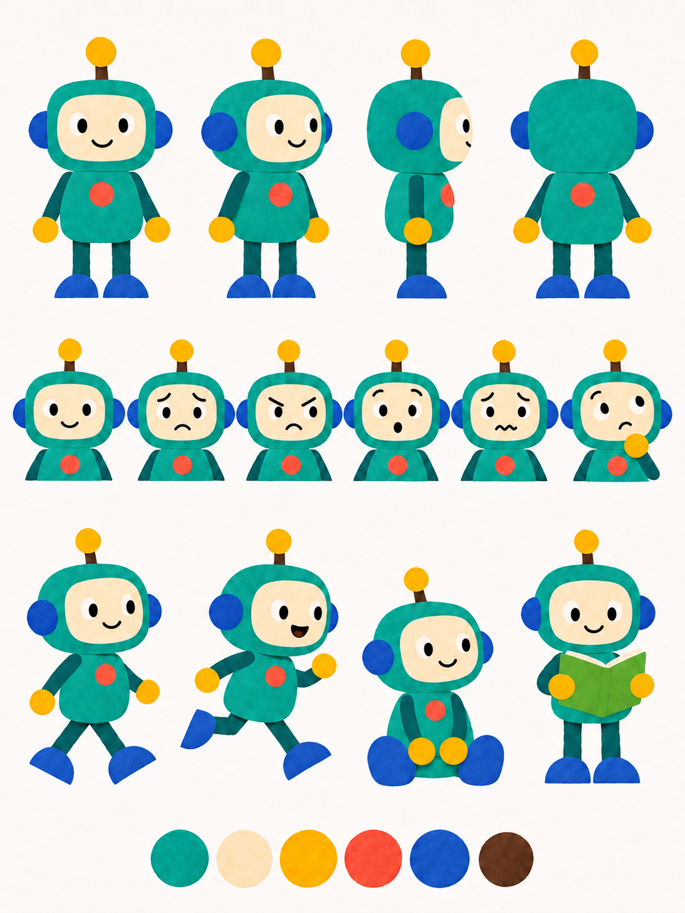
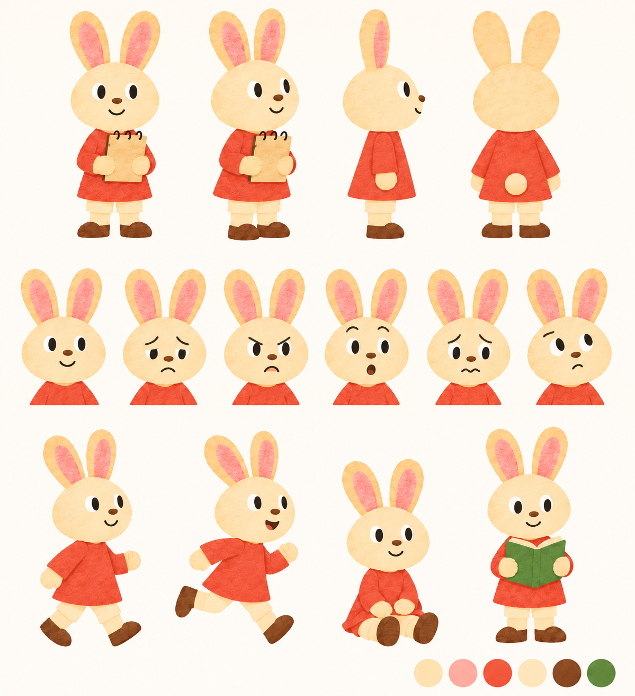
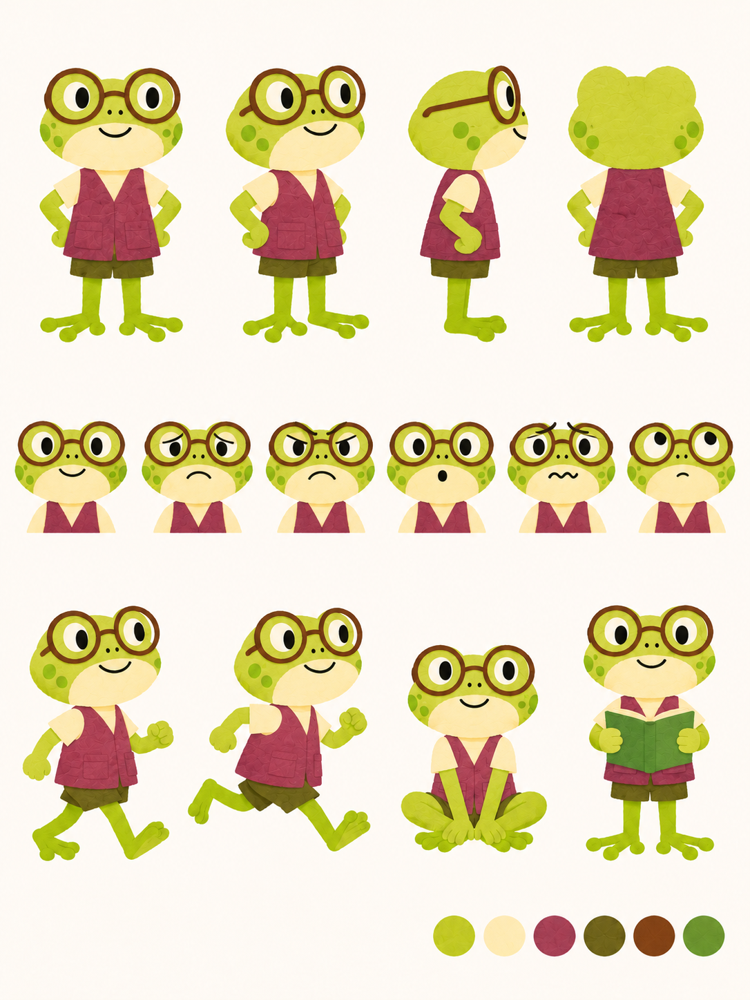
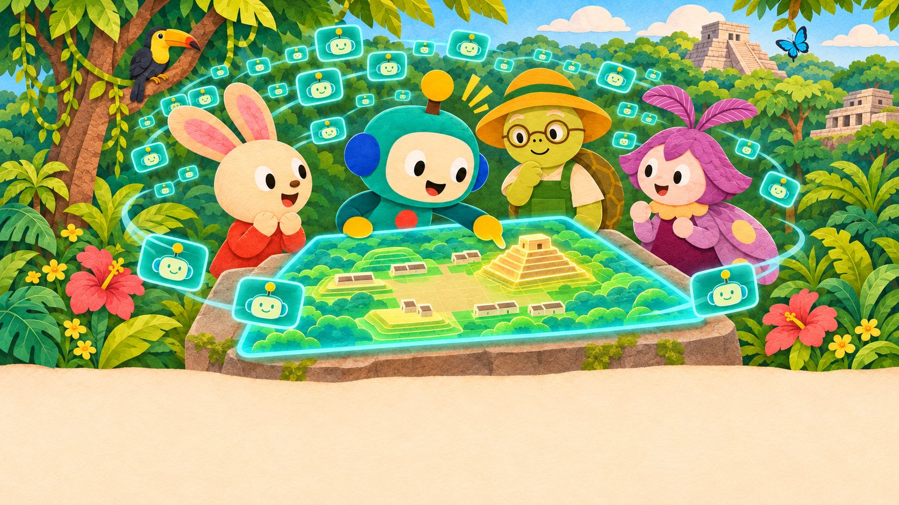
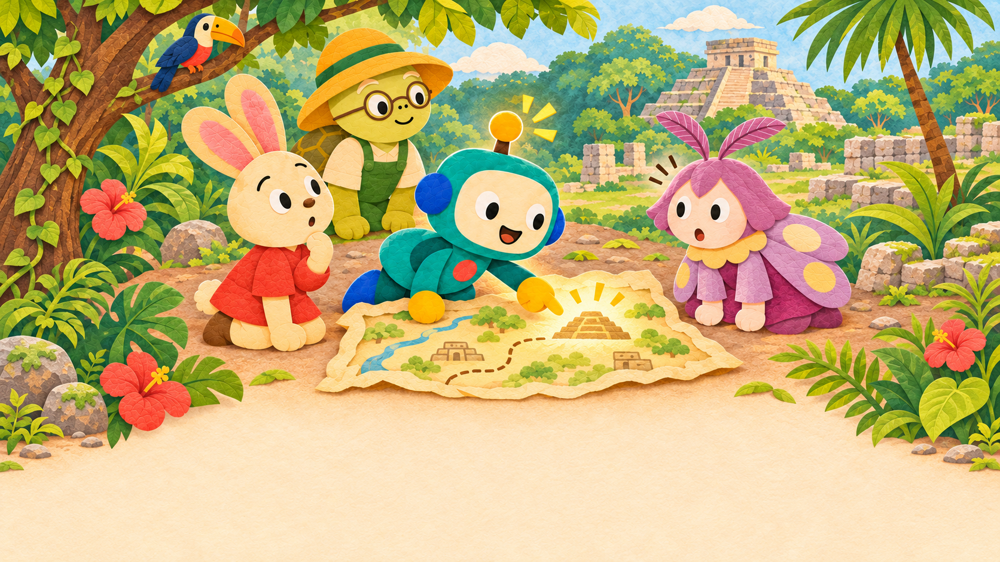
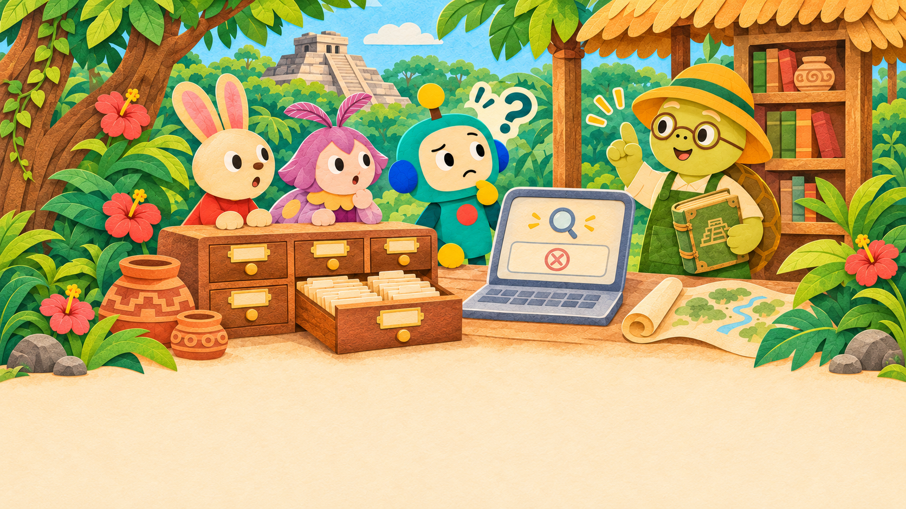
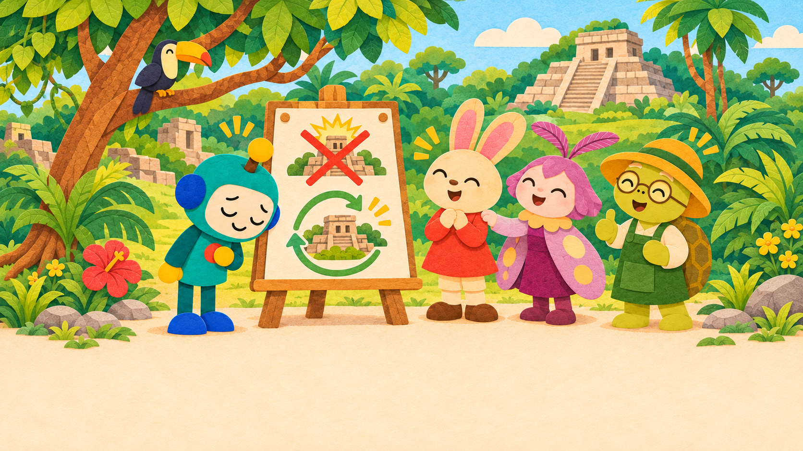
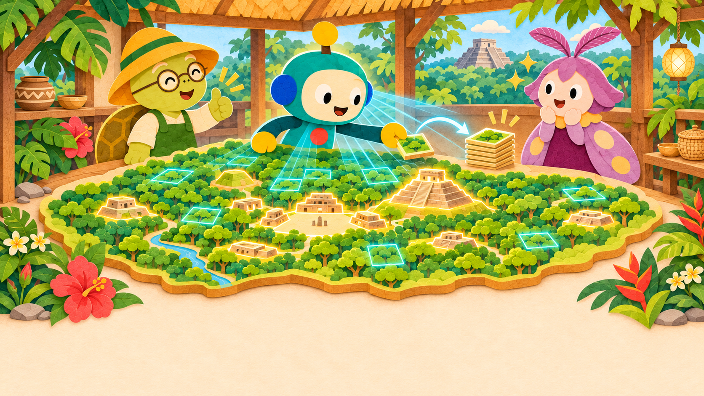
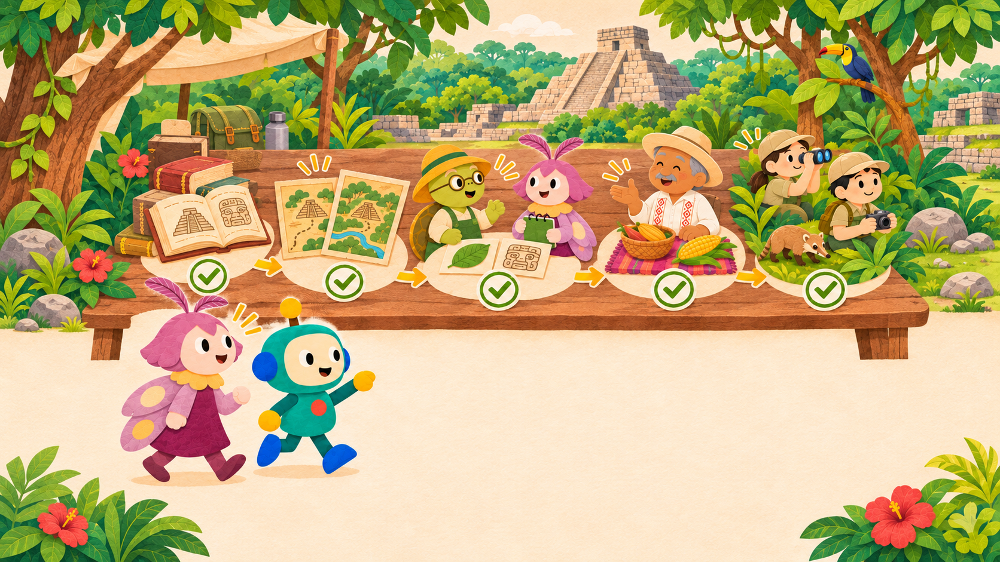
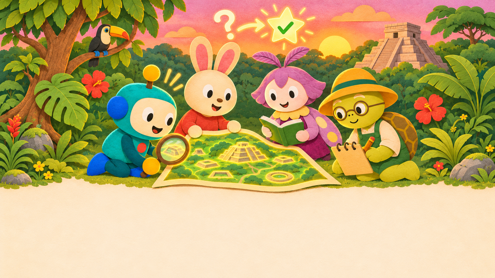

# *Dot Asks Pip About Feeling Tired*

十頁互動繪本分鏡規格

## 0. 指定視覺參考

本分鏡只使用以下使用者指定的角色設計資料夾與成品範例，不以其他故事檔案作為視覺參考。

### 角色範例圖片

#### Pip（AI 機器人）

- 指定來源：`storybook_main/00_storybook_design/character-board-00-robot.png`
- 使用重點：保留青綠色圓角機身、奶油色臉部、黃色手掌與天線球、藍色耳部與鞋子，以及簡單清楚的眼睛和嘴型。
- 分鏡中的 Pip 必須延續此設計板的比例、配色、紙張拼貼質感和表情語言，不重新設計成另一種機器人。

#### Dot（小兔）

- 指定來源：`storybook_main/00_storybook_design/character-board-07-rabbit-v1.png`
- 使用重點：保留奶油色毛皮、粉紅耳內、紅色上衣、淺色短褲與棕色鞋子，以及長耳朵帶來的清楚情緒變化。
- 分鏡中的 Dot 必須延續此設計板的比例、配色、紙張拼貼質感和表情語言；疲倦只以耳朵微垂、慢眨眼和小呵欠呈現，不把角色畫得嚴重生病。

#### Fenn（可信任的大人／健康專業人員）

- 指定來源：`storybook_main/00_storybook_design/character-board-09-frog-v1.png`
- 使用重點：保留黃綠色皮膚、大圓眼鏡、莓紅色背心、奶油色上衣與深綠短褲。
- 分鏡中的 Fenn 必須延續此設計板的比例、配色、紙張拼貼質感和表情語言；角色氣質應溫和、可靠，與孩子保持同高度溝通。

### 最終產出範例

- 指定最終版面參考資料夾：[`storybook_main/00_storybook_design/sample-storybook`](../00_storybook_design/sample-storybook/)
- 指定參考圖片：`page-01.png` 至 `page-10.png`，全部為 1672 × 941 px 的橫式完整頁面。
- 這十張圖片是**最終插畫構圖、完成度、材質與文字留白的直接參考**，不是本故事要複製的角色、場景或新聞內容。
- 最終每一頁應像參考圖一樣呈現為完整的橫式手繪繪本插畫：場景細節豐富、角色自然融入環境、前中後景形成完整空間，下方保留大面積可放英文文字的淺色區域。
- 插畫與下方文字區之間，應以桌緣、地面、草丘、棉被、地毯或紙張撕邊形成帶有手繪起伏的不規則邊界，不使用生硬的水平直線。
- 最終頁面不可輸出成單一影片或單一合成圖；視覺上雖然是一張完整插畫，實際交付仍須保留 `background.png`、透明角色／物件 PNG，以及各個逐格動作 PNG。
- 目前階段只交付文字分鏡，**尚未生成本故事的最終示範圖片**。進入繪圖階段後，應先製作一張完整頁面樣稿供確認，再依確認後的樣式完成其餘九頁。

#### 最終版面參考圖片

## 1. 專案定位

- 讀者年齡：5 歲
- 書中文字：English
- 畫面比例：3:2 橫式滿版
- 核心主題：AI 可以幫忙解釋一般健康資訊，但不能檢查身體、不能代替可信任的大人與醫護人員。
- 新聞基礎：Apple 在 2026-11-15 宣布一項研究，了解成人如何使用對話式 AI 詢問健康問題，以及回答是否有用、易懂並有可信醫療資訊支持。研究剛開始，尚未證明 AI 可以安全地當醫生。
- 角色：
  - **Dot**：小兔，代表小讀者。
  - **Pip**：機器人，代表 AI；親切、願意幫忙，也會清楚說出自己的限制。
  - **Fenn**：戴圓眼鏡的青蛙，代表可信任的大人與健康專業人員。
- 視覺調性：溫暖紙張拼貼感、圓潤造型、清楚表情、大色塊；健康情境不呈現可怕器材或嚴重病痛。

## 2. 全書畫面與動畫共通規格

### 版面

- 每頁看起來必須是一張完整的手繪繪本插畫，而不是角色貼在空背景上的介面。
- 主要敘事集中在上方約 72–76% 畫面；下方保留約 24–28% 的淺色文字空間。
- 插畫與文字區的交界使用草地、棉被、桌沿、地毯、書頁、雲朵或紙張撕邊形成不規則曲線，不使用筆直硬切線。
- 文字區仍屬於同一張背景插畫的一部分；角色或小道具可少量跨過交界，讓畫面連成一體，但不可妨礙閱讀。
- 每頁英文以 1 個短標題加 1–3 個短句為原則；字詞適合親子共讀。

### 動畫

- 逐格動畫維持手繪跳動感，建議 6 fps；可接受範圍 4–8 fps。
- 自動動作使用 3–4 格來回循環，週期約 1.2–2.4 秒；不同物件錯開起始時間，避免全部一起動。
- 點擊動作使用 4–6 格，播放一次後回到 idle；可開關物件則保留開、關兩種穩定狀態。
- 不做整頁位移、鏡頭縮放或流暢骨架動畫；只做眨眼、呼吸、耳朵晃動、手勢、燈光、紙張與小物件反應。
- 所有可動角色和物件都必須獨立於背景，以透明 PNG 輸出；不要把可動部分畫死在 `background.png`。

### 共通圖層順序

1. `background.png`：房間／戶外／診間、牆面、地面、遠景，以及下方不規則文字留白。
2. `midground.png`：不動但可能遮住角色腳部的家具或景物；沒有需要時可省略。
3. 自動循環物件／角色透明 PNG。
4. 點擊互動物件／角色透明 PNG。
5. `foreground.png`：前景葉片、桌緣、棉被邊、地毯邊等遮罩；沒有需要時可省略。
6. UI 與英文文字：由程式排版，不烘焙進圖片。

### 檔名規則

- 每頁資料夾：`page-01/` 至 `page-10/`。
- 靜止狀態：`<name>-idle.png`。
- 自動循環：`<name>-loop-01.png`、`<name>-loop-02.png`……
- 點擊動作：`<name>-action-01.png`、`<name>-action-02.png`……
- 開關狀態：`<name>-closed.png`、`<name>-opening-01.png`……`<name>-open.png`；關閉時倒播 opening 影格即可。
- 同一角色若只有局部在動，拆成固定身體與活動部位，例如 `dot-body.png`、`dot-eyes-loop-01.png`、`dot-ear-loop-01.png`，可減少重畫範圍並保留手繪感。

---

## Page 01 — A Tired Morning

### English text

**A Tired Morning**

Dot woke up feeling very tired. “Pip, why do I feel this way?” she asked.

### 完整畫面

溫暖的清晨臥室。Dot 坐在床邊揉眼睛，Pip 站在小床旁，胸口柔和發光。窗外有太陽與一隻小鳥；棉被、床沿與橢圓地毯一路形成下方奶油色文字區的不規則邊界。畫面先建立「孩子真的不舒服／疲倦」，但不讓氣氛可怕。

### Layer 與自動微動畫（3 個）

1. **Dot 自動眨眼、耳朵微垂**：3 格慢循環；`dot-body.png`、`dot-eyes-loop-01.png`～`03.png`、`dot-ears-loop-01.png`～`03.png`。
2. **Pip 輕微呼吸與天線左右晃**：4 格循環；`pip-body.png`、`pip-antenna-loop-01.png`～`04.png`。
3. **窗邊小鳥輕拍翅膀**：3 格循環；`sparrow-loop-01.png`～`03.png`。

### 點擊互動（3 個）

1. **點 Dot**：Dot 打一個小呵欠，手抬起遮嘴，再回到 idle；`dot-yawn-action-01.png`～`05.png`。
2. **點 Pip**：Pip 轉頭看 Dot、胸口亮一次，表情變關心；`pip-listen-action-01.png`～`04.png`。
3. **點窗簾**：窗簾左右打開，陽光多一點；`curtain-closed.png`、`curtain-opening-01.png`～`03.png`、`curtain-open.png`。

### 背景與前景素材

- `background.png`：臥室、窗戶、晨光、床架、文字留白。
- `midground.png`：床頭櫃與小檯燈。
- `foreground.png`：棉被下緣與地毯前緣，局部遮住角色腳部。

---

## Page 02 — Pip Has Ideas, Not an Exam

### English text

**Ideas Are Not an Exam**

Pip knew many possible reasons. But Pip could not look inside Dot’s body or know exactly what was wrong.

### 完整畫面

同一間房內，Pip 投出三個像紙片泡泡般的圖示：月亮、杯子、問號，代表「可能有很多原因」，而不是診斷。Dot 把手放在胸前專心聽。床單弧線與散落的紙片圖示延伸為下方文字留白。

### Layer 與自動微動畫（3 個）

1. **Pip 的眼睛眨動**：3 格循環；`pip-eyes-loop-01.png`～`03.png`。
2. **Dot 的耳朵小幅左右晃**：4 格循環；`dot-ears-loop-01.png`～`04.png`。
3. **三個想法泡泡輕輕上下漂**：各 3 格、錯時循環；`idea-moon-loop-01.png`～`03.png`、`idea-cup-loop-01.png`～`03.png`、`idea-question-loop-01.png`～`03.png`。

### 點擊互動（3 個）

1. **點月亮泡泡**：月亮閉眼再睜眼，旁邊閃兩顆星；`idea-moon-action-01.png`～`04.png`。
2. **點問號泡泡**：問號變大、左右搖，再回原位；`idea-question-action-01.png`～`04.png`。
3. **點 Pip**：Pip 搖搖頭並張開雙手，表達「I can’t know for sure」；`pip-not-sure-action-01.png`～`05.png`。

### 背景與前景素材

- `background.png`：臥室另一角、柔和牆面、床與下方紙張形文字區。
- `foreground.png`：前景床單弧邊。

---

## Page 03 — A New Study Begins

### English text

**A New Study Begins**

Researchers are studying how adults ask AI about health. They want to learn when its answers help—and when they do not.

### 完整畫面

畫面轉成溫暖的研究小屋／工作室。Fenn 坐在桌前，桌上有一台不帶品牌標誌的研究裝置；螢幕顯示成人角色、對話泡泡和放大鏡。Pip 與 Dot 從桌邊觀看。桌面像一條柔軟波浪，向下展開成文字區。用「正在研究」的視覺語言，避免呈現研究已完成。

### Layer 與自動微動畫（3 個）

1. **Fenn 眨眼、眼鏡有一點反光**：4 格循環；`fenn-eyes-loop-01.png`～`04.png`。
2. **Pip 天線慢慢晃**：3 格循環；`pip-antenna-loop-01.png`～`03.png`。
3. **螢幕上的對話小點依序亮起**：4 格循環；`chat-dots-loop-01.png`～`04.png`。

### 點擊互動（3 個）

1. **點放大鏡**：放大鏡移過三個對話泡泡，逐一框亮；`magnifier-action-01.png`～`05.png`。
2. **點研究筆記本**：封面打開，出現三個大圖示「helpful / clear / trusted」；`notebook-closed.png`、`notebook-opening-01.png`～`03.png`、`notebook-open.png`。
3. **點 Fenn**：Fenn 舉起一根手指，再指向「START」小牌；`fenn-point-action-01.png`～`05.png`。

### 背景與前景素材

- `background.png`：研究小屋、書架、牆面、桌後空間與文字留白。
- `midground.png`：桌子固定部分與螢幕底座。
- `foreground.png`：桌面前緣和一角紙張。

---

## Page 04 — Three Careful Questions

### English text

**Three Careful Questions**

Is the answer helpful? Is it easy to understand? Does trusted health information support it?

### 完整畫面

Fenn、Dot、Pip 圍著三張大型圖卡：愛心加工具代表 helpful、眼睛加簡短句子代表 easy to understand、書本加盾牌代表 trusted information。三張圖卡像扇形鋪在桌上，卡片下緣自然構成文字區。重點是研究如何「檢查回答」，不是展示 AI 無所不知。

### Layer 與自動微動畫（3 個）

1. **Dot 眨眼並輕點頭**：4 格循環；`dot-head-loop-01.png`～`04.png`。
2. **Fenn 手中的鉛筆微微上下動**：3 格循環；`fenn-pencil-loop-01.png`～`03.png`。
3. **Pip 胸口小燈柔和呼吸亮滅**：4 格循環；`pip-light-loop-01.png`～`04.png`。

### 點擊互動（3 個）

1. **點 helpful 圖卡**：愛心彈一下，小工具轉半圈；`card-helpful-action-01.png`～`04.png`。
2. **點 clear 圖卡**：一團亂線逐格變成三條清楚短線；`card-clear-action-01.png`～`05.png`。
3. **點 trusted 圖卡**：書本打開，盾牌亮起勾勾；`card-trusted-action-01.png`～`05.png`。

### 背景與前景素材

- `background.png`：研究桌場景、暖色書架、牆面與下方文字留白。
- `foreground.png`：三張圖卡不動的底部陰影與桌緣；會動的圖示保持獨立。

---

## Page 05 — The Answer Is Not Here Yet

### English text

**The Study Just Started**

The study is new. No one has proved that AI can safely act like a doctor.

### 完整畫面

一條簡單的紙片時間軸從「START」通往遠方仍空白的「RESULTS」旗子，中間是一大片尚未填滿的路。Pip 停在起點，Dot 看著遠方，Fenn 拿著空白夾板。下方道路彎曲成淺色文字區。整頁要清楚傳達「還不知道」，而不是把不確定性畫得陰暗。

### Layer 與自動微動畫（3 個）

1. **起點小旗輕晃**：3 格循環；`start-flag-loop-01.png`～`03.png`。
2. **Pip 眼睛左右看**：4 格循環；`pip-eyes-loop-01.png`～`04.png`。
3. **Fenn 夾板上的空白紙角輕翹**：3 格循環；`clipboard-corner-loop-01.png`～`03.png`。

### 點擊互動（3 個）

1. **點 RESULTS 旗子**：旗子翻面仍是大問號，然後回位；`results-flag-action-01.png`～`04.png`。
2. **點時間軸**：只有第一個圓點亮起，後面的圓點維持空白；`timeline-action-01.png`～`05.png`。
3. **點 Pip**：Pip 先想一想，再誠實攤手；`pip-wait-action-01.png`～`05.png`。

### 背景與前景素材

- `background.png`：明亮抽象研究花園、彎曲時間軸道路、遠方旗座與文字留白。
- `foreground.png`：道路前緣的紙張撕邊與小草。

---

## Page 06 — Tell a Trusted Grown-Up

### English text

**Tell a Grown-Up**

Dot still felt tired. “I will tell a grown-up who can help me,” she said.

### 完整畫面

回到家中客廳。Dot 走向 Fenn，Fenn 蹲下來與她同高度，Pip 稍微退到一旁，做出支持而非主導的姿態。牆上有家庭照片形狀但不放私人資訊。沙發、地毯與抱枕形成下方柔軟的文字留白邊界。

### Layer 與自動微動畫（3 個）

1. **Dot 緩慢眨眼、耳朵微動**：4 格循環；`dot-loop-01.png`～`04.png`。
2. **Fenn 溫柔點頭**：4 格循環；`fenn-nod-loop-01.png`～`04.png`。
3. **Pip 胸口燈慢慢明暗**：3 格循環；`pip-light-loop-01.png`～`03.png`。

### 點擊互動（3 個）

1. **點 Dot**：Dot 舉手指向自己，再指向 Fenn，表示主動說出感受；`dot-tell-action-01.png`～`05.png`。
2. **點 Fenn**：Fenn 張開雙臂給一個短短的安慰抱抱；`fenn-hug-action-01.png`～`05.png`。
3. **點電話**：電話螢幕亮起，出現簡單的醫療十字與行事曆圖示，不顯示姓名或號碼；`phone-off.png`、`phone-on-action-01.png`～`04.png`、`phone-on.png`。

### 背景與前景素材

- `background.png`：客廳、沙發、牆面、家庭感裝飾與文字留白。
- `midground.png`：邊桌與電話底座。
- `foreground.png`：地毯前緣與一個抱枕角。

---

## Page 07 — A Real Check-Up

### English text

**A Real Check-Up**

Fenn listened, looked, and asked questions. A health professional can check things that Pip cannot.

### 完整畫面

明亮、親切的診間。Dot 坐在小凳上，Fenn 以簡單聽診器聽她呼吸；Pip 在旁邊拿著一本一般健康詞彙小書。診療床的圓弧床單和地板水波紋圖案自然包住下方文字區。避免針、血或讓孩子焦慮的器具。

### Layer 與自動微動畫（3 個）

1. **Dot 平穩呼吸，胸口小幅起伏**：4 格循環；`dot-breathe-loop-01.png`～`04.png`。
2. **Fenn 眨眼並微微點頭**：4 格循環；`fenn-check-loop-01.png`～`04.png`。
3. **牆上小植物葉片晃動**：3 格循環；`plant-loop-01.png`～`03.png`。

### 點擊互動（3 個）

1. **點聽診器**：聽診器圓片輕輕移到正確位置，旁邊出現兩個柔和心形波紋；`stethoscope-action-01.png`～`05.png`。
2. **點 Fenn**：Fenn 依序指向眼睛、耳朵與問句卡，表示看、聽、問；`fenn-explain-action-01.png`～`06.png`。
3. **點 Pip**：Pip 合上書、往後一步並微笑，表示把檢查交給專業人員；`pip-step-back-action-01.png`～`05.png`。

### 背景與前景素材

- `background.png`：柔和診間、牆面圖卡、窗戶、地面與文字留白。
- `midground.png`：診療床固定部分、小凳。
- `foreground.png`：床單前緣與地板圓弧圖案。

---

## Page 08 — Keep Private Things Private

### English text

**Private Means Private**

Health information can be personal. A child should ask a trusted adult before sharing it with an AI tool.

### 完整畫面

桌面中央有一個大鎖頭造型的資料盒。Dot 手中拿著一張只有心形與星形、沒有真實資料的卡片，先轉頭問 Fenn；Pip 的輸入框保持關閉。背景使用安全的藍綠色與暖黃色。資料盒與桌巾曲線形成下方文字空間。

### Layer 與自動微動畫（3 個）

1. **鎖頭微微閃光**：3 格循環；`lock-sparkle-loop-01.png`～`03.png`。
2. **Dot 轉頭在 Fenn 與 Pip 之間看**：4 格循環；`dot-look-loop-01.png`～`04.png`。
3. **Fenn 安心點頭**：3 格循環；`fenn-nod-loop-01.png`～`03.png`。

### 點擊互動（3 個）

1. **點鎖頭**：鎖頭關緊，盾牌圖案亮起；`lock-idle.png`、`lock-action-01.png`～`04.png`。
2. **點私人資料卡**：卡片翻面，正面內容被大星星遮住；`private-card-front.png`、`private-card-action-01.png`～`04.png`、`private-card-covered.png`。
3. **點 Pip 的輸入框**：輸入框先亮一下，接著出現「ASK AN ADULT」圖示並保持未送出；`input-idle.png`、`input-action-01.png`～`05.png`。

### 背景與前景素材

- `background.png`：安全資訊角落、桌子、柔和牆面與文字留白。
- `midground.png`：資料盒固定底座。
- `foreground.png`：桌巾前緣與大盾牌形紙片。

---

## Page 09 — A Helpful Way to Use AI

### English text

**AI Can Help Explain**

With Fenn beside her, Dot asked Pip what a health word meant. Pip used simple words and pictures to explain.

### 完整畫面

圖書角裡，Dot 與 Fenn 一起坐在圓毯上，Pip 展示「temperature」的兒童版解釋：溫度計、暖與涼的圖像。重點是一般資訊與大人陪同，不詢問或輸入 Dot 的私人健康資料。展開的綠色書本與圓毯形成下方文字留白。

### Layer 與自動微動畫（3 個）

1. **Pip 說話時嘴型兩格交替、手微動**：4 格循環；`pip-explain-loop-01.png`～`04.png`。
2. **Dot 眨眼並輕點頭**：4 格循環；`dot-listen-loop-01.png`～`04.png`。
3. **Fenn 的眼鏡反光慢慢滑過**：3 格循環；`fenn-glasses-loop-01.png`～`03.png`。

### 點擊互動（3 個）

1. **點 temperature 字卡**：長字逐格分成較容易看的三小段，再合回去；`word-card-action-01.png`～`05.png`。
2. **點溫度計圖示**：色帶從涼藍移到暖黃，再回到中間；`thermometer-action-01.png`～`05.png`。
3. **點書本**：翻開下一頁，出現「Ask. Listen. Check.」三個圖示；`book-closed.png`、`book-opening-01.png`～`03.png`、`book-open.png`。

### 背景與前景素材

- `background.png`：溫暖圖書角、低書架、窗邊、圓毯與文字留白。
- `foreground.png`：打開的書本下緣與圓毯前緣。

---

## Page 10 — The Safe Rule

### English text

**The Safe Rule**

AI can explain. Grown-ups can help. When someone may be sick or hurt, ask a health professional.

### 完整畫面

明亮花園中的收束畫面。Dot 站在中間，左手牽 Fenn，右側 Pip 展開一本圖像小書。三人身後有三塊路標：`EXPLAIN` 指向 Pip、`HELP` 指向可信任的大人、`CHECK` 指向有醫療十字的小屋。花園小徑與草丘形成下方不規則文字區，氣氛安心、有行動方向。

### Layer 與自動微動畫（3 個）

1. **Dot 開心眨眼、耳朵輕彈**：4 格循環；`dot-happy-loop-01.png`～`04.png`。
2. **Pip 揮手**：4 格慢循環；`pip-wave-loop-01.png`～`04.png`。
3. **Fenn 點頭，旁邊葉子一起微晃**：4 格循環；`fenn-nod-loop-01.png`～`04.png`、`leaves-loop-01.png`～`04.png`。

### 點擊互動（3 個）

1. **點 EXPLAIN 路標**：路標亮起，Pip 的書本浮出簡單圖像；`sign-explain-action-01.png`～`05.png`。
2. **點 HELP 路標**：路標亮起，Dot 與 Fenn 輕輕牽手；`sign-help-action-01.png`～`05.png`。
3. **點 CHECK 路標**：遠方小屋燈亮，醫療十字柔和發光；`clinic-light-off.png`、`clinic-light-action-01.png`～`04.png`、`clinic-light-on.png`。

### 背景與前景素材

- `background.png`：花園、遠方健康小屋、天空、草丘、小徑與文字留白。
- `midground.png`：三塊路標的固定木柱；會發亮的標面獨立輸出。
- `foreground.png`：前景花朵與草葉，少量遮住角色腳部。

---

## 3. 每頁資料夾交付檢查

每一頁資料夾至少應包含：

- `background.png`
- 視構圖需要選擇性加入 `midground.png`、`foreground.png`
- 3 組自動微動畫透明 PNG 影格
- 3 組點擊互動透明 PNG 影格
- 每個可互動物件的 `idle` 或穩定開／關狀態 PNG
- 一份 `layer-map.md`，記錄每個檔案的畫面位置、基準點、圖層順序、fps、循環方式與點擊範圍

所有透明素材必須維持同一畫布尺寸與對齊原點，避免逐格播放時跳位。背景不可含任何之後需要移動的眼睛、手、耳朵、燈光、紙張或物件。

## 4. 內容安全檢查

- 不讓 Pip 提供診斷、藥物、劑量或「一定沒事」的保證。
- 明確說明研究剛開始，結果尚未公布，也尚未證明 AI 可以安全地當醫生。
- 生病、受傷、害怕或異常疲倦時，孩子應告訴可信任的大人並尋求合格健康專業人員協助。
- 不要求孩子輸入姓名、症狀紀錄、照片、位置或其他私人健康資訊。
- 隱私頁呈現「先問大人」與「不送出」的可見行為。
- 結尾讓孩子記住三段式規則：**AI can explain. Grown-ups can help. Health professionals can check.**

## 5. 新聞來源（供製作與事實核對，不放入兒童正文）

- https://www.theverge.com/tech/1033355/apples-new-study-looks-to-improve-the-effectiveness-of-ai-health-tools
- https://techcrunch.com/2026/11/15/apple-launches-new-app-to-study-how-people-use-ai-for-health/
- https://www.apple.com/newsroom/2026/11/apple-launches-research-study-to-explore-the-use-of-ai-for-health/
- https://abcnews.com/US/apple-launches-ai-health-chatbot-part-research-study/story?id=138164909
